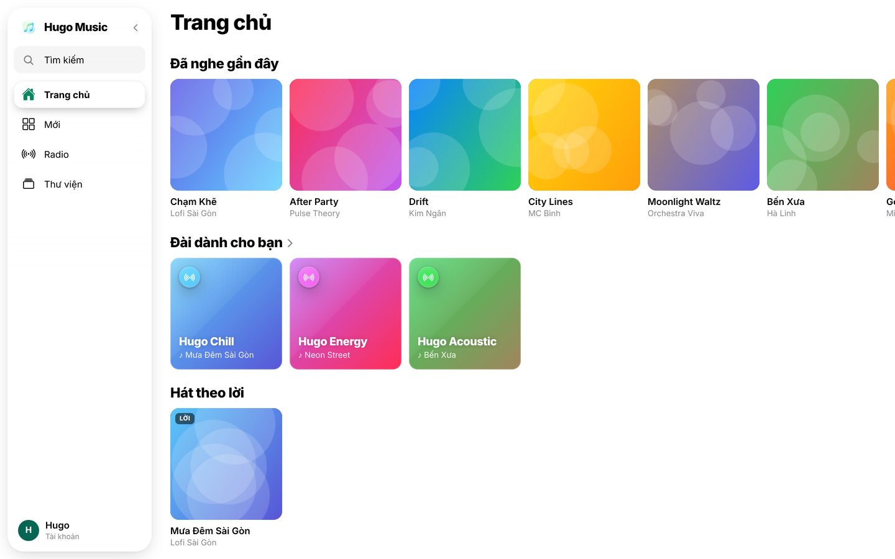
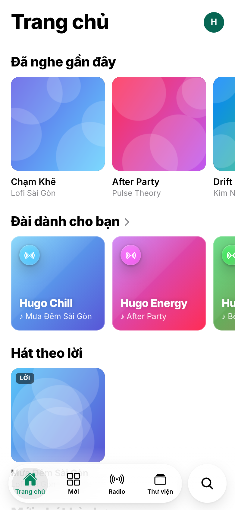

## Chương 1. Hugo Music là gì

### Chương này làm gì

Chưa có dòng code nào. Chương này viết đặc tả sản phẩm: ai dùng, dùng để làm gì, và điều gì khiến Hugo Music khác một app nghe nhạc bình thường. Mọi quyết định kỹ thuật ở các chương sau đều quay lại trang này để hỏi: sản phẩm có cần cái này không?

### Để làm gì

Code viết trước khi biết sản phẩm cần gì thường phải viết lại. Một trang đặc tả rõ ràng giúp bạn nói "không" với tính năng thừa, và biết phần nào đáng đầu tư công sức.

### Sản phẩm trong một câu

> Hugo Music là dịch vụ nghe nhạc có giấy phép mở (Creative Commons, public domain), phát chất lượng tự thích ứng theo mạng trên web, iOS và Android, kèm đài 24/7 nghe chung và phòng blind test để chính người nghe kiểm chứng chất lượng âm thanh.

### Người dùng

| Vai | Họ là ai | Họ cần |
|---|---|---|
| Khách | Người mở link lần đầu, chưa muốn đăng ký | Nghe thử ngay, không phải điền gì. Giới hạn 3 bài mỗi ngày. |
| Thành viên | Người nghe thường xuyên | Thư viện riêng, bài yêu thích, danh sách phát, tạo nhóm nghe cùng bạn bè, nghe tiếp trên máy khác |
| Admin | Người quản lý danh mục | Tải bài lên kèm giấy phép, duyệt bài, xem bài nào đang xử lý |

### Bốn luồng chính

1. **Nhập danh mục.** Admin tải file nhạc lên kèm giấy phép và nguồn → bài ở trạng thái *chờ duyệt* → admin duyệt → hệ thống tự xử lý (đo chất lượng, tạo luồng phát nhiều mức) → bài được phát hành.
2. **Nghe.** Người nghe bấm phát → app xin vé nghe → trình phát tải luồng HLS, tự chọn mức chất lượng theo tốc độ mạng. Khách hết 3 lượt thì được mời đăng nhập, rồi nghe tiếp đúng bài đang dở.
3. **Nghe cùng nhau.** Nhóm: tạo nhóm, gửi mã 6 ký tự cho bạn bè, cả nhóm nghe đúng bài, đúng giây với chủ nhóm. Đồng bộ thiết bị: nghe trên máy tính, chuyển sang điện thoại nghe tiếp. Đài 24/7: mọi người vào đài nghe cùng một bài, cùng một giây; thành viên gợi ý và bỏ phiếu bài tiếp theo. Blind test: cả phòng nghe một đoạn ở hai mức chất lượng, đoán bản nào tốt hơn, rồi cùng xem đáp án.
4. **Thư viện.** Thích bài, tạo danh sách phát, xem lời bài hát chạy theo nhạc, tìm bài bằng tiếng Việt không dấu.

### Điểm khác biệt

| Điểm | Ý nghĩa |
|---|---|
| **PSL** (thang chất lượng theo cảm nhận) | Không dựng sẵn mọi mức bitrate như nhau. Mỗi bài được đo xem tai người còn nghe ra khác biệt tới mức nào, và chỉ giữ những mức đáng giữ. Tiết kiệm dung lượng và băng thông mà người nghe không nhận ra. |
| **Blind test** | Người nghe tự kiểm chứng PSL: nếu đa số không phân biệt được hai mức, mức cao hơn là thừa. Dữ liệu này quay lại cải thiện PSL. |
| **Nghe chung chính xác tới giây** | Nhóm bạn bè, đài 24/7 và các thiết bị của cùng một người lệch nhau dưới một giây, kể cả khi đồng hồ điện thoại sai. |
| **Chỉ nhạc có giấy phép mở** | Mỗi bài bắt buộc có giấy phép và nguồn. Bài có giấy phép cấm chỉnh sửa (ND) không được chuyển mã. |

### Không làm (giai đoạn đầu)

- Không bán nhạc, không quảng cáo.
- Không có mạng xã hội (theo dõi, bình luận).
- Không nhận nhạc có bản quyền thương mại.

### Các màn hình

| Màn hình | Nội dung |
|---|---|
| Trang chủ | Mix theo thể loại, nghe gần đây, mới phát hành, nghệ sĩ gợi ý |
| Mới | Bảng xếp hạng, bài mới theo thể loại |
| Radio | Các đài 24/7 và phòng blind test |
| Thư viện | Bài đã thích, danh sách phát, nghệ sĩ, album, bài đã tải |
| Tìm kiếm | Ô tìm không dấu, kết quả theo bài và nghệ sĩ |
| Trình phát | Ảnh bìa, lời chạy theo nhạc, hàng đợi, chọn chất lượng |
| Quản trị | Duyệt bài, theo dõi xử lý, quản lý đài |

### Kiểm tra

Chương này kiểm tra bằng câu hỏi chứ không bằng lệnh: với mỗi tính năng bạn định thêm, nó thuộc luồng nào trong bốn luồng trên? Không thuộc luồng nào thì để lại sau.

### Thực hành

1. Mở app web của bạn ở chế độ khách, đi qua đủ bốn luồng chính (nhập danh mục cần tài khoản admin). Ghi lại mỗi luồng đi qua những màn hình nào.
2. Viết đặc tả một trang cho một tính năng bạn muốn thêm (ví dụ "lịch sử nghe theo tuần"): ai dùng, để làm gì, thuộc luồng nào, không làm gì.

### Tự kiểm

1. Bốn luồng chính của Hugo Music là gì? Một tính năng "bình luận dưới bài hát" thuộc luồng nào, và theo trang đặc tả thì có nên làm ở giai đoạn đầu không?
2. Vì sao khách được nghe ngay mà không phải đăng ký, nhưng lại bị giới hạn 3 bài mỗi ngày?
3. PSL và blind test liên quan với nhau thế nào?

### Khi nào đổi

- Có nghệ sĩ muốn tự tải nhạc lên: thêm vai *nghệ sĩ* với quyền tải lên nhưng không tự duyệt.
- Muốn nhận nhạc thương mại: phải đổi cách bảo vệ file (chương 11) và có hợp đồng bản quyền. Đó là một sản phẩm khác.
