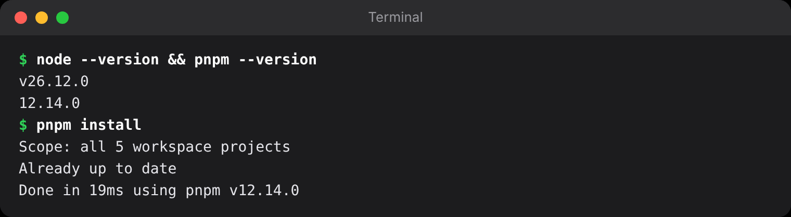
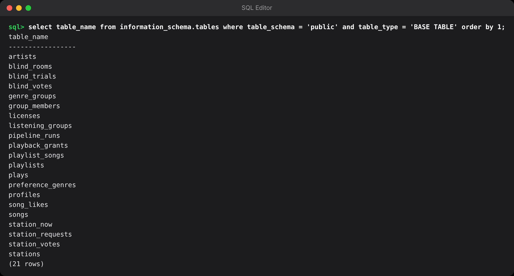

## Chương 3. Môi trường và cấu trúc repo

### Chương này làm gì

Cài công cụ, tạo project Supabase, dựng monorepo ba phần (`supabase/`, `worker/`, `app/`) và chạy được lệnh đầu tiên.

### Để làm gì

Cấu trúc thư mục rõ ràng từ đầu giúp người mới tìm đúng chỗ để sửa, và giúp chính bạn sáu tháng sau. Mỗi thư mục tên theo **nơi nó chạy**.

### Phân tích kỹ thuật

**Chạy TypeScript trên server:**

| Cách | Ghi chú |
|---|---|
| Biên dịch bằng `tsc` rồi chạy file `.js` | Thêm bước build và thư mục `dist/` |
| Công cụ chạy thẳng (`tsx`, `ts-node`) | Thêm một thư viện, chậm hơn khi khởi động |
| **Node.js 26 chạy thẳng file `.ts`** | Node tự bỏ phần kiểu khi chạy (type stripping; Node.js, n.d.). Không build, không thư viện thêm. Chỉ cần viết TypeScript "xóa được" (không dùng `enum`, `namespace`) |

**Quản lý thư viện cho monorepo:**

| Công cụ | Ghi chú |
|---|---|
| npm workspaces | Có sẵn, chậm và tốn ổ đĩa hơn |
| **pnpm 12** | Nhanh, tiết kiệm ổ đĩa, chặn script cài đặt lạ theo mặc định |
| Bun | Rất nhanh, nhưng React Native và Expo hỗ trợ npm/pnpm tốt hơn |

### Chọn gì, vì sao

**Node.js 26, pnpm 12, Supabase CLI, Expo SDK 58.** Node 26 thành bản LTS vào tháng 10/2026 và được hỗ trợ tới tháng 4/2029, nên là lựa chọn dài hơi nhất cho dự án mới; nó còn cho chạy thẳng TypeScript, bớt hẳn một bước build cho worker.

### Làm từng bước

**Bước 1: cài công cụ.**

```bash
# Node 26 (qua fnm, nvm hoặc trình cài từ nodejs.org)
fnm install 26 && fnm use 26
npm install -g pnpm@12
npm install -g supabase          # Supabase CLI
brew install ffmpeg              # macOS; Ubuntu: sudo apt install ffmpeg
```

**Bước 2: tạo project Supabase.** Vào supabase.com → *New project*, chọn vùng Singapore (gần Việt Nam). Ghi lại ba thứ ở *Project Settings → API Keys*: Project URL, **publishable key** (`sb_publishable_...`, dùng trong app) và **secret key** (`sb_secret_...`, chỉ dùng ở server).

| Khóa | Dùng ở đâu | Làm được gì |
|---|---|---|
| Publishable | App web, iOS, Android | Chỉ những gì RLS cho phép (chương 7) |
| Secret | Worker, Edge Function | Bỏ qua RLS, làm được mọi thứ. Không bao giờ để trong app. |

**Bước 3: cấu trúc repo.**

```text
hugo-music-book/
├─ supabase/            backend: chạy trên Supabase
│  ├─ migrations/       mỗi file SQL là một bước thay đổi database, chạy theo thứ tự tên
│  ├─ functions/        Edge Function (Deno), ví dụ playback/
│  ├─ seed/             tạo nhạc mẫu để thử
│  └─ config.toml       cấu hình Auth, Edge Function...
├─ worker/              Node.js 26: xử lý âm thanh, chạy trên server của bạn
├─ app/                 Expo: một mã nguồn cho web, iOS, Android
└─ packages/
   ├─ ui/               hugo-music: bộ giao diện kính mờ tự làm
   └─ stream/           hugo-stream: đồng hồ máy chủ, lời bài hát LRC
```

**Bước 4: khai báo workspace.**

```yaml
# pnpm-workspace.yaml
packages:
  - app
  - worker
  - edge          # Cloudflare Worker, chương 23
  - packages/*
# Expo/React Native cần node_modules phẳng như npm để Metro tìm thấy module native
nodeLinker: hoisted
# pnpm chỉ chạy script cài đặt (postinstall) của gói có tên ở đây, để chặn mã độc trong gói phụ thuộc.
# Thiếu dòng này, `pnpm install` trên CI báo ERR_PNPM_IGNORED_BUILDS.
allowBuilds:
  esbuild: true   # wrangler dùng để đóng gói Worker
  workerd: true   # chạy Worker trên máy (wrangler dev)
```

Thư mục `app/` và `edge/` chưa có cũng không sao: pnpm bỏ qua đường dẫn chưa tồn tại. Chương Ứng dụng 1 tạo `app/`, chương 23 tạo `edge/`.

`package.json` ở gốc repo gom các lệnh hay dùng, để lệnh nào cũng chạy được từ gốc:

```json
{
  "name": "hugo-music", "private": true, "type": "module",
  "packageManager": "pnpm@12.14.0",
  "engines": { "node": ">=26" },
  "scripts": {
    "web": "pnpm --filter @hugo/app web",
    "worker": "pnpm --filter @hugo/worker dev",
    "test": "pnpm -r test",
    "db:push": "supabase db push",
    "db:types": "supabase gen types typescript --linked > app/src/api/database.types.ts"
  }
}
```

**Bước 5: nối repo với project.**

```bash
supabase login                              # mở trình duyệt để đăng nhập
supabase link --project-ref <project-ref>   # project-ref là phần đầu của Project URL
supabase db push                            # chạy mọi file trong supabase/migrations lên project
```

`supabase link` hỏi mật khẩu database: đó là mật khẩu bạn đặt lúc tạo project ở bước 2.

**Bước 6: khóa và biến môi trường.** Mỗi phần của hệ thống đọc địa chỉ project và khóa từ một file `.env` riêng. Thiếu file này là phần đó không nối được với Supabase. Tạo ngay từ bây giờ:

```bash
cp app/.env.example app/.env          # EXPO_PUBLIC_SUPABASE_URL, EXPO_PUBLIC_SUPABASE_PUBLISHABLE_KEY
cp worker/.env.example worker/.env    # SUPABASE_URL, SUPABASE_SECRET_KEY, SUPABASE_PUBLISHABLE_KEY
supabase secrets set PLAYBACK_SECRET=$(openssl rand -hex 32)   # khóa ký vé nghe, chương 11
```

Code lại từ đầu thì chưa có hai file `.env.example`. Tạo thẳng `app/.env` và `worker/.env` với các biến ghi ở trên.

```bash
# .gitignore: không bao giờ commit khóa
node_modules/
.env
supabase/.env.deploy
edge/.dev.vars
```

Bảng đầy đủ mọi biến, lấy giá trị ở đâu, phần nào đọc, và các lỗi hay gặp khi đặt sai nằm ở **Phụ lục C**. Mỗi khi một chương nhắc tới biến mới, quay lại phụ lục đó.

### Kết quả





### Kiểm tra

```bash
node -v                      # v26.x
pnpm -v                      # 12.x
supabase migration list      # cột Local và Remote khớp nhau
```

### Thực hành

1. Clone repo, `pnpm install`, `supabase link` vào project của bạn, `supabase db push`. Mở Table Editor xem các bảng.
2. Nếu bạn clone repo: đổi `app/.env` sang project của bạn, chạy `pnpm web`; Trang chủ trống (chưa có nhạc) là đúng. Nếu bạn code lại từ đầu: thư mục `app/` được tạo ở chương kế tiếp (Ứng dụng 1).

### Tự kiểm

1. `nodeLinker: hoisted` trong pnpm-workspace.yaml để làm gì?
2. Publishable key và secret key khác nhau thế nào? Key nào được phép nằm trong app?
3. Vì sao các file `.env` phải nằm trong `.gitignore`? Biến nào trong `app/.env` thì công khai được, vì sao?
4. Thiếu `allowBuilds` trong `pnpm-workspace.yaml` thì `pnpm install` trên CI báo lỗi gì?

### Khi nào đổi

- **Nhiều người cùng làm:** mỗi người một nhánh database (Supabase Branching) thay vì cùng sửa một project.
- **Muốn làm việc không cần mạng:** `supabase start` chạy cả bộ Supabase trên máy bằng Docker.

### Code của chương

Các file chương này viết, trong repo đã clone ở phần Mở đầu:

- `pnpm-workspace.yaml`
