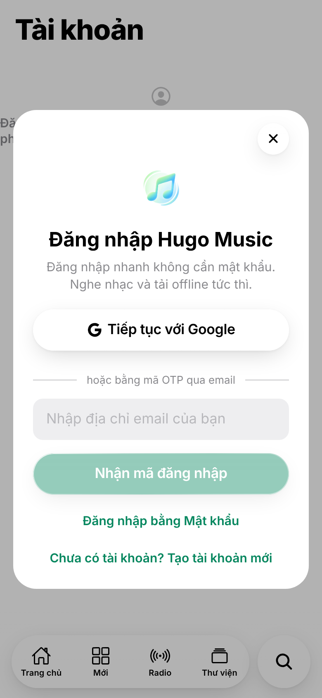
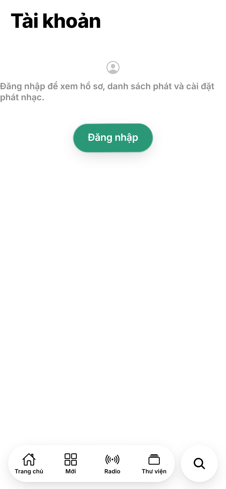
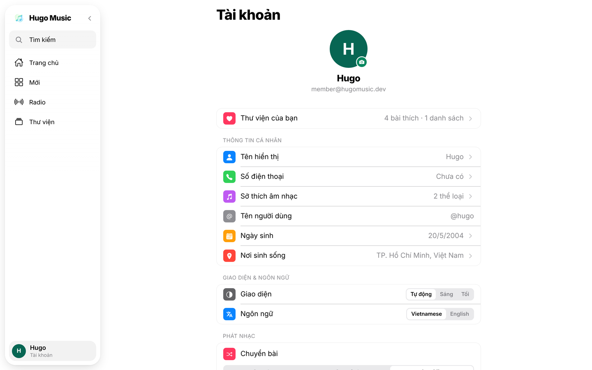

## Chương 6. Đăng nhập 1 chạm

### Chương này làm gì

Ba cách vào app không cần mật khẩu: **nghe thử ngay với tư cách khách**, **nhập email nhận mã 6 số**, hoặc **bấm "Tiếp tục với Google"**. Ai thích mật khẩu thì đặt thêm được, nhưng không bắt buộc. Mỗi tài khoản tự có một hồ sơ trong database.

### Để làm gì

Mỗi ô "mật khẩu" là một lý do để người mới bỏ đi, và là một thứ server phải băm, lưu, cho đặt lại, chống dò. Người nghe chỉ muốn bấm phát.

### Phân tích kỹ thuật

| Cách | Người dùng thấy | Server phải làm |
|---|---|---|
| Email + mật khẩu tự viết | Đăng ký, nhớ mật khẩu, quên mật khẩu | Băm mật khẩu, phát JWT, gia hạn, server gửi mail, chống dò |
| Thư viện auth tự host (Auth.js, Better Auth) | Tùy cấu hình | Vẫn tự vận hành database phiên và gửi mail |
| **Supabase Auth** | Mã 6 số qua email, Google, khách ẩn danh | Không gì: Supabase phát và gia hạn JWT, gửi mail, giới hạn số lần thử |

Ba cách đăng nhập của Supabase Auth hợp với Hugo Music:

| Cách | Khi nào |
|---|---|
| `signInAnonymously()` | Lần đầu mở app: có ngay một tài khoản thật (có id, có JWT) để nghe thử, chưa cần thông tin gì |
| `signInWithOtp({ email })` + `verifyOtp()` | Muốn lưu thư viện: nhập email, nhận mã 6 số. Email mới thì tự tạo tài khoản, nên **đăng ký và đăng nhập là một** |
| `signInWithOAuth({ provider: 'google' })` | Một chạm cho người đã đăng nhập Google trên máy |

### Chọn gì, vì sao

**Supabase Auth với cả ba cách trên.** Khách ẩn danh là một người dùng thật trong `auth.users`, nên luật "khách nghe tối đa 3 bài mỗi ngày" viết được bằng SQL như mọi luật khác (chương 11). Khi khách đăng nhập, phiên được thay bằng tài khoản thật.

### Làm từng bước

**Bước 1: bật các cách đăng nhập.** Trong dashboard: *Authentication → Sign In / Providers*: bật Email (độ dài mã 6), Anonymous sign-ins, và Google (dán Client ID, Client Secret từ Google Cloud Console). Cấu hình tương ứng trong repo:

```toml
# supabase/config.toml (trích)
[auth]
enable_anonymous_sign_ins = true
additional_redirect_urls = ["http://localhost:8081", "hugomusic://auth"]

[auth.email]
otp_length = 6
otp_expiry = 600
```

Mẫu email gửi mã đặt ở *Authentication → Email Templates → Magic Link*, dùng biến `{{ .Token }}` để hiện mã 6 số thay vì đường link.

> **Lưu ý gói miễn phí.** Với bộ gửi mail mặc định, Supabase không cho sửa mẫu email và chỉ gửi vài email mỗi giờ (đủ để thử, không đủ chạy thật). Nối một dịch vụ SMTP ở *Authentication → Emails → SMTP Settings* (Resend, Postmark, Amazon SES đều có gói miễn phí) thì sửa được mẫu và hết giới hạn.

Mẫu *Reset Password* cũng dùng `{{ .Token }}`: người muốn có mật khẩu bấm "Quên mật khẩu", nhận mã 6 số, đặt mật khẩu mới (bước 4b).

**Bước 2: ba hàm đăng nhập.**

```ts
// app/src/api/api.ts (trích)
export const auth = {
  // Email chưa có tài khoản thì Supabase tự tạo: đăng ký và đăng nhập là một.
  sendCode: async (email: string) => must(await supabase.auth.signInWithOtp({ email })),
  verifyCode: async (email: string, code: string) =>
    must(await supabase.auth.verifyOtp({ email, token: code, type: 'email' })),
  continueAsGuest: async () => must(await supabase.auth.signInAnonymously()),
  signOut: () => supabase.auth.signOut(),
};
```

**Bước 3: Google trên web và trên điện thoại.** Web chuyển cả trang sang Google rồi quay về. iOS/Android mở trình duyệt hệ thống, Google trả về một mã qua deep link `hugomusic://auth`, app đổi mã lấy phiên (luồng PKCE: mã bị chặn giữa đường cũng vô dụng).

```ts
signInWithGoogle: async (): Promise<boolean> => {
  if (Platform.OS === 'web') {
    await supabase.auth.signInWithOAuth({ provider: 'google', options: { redirectTo: window.location.origin } });
    return false; // trang đang chuyển sang Google
  }
  const redirectTo = Linking.createURL('auth');
  const { url } = must(await supabase.auth.signInWithOAuth({ provider: 'google', options: { redirectTo, skipBrowserRedirect: true } }));
  const result = await WebBrowser.openAuthSessionAsync(url!, redirectTo);
  if (result.type !== 'success') return false;
  must(await supabase.auth.exchangeCodeForSession(new URL(result.url).searchParams.get('code')!));
  return true;
},
```

**Bước 4: app nghe sự kiện, không tự giữ token.** Supabase tự lưu phiên, tự gia hạn token trước khi hết hạn. App chỉ cần biết "vừa có người đăng nhập" để nạp hồ sơ. Chưa có phiên thì vào thẳng với tư cách khách.

```ts
// app/src/store/useStore.ts (trích)
supabase.auth.onAuthStateChange((event) => {
  if (event === 'SIGNED_IN') setTimeout(completeSession); // nạp hồ sơ, thư viện
  if (event === 'SIGNED_OUT') set({ user: null, playlists: [], likedSongs: [] });
});
supabase.auth.getSession().then(({ data }) => {
  if (!data.session) auth.continueAsGuest();
});
```

**Bước 4b: mật khẩu là tùy chọn.** Cùng một ô mã 6 số dùng cho việc đặt mật khẩu: `resetPasswordForEmail` gửi mã, `verifyOtp` với `type: 'recovery'` đăng nhập bằng mã đó, rồi `updateUser` đặt mật khẩu. Supabase băm và kiểm mật khẩu, app không bao giờ thấy bản băm.

```ts
// app/src/api/api.ts (trích)
signInWithPassword: async (email: string, password: string) => must(await supabase.auth.signInWithPassword({ email, password })),
sendResetCode: async (email: string) => must(await supabase.auth.resetPasswordForEmail(email)),
resetPassword: async (email: string, code: string, password: string) => {
  must(await supabase.auth.verifyOtp({ email, token: code, type: 'recovery' }));
  must(await supabase.auth.updateUser({ password, data: { has_password: true } }));
},
```

**Bước 5: hồ sơ tự tạo cùng tài khoản.** `auth.users` do Supabase quản lý; dữ liệu riêng của app nằm ở `public.profiles`. Một trigger tạo hồ sơ ngay khi có tài khoản mới, lấy sẵn tên và ảnh nếu đăng nhập bằng Google.

```sql
-- supabase/migrations/20261018000200_profiles.sql (trích)
create table public.profiles (
  id           uuid primary key references auth.users (id) on delete cascade,
  nickname     text check (length(nickname) <= 40),
  avatar_url   text,
  music_genres text[] not null default '{}'
);

create or replace function public.handle_new_user()
returns trigger language plpgsql security definer set search_path = '' as $$
begin
  insert into public.profiles (id, nickname, avatar_url)
  values (new.id, new.raw_user_meta_data ->> 'full_name', new.raw_user_meta_data ->> 'avatar_url');
  return new;
end;
$$;

create trigger on_auth_user_created
  after insert on auth.users for each row execute function public.handle_new_user();
```

`security definer` cho hàm chạy với quyền của người tạo hàm, vì người dùng không có quyền tự ghi vào `profiles` lúc tài khoản vừa sinh ra. `set search_path = ''` buộc mọi tên bảng phải ghi đủ schema, chặn kiểu tấn công đánh tráo bảng cùng tên.

**Bước 6: ai là admin.** Không thêm cột `role` mà người dùng có thể tự sửa. Vai trò nằm trong `app_metadata` của tài khoản: chỉ secret key mới sửa được, và nó có sẵn trong JWT nên kiểm tra không tốn truy vấn nào.

```sql
create or replace function public.is_admin() returns boolean language sql stable set search_path = '' as $$
  select coalesce((auth.jwt() -> 'app_metadata' ->> 'role') = 'admin', false)
$$;

create or replace function public.is_guest() returns boolean language sql stable set search_path = '' as $$
  select coalesce((auth.jwt() ->> 'is_anonymous')::boolean, false)
$$;
```

Cấp quyền admin cho một tài khoản (chạy trong SQL Editor, một lần):

```sql
update auth.users set raw_app_meta_data = raw_app_meta_data || '{"role": "admin"}' where email = 'ban@example.com';
```

**Bước 7: ai đọc được hồ sơ của ai.** Người khác chỉ cần thấy tên hiển thị và ảnh (bảng xếp hạng, danh sách người cùng nghe). Quốc gia, thể loại yêu thích là thông tin riêng. RLS chọn *dòng*; chọn *cột* thì dùng quyền theo cột của PostgreSQL, còn chủ hồ sơ đọc đủ qua một hàm.

```sql
revoke select on public.profiles from anon, authenticated;
grant select (id, nickname, avatar_url) on public.profiles to authenticated;

create or replace function public.my_profile() returns public.profiles
language sql stable security definer set search_path = '' as $$
  select * from public.profiles where id = auth.uid()
$$;
```

**Bước 8: tự xóa tài khoản** (App Store bắt buộc có). Không xóa thẳng bảng `auth.users` bằng SQL: schema `auth` thuộc về Supabase Auth. Dùng API chính thức `auth.admin.deleteUser()` trong một Edge Function; hồ sơ, lượt thích, danh sách phát xóa theo nhờ `on delete cascade`.

```ts
// supabase/functions/delete-account/index.ts (trích)
const token = (req.headers.get('Authorization') ?? '').replace(/^Bearer /, '');
const { data, error } = await admin.auth.getUser(token);          // token này của ai?
if (error || !data.user) return Response.json({ error: 'not signed in' }, { status: 401 });
await admin.auth.admin.deleteUser(data.user.id);
```

```ts
// app/src/api/api.ts
deleteAccount: async () => must(await supabase.functions.invoke('delete-account', { method: 'POST' })),
```

### Kết quả







### Kiểm tra

- Mở app ở cửa sổ ẩn danh: trang Users có thêm một dòng *Anonymous*.
- Nhập email, nhận mã, nhập mã: bảng `profiles` có dòng mới cùng id.
- Gọi `select public.is_admin();` bằng tài khoản thường trả `false`.

### Ví dụ tính tay

**Một "ngày" của khách là ngày nào.** Hàm `claim_playback()` đếm lượt theo giờ Việt Nam (Asia/Ho_Chi_Minh, UTC+7), không theo UTC:

```text
khách nghe bài thứ 3 lúc 23:50 giờ VN ngày 18 (= 16:50 UTC ngày 18)
lúc 00:05 giờ VN ngày 19 (= 17:05 UTC ngày 18):
  đếm theo UTC: vẫn là ngày 18 → hết lượt (sai với cảm nhận người dùng)
  đếm theo giờ VN: đã sang ngày 19 → còn 3 lượt ✓
```

### Thực hành

1. Đăng nhập bằng mã 6 số với email của bạn. Mở Authentication → Users, tìm tài khoản vừa tạo và tài khoản khách ẩn danh trước đó.
2. Dùng tài khoản admin trong SQL Editor: `select raw_app_meta_data from auth.users where email = '...'`. Thử đặt `role` cho một tài khoản khác rồi đăng nhập lại để thấy trang quản trị hiện ra.

### Tự kiểm

1. Khách ẩn danh có phải là một người dùng thật trong `auth.users` không? Điều đó giúp gì cho luật 3 bài mỗi ngày?
2. Mật khẩu là tùy chọn: người đăng nhập bằng mã 6 số muốn đặt mật khẩu thì đi qua những bước nào?
3. Vì sao quyền admin để trong `app_metadata` mà không để trong `user_metadata`?

### Khi nào đổi

- **Muốn đăng nhập bằng vân tay/Face ID:** Supabase Auth đang có passkey (bản beta từ 5/2026); thêm làm cách thứ tư khi ra bản chính thức.
- **Nhiều khách ảo do bot:** bật CAPTCHA (hCaptcha hoặc Cloudflare Turnstile) cho đăng nhập ẩn danh và hạ giới hạn theo IP ở *Authentication → Rate Limits*.
- **Khách muốn giữ dữ liệu khi đăng ký:** dùng `linkIdentity()` (Google) hoặc `updateUser({ email })` để biến tài khoản ẩn danh thành tài khoản thật thay vì tạo tài khoản mới.

### Code của chương

Các file chương này viết, trong repo đã clone ở phần Mở đầu:

- `supabase/config.toml`
- `app/src/api/api.ts`
- `app/src/store/useStore.ts`
- `supabase/migrations/20261018000200_profiles.sql`
- `supabase/functions/delete-account/index.ts`
