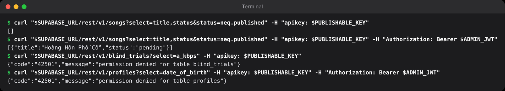
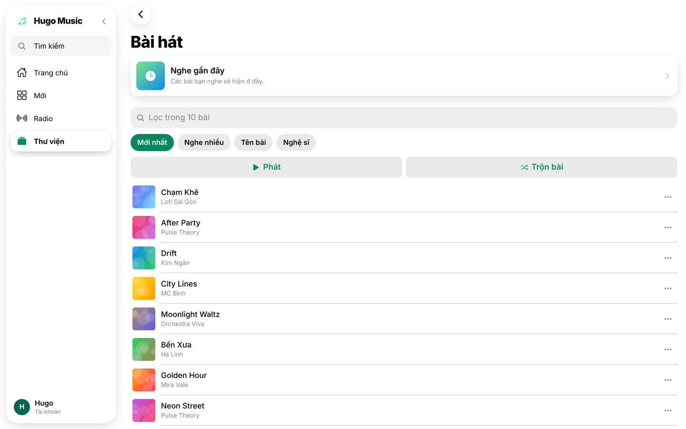

## Chương 7. Row Level Security: khiên bảo mật ở tầng database

### Chương này làm gì

Thư viện cá nhân: thích bài và danh sách phát. Mỗi người chỉ đọc và sửa được dữ liệu của mình, khách không được thích bài, admin quản lý được toàn bộ danh mục. Tất cả luật nằm trong database.

### Để làm gì

Publishable key nằm ngay trong app, ai cũng lấy được. Nếu bảo vệ chỉ nằm ở giao diện ("nút xóa chỉ hiện cho chủ"), kẻ xấu gọi thẳng API là xong. Cần một lớp bảo vệ mà không ai vòng qua được.

### Phân tích kỹ thuật

| Nơi đặt luật | Mạnh | Yếu |
|---|---|---|
| Giao diện | Dễ | Không bảo vệ gì: API vẫn mở |
| Middleware ở server API | Quen thuộc | Phải nhớ ở mọi route; thêm route mới quên kiểm là lộ |
| **RLS trong PostgreSQL** | Luật gắn với bảng: mọi đường vào (API tự sinh, Realtime, Storage, SQL) đều qua cùng luật | Phải nghĩ theo kiểu "dòng nào được thấy" thay vì "route nào được gọi" |

Một chính sách RLS trả lời đúng một câu: **AI** (`to authenticated`) được làm **GÌ** (`for select`, `insert`, `update`, `delete`) với **DÒNG NÀO** (`using`: dòng có sẵn; `with check`: dòng mới hoặc sau khi sửa).

### Chọn gì, vì sao

**Mọi bảng bật RLS lúc tạo; mặc định không ai làm được gì; mỗi quyền là một chính sách có tên đọc lên thành câu.** Hàm SQL `security definer` chỉ dùng cho việc nhiều bước cần luật riêng (đếm lượt nghe, duyệt bài), và tự kiểm quyền ở dòng đầu.

### Làm từng bước

**Bước 1: bảng bài đã thích.** `user_id` mặc định là người đang gọi (`auth.uid()`), nên app không cần (và không thể) gửi id của người khác.

```sql
-- supabase/migrations/20261018000300_library.sql (trích)
create table public.song_likes (
  user_id    uuid not null default auth.uid() references auth.users (id) on delete cascade,
  song_id    uuid not null references public.songs (id) on delete cascade,
  created_at timestamptz not null default now(),
  primary key (user_id, song_id)
);
alter table public.song_likes enable row level security;
```

**Bước 2: ba chính sách, ba câu.** Khách ẩn danh không được thích bài: luật nằm ngay trong `with check`.

```sql
create policy "users see their own likes"
  on public.song_likes for select to authenticated
  using ((select auth.uid()) = user_id);

create policy "members like songs"
  on public.song_likes for insert to authenticated
  with check ((select auth.uid()) = user_id and not (select public.is_guest()));

create policy "users unlike their own likes"
  on public.song_likes for delete to authenticated
  using ((select auth.uid()) = user_id);
```

Viết `(select auth.uid())` chứ không phải `auth.uid()`: bọc trong `select`, PostgreSQL tính một lần cho cả câu truy vấn thay vì một lần cho mỗi dòng. Với bảng lớn, khác biệt là hàng chục lần.

**Bước 3: đếm lượt thích bằng trigger.** Đọc `likes_count` có sẵn rẻ hơn đếm `song_likes` mỗi lần hiển thị một bài. Hàm chạy `security definer` vì người thích bài không có quyền sửa bảng `songs`.

```sql
create or replace function public.sync_likes_count()
returns trigger language plpgsql security definer set search_path = '' as $$
begin
  update public.songs
     set likes_count = likes_count + (case when tg_op = 'INSERT' then 1 else -1 end)
   where id = coalesce(new.song_id, old.song_id);
  return null;
end;
$$;
create trigger song_likes_count after insert or delete on public.song_likes
  for each row execute function public.sync_likes_count();
```

**Bước 4: danh sách phát và bài trong danh sách.** Bảng con không có `owner_id`; quyền suy ra từ bảng cha bằng `exists`.

```sql
create policy "owners manage their playlists"
  on public.playlists for all to authenticated
  using ((select auth.uid()) = owner_id)
  with check ((select auth.uid()) = owner_id and not (select public.is_guest()));

create policy "owners manage playlist songs"
  on public.playlist_songs for all to authenticated
  using (exists (select 1 from public.playlists p where p.id = playlist_id and p.owner_id = (select auth.uid())));
```

**Bước 5: admin quản lý danh mục.** Một chính sách `for all` cho admin, cộng với chính sách đọc công khai ở chương 4. Nhiều chính sách cùng loại được cộng lại theo kiểu "hoặc".

```sql
create policy "admins manage songs"
  on public.songs for all to authenticated
  using ((select public.is_admin())) with check ((select public.is_admin()));
```

**Bước 6: app chỉ còn những câu gọi rất ngắn.** Không có id người dùng nào trong code: database tự biết ai đang gọi.

```ts
// app/src/api/api.ts (trích)
toggleLike: async (songId: string) => {
  const { data: { user } } = await supabase.auth.getUser();
  const { count } = await supabase.from('song_likes').delete({ count: 'exact' }).eq('song_id', songId).eq('user_id', user!.id);
  if (!count) must(await supabase.from('song_likes').insert({ song_id: songId }));
  return { liked: !count };
},
```

### Kết quả





### Kiểm tra

Kiểm tra RLS từ góc nhìn kẻ tấn công: dùng publishable key và phiên của người A để đọc dữ liệu của người B.

```sql
-- SQL Editor: đóng vai một người dùng cụ thể rồi thử đọc
set local role authenticated;
set local request.jwt.claims = '{"sub": "<id người A>", "role": "authenticated"}';
select count(*) from public.song_likes;          -- chỉ ra lượt thích của A
insert into public.song_likes (user_id, song_id) values ('<id người B>', '<id bài>');
-- ERROR: new row violates row-level security policy
```

Mở *Advisors → Security Advisor* trong dashboard: không còn cảnh báo "RLS disabled" cho bảng nào trong schema `public`.

### Khi nào đổi

- **Chia sẻ danh sách phát cho bạn bè:** thêm bảng `playlist_members` và một chính sách đọc `exists (... member ...)`.
- **Chính sách chậm:** chạy `explain analyze` với vai người dùng; thường thiếu index trên cột dùng trong `using` (ví dụ `playlists.owner_id`).

### Code của chương

Các file chương này viết, trong repo đã clone ở phần Mở đầu:

- `supabase/migrations/20261018000300_library.sql`
- `app/src/api/api.ts`
