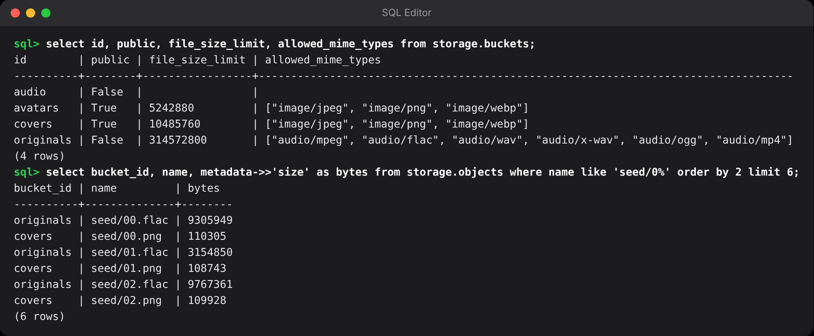
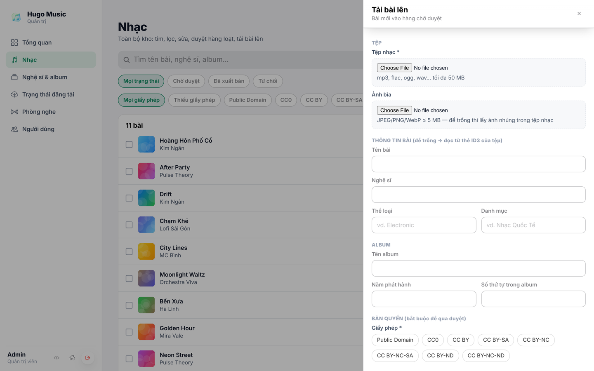

## Chương 8. Lưu trữ file nhạc và ảnh

### Chương này làm gì

Bốn "thùng" chứa file (bucket) với bốn mức truy cập, và luồng admin tải bài lên: file đi thẳng từ máy lên Storage, rồi tạo dòng `songs` ở trạng thái chờ duyệt.

### Để làm gì

File nhạc gốc nặng hàng chục tới hàng trăm MB. Nếu đi qua server API, server bị nghẽn và tốn băng thông gấp đôi. Mỗi loại file lại cần một mức bảo vệ khác nhau: ảnh bìa ai cũng xem được, file gốc thì chỉ admin.

### Phân tích kỹ thuật

| Cách | Mạnh | Yếu |
|---|---|---|
| Upload qua server API rồi server đẩy lên S3 | Server kiểm soát hết | Server nghẽn, tốn băng thông, phải xử lý file lớn |
| Link upload ký sẵn (presigned URL) lên S3/R2 | File không qua server | Tự viết route ký, tự cấu hình CORS, tự đồng bộ quyền |
| **Supabase Storage** | Upload thẳng từ app bằng phiên người dùng; quyền là chính sách RLS trên `storage.objects`; có CDN; có upload tiếp tục được (TUS) cho file lớn | Gói miễn phí giới hạn dung lượng; biến đổi ảnh (resize) cần gói trả phí |

### Chọn gì, vì sao

**Supabase Storage, bốn bucket:**

| Bucket | Công khai | Ai ghi | Chứa |
|---|---|---|---|
| `originals` | Không | Admin | File gốc admin tải lên (giữ nguyên, để xử lý lại khi cần) |
| `audio` | Không | Worker (secret key) | HLS do worker tạo; người nghe nhận link ký có hạn (chương 11) |
| `covers` | Có | Admin | Ảnh bìa, phục vụ thẳng qua CDN |
| `avatars` | Có | Chính người dùng | Ảnh đại diện, mỗi người một thư mục mang id của mình |

File nhạc để riêng tư vì Hugo Music giới hạn lượt nghe của khách: link công khai thì ai cũng tải thẳng được, giới hạn vô nghĩa.

### Làm từng bước

**Bước 1: tạo bucket bằng migration.** Giới hạn kích thước và loại file ngay ở bucket: file sai loại bị từ chối trước khi tới app.

```sql
-- supabase/migrations/20261018000400_storage.sql (trích)
insert into storage.buckets (id, name, public, file_size_limit, allowed_mime_types) values
  ('originals', 'originals', false, 300 * 1024 * 1024, array['audio/mpeg', 'audio/flac', 'audio/wav', 'audio/ogg', 'audio/mp4']),
  ('audio',     'audio',     false, null, null),
  ('covers',    'covers',    true,  10 * 1024 * 1024, array['image/jpeg', 'image/png', 'image/webp']),
  ('avatars',   'avatars',   true,  5 * 1024 * 1024,  array['image/jpeg', 'image/png', 'image/webp']);
```

**Bước 2: quyền trên file cũng là RLS.** Mỗi file là một dòng trong `storage.objects`. `storage.foldername(name)` tách đường dẫn thành mảng thư mục: `avatars/<id>/a.webp` có thư mục đầu là id người dùng.

```sql
create policy "admins upload originals and covers"
  on storage.objects for insert to authenticated
  with check (bucket_id in ('originals', 'covers') and (select public.is_admin()));

create policy "users manage their own avatar"
  on storage.objects for all to authenticated
  using (bucket_id = 'avatars' and (storage.foldername(name))[1] = (select auth.uid())::text);
```

**Bước 3: admin tải bài lên.** Sinh id bài trước, dùng nó làm thư mục; tải file gốc và ảnh bìa thẳng lên Storage; cuối cùng tạo dòng `songs`. Nếu một bước lỗi, chưa có dòng nào xuất hiện trong danh mục.

```ts
// app/src/api/api.ts (trích)
async function uploadSong(form: FormData) {
  const file = form.get('audio') as File;
  const id = crypto.randomUUID();
  const ext = file.name.split('.').pop()?.toLowerCase() ?? 'mp3';
  must(await supabase.storage.from('originals').upload(`${id}/original.${ext}`, file, { contentType: file.type }));

  const artist = must(await supabase.rpc('ensure_artist', { p_name: String(form.get('artist')) }));
  return toSong(must(await supabase.from('songs').insert({
    id, title: String(form.get('title')), artist_id: artist,
    license: String(form.get('licenseType')), source_url: String(form.get('sourceUrl')),
    original_path: `${id}/original.${ext}`,
  }).select(SONG_COLUMNS).single()));
}
```

**Bước 4: ảnh bìa công khai.** Bucket công khai cho URL cố định, CDN giữ cache; app không phải xin link mỗi lần.

```ts
const coverUrl = (path?: string | null) =>
  path ? supabase.storage.from('covers').getPublicUrl(path).data.publicUrl : undefined;
```

### Kết quả





### Kiểm tra

- Đăng nhập bằng tài khoản thường, thử `supabase.storage.from('originals').upload(...)`: lỗi `new row violates row-level security policy`.
- Tải file 400 MB lên `originals`: bị từ chối vì vượt `file_size_limit`.
- Mở URL ảnh bìa ở cửa sổ ẩn danh: xem được, header có `cf-cache-status` (qua CDN).

### Khi nào đổi

- **File gốc rất lớn, mạng chập chờn:** dùng upload tiếp tục được (TUS, thư viện `tus-js-client` trỏ vào `/storage/v1/upload/resumable`) để mất mạng giữa chừng không phải tải lại từ đầu.
- **Cần ảnh bìa nhiều kích thước:** bật biến đổi ảnh của Supabase (gói Pro) với `getPublicUrl(path, { transform: { width: 300 } })`, hoặc để worker tạo sẵn vài kích thước.
- **Băng thông nhạc lớn:** đặt CDN riêng (Cloudflare R2 không tính phí băng thông ra) cho bucket `audio`; Supabase Storage có cổng tương thích S3 để đồng bộ.

### Code của chương

Các file chương này viết, trong repo đã clone ở phần Mở đầu:

- `supabase/migrations/20261018000400_storage.sql`
- `app/src/api/api.ts`
