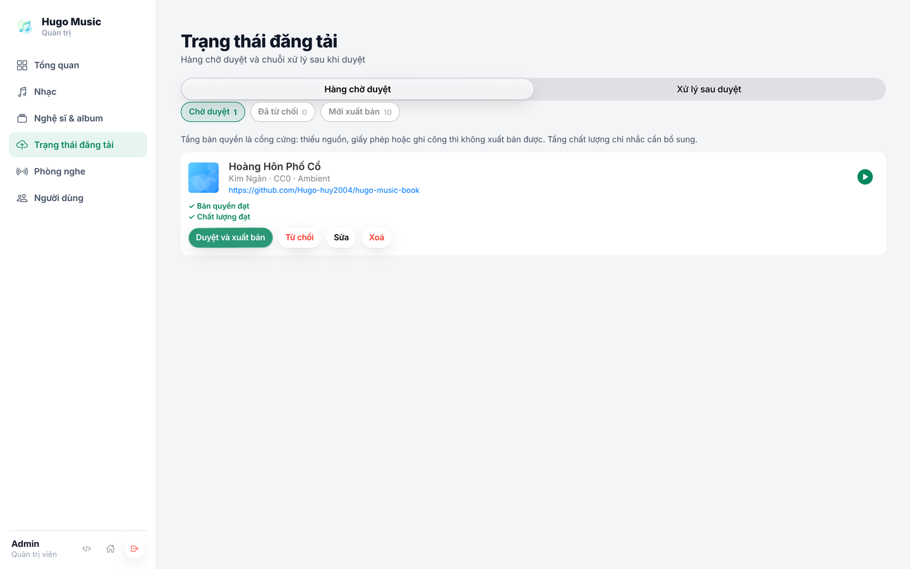
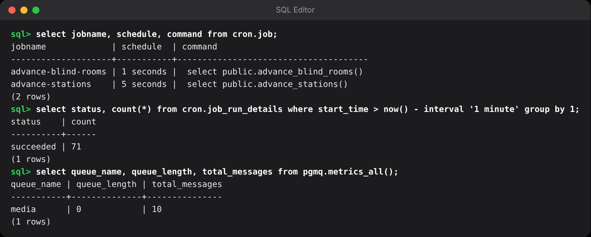

## Chương 9. Duyệt bài và tự động hóa ngầm

### Chương này làm gì

Admin bấm **Duyệt** → bài chuyển sang *đang xử lý* và một việc được đưa vào hàng đợi, cả hai trong cùng một giao dịch. Việc định kỳ chạy bằng pg_cron, việc dọn tài khoản khách bỏ quên chạy ở worker. Không có server API nào ở giữa.

### Để làm gì

Xử lý một bài (đo chất lượng, mã hóa nhiều mức) mất vài phút. Admin không thể đứng chờ, và nếu server xử lý chết giữa chừng thì bài không được bỏ sót. Đồng thời "đổi trạng thái" và "giao việc" phải cùng thành công hoặc cùng thất bại: bài *đang xử lý* mà không ai xử lý là bài treo vĩnh viễn.

### Phân tích kỹ thuật

**Hàng đợi việc:**

| Cách | Mạnh | Yếu |
|---|---|---|
| Xử lý ngay trong request | Đơn giản | Request treo vài phút, server chết là mất việc |
| Hàng đợi trên Redis (BullMQ) | Mạnh, nhiều tính năng | Thêm một dịch vụ; ghi database và đưa việc vào Redis là hai hệ thống, có thể lệch nhau |
| Database webhook gọi HTTP sang worker | Không cần hàng đợi | Worker phải luôn mở cổng nhận; worker bận hoặc chết thì mất việc |
| **Supabase Queues (pgmq)** | Hàng đợi nằm trong PostgreSQL: đổi trạng thái và đưa việc vào hàng đợi trong **cùng một giao dịch**; việc không bị mất; có thời gian ẩn tự trả việc khi worker chết | Thông lượng thấp hơn Redis (thừa sức cho vài nghìn bài mỗi ngày) |

**Việc định kỳ:**

| Cách | Ghi chú |
|---|---|
| Cron của hệ điều hành trên một server | Thêm server phải sống mãi |
| **Supabase Cron (pg_cron)** | Lịch nằm trong database, chạy SQL hoặc gọi Edge Function; chạy được theo giây |

### Chọn gì, vì sao

**Duyệt bài là một hàm SQL `review_song()`; việc đưa vào hàng đợi `media` của pgmq; worker đọc bằng ba hàm chỉ secret key gọi được. Việc định kỳ dùng pg_cron.** Mọi thứ nằm trong database nên một giao dịch bao trọn, không có trạng thái lệch.

### Làm từng bước

**Bước 1: tạo hàng đợi và bảng nhật ký.**

```sql
-- supabase/migrations/20261018000500_pipeline.sql (trích)
create extension if not exists pgmq;
select pgmq.create('media');

-- Admin xem được bài nào đang ở bước nào, lỗi gì
create table public.pipeline_runs (
  id          bigint generated always as identity primary key,
  song_id     uuid not null references public.songs (id) on delete cascade,
  status      text not null default 'queued' check (status in ('queued', 'running', 'done', 'failed')),
  step        text,
  error       text,
  created_at  timestamptz not null default now()
);
```

**Bước 2: hàm duyệt bài.** Kiểm quyền ở dòng đầu, đổi trạng thái có điều kiện (chỉ bài đang chờ mới duyệt được, bấm hai lần không sinh hai việc), rồi đưa việc vào hàng đợi. Tất cả trong một giao dịch: lỗi ở bất kỳ dòng nào thì không có gì thay đổi.

```sql
create or replace function public.review_song(p_song_id uuid, p_decision text, p_note text default null)
returns public.songs language plpgsql security definer set search_path = '' as $$
declare v_song public.songs;
begin
  if not public.is_admin() then
    raise exception 'only admins can review songs' using errcode = '42501';
  end if;

  update public.songs
     set status = case when p_decision = 'publish' then 'processing' else 'rejected' end::public.song_status,
         review_note = p_note, reviewed_by = auth.uid(), reviewed_at = now()
   where id = p_song_id and status in ('pending', 'failed', 'rejected')
  returning * into v_song;
  if v_song.id is null then raise exception 'song not found or already processed'; end if;

  if p_decision = 'publish' then
    insert into public.pipeline_runs (song_id) values (p_song_id);
    perform pgmq.send('media', jsonb_build_object('song_id', p_song_id));
  end if;
  return v_song;
end;
$$;
```

App gọi đúng một dòng:

```ts
reviewSong: async (songId: string, decision: 'publish' | 'reject', note?: string) =>
  toSong(must(await supabase.rpc('review_song', { p_song_id: songId, p_decision: decision, p_note: note ?? null }))),
```

**Bước 3: cửa cho worker.** Worker không nói chuyện thẳng với schema `pgmq`; nó gọi hai hàm nhỏ trong `public`, cấp quyền cho riêng `service_role` (secret key). App của người dùng không gọi được.

```sql
create or replace function public.media_read(p_count integer default 1, p_visibility_sec integer default 600)
returns setof pgmq.message_record language sql security definer set search_path = '' as $$
  select * from pgmq.read('media', p_visibility_sec, p_count)
$$;

create or replace function public.media_archive(p_msg_id bigint)
returns boolean language sql security definer set search_path = '' as $$
  select pgmq.archive('media', p_msg_id)
$$;

revoke execute on function public.media_read, public.media_archive from public, anon, authenticated;
grant execute on function public.media_read, public.media_archive to service_role;
```

`pgmq.read(..., p_visibility_sec, ...)` cho việc "ẩn" khỏi worker khác trong khoảng thời gian đó. Worker xử lý xong thì `archive`; worker chết giữa chừng thì hết giờ ẩn, việc tự hiện lại cho worker khác. Không việc nào bị mất.

**Bước 4: việc định kỳ.** Có hai loại:

- Việc thuần SQL (chuyển bài ở đài, dẫn trò blind test ở chương 13, 14): **pg_cron**, chạy được theo giây.
  ```sql
  create extension if not exists pg_cron;
  select cron.schedule('advance-stations', '5 seconds', $$ select public.advance_stations() $$);
  ```
- Việc cần API của Supabase Auth, ví dụ xóa khách ẩn danh không quay lại sau 30 ngày: không sửa thẳng schema `auth` bằng SQL. Một hàm SQL chỉ *liệt kê*, worker (đã có secret key) xóa bằng `auth.admin.deleteUser()` mỗi ngày một lần.
  ```sql
  create or replace function public.stale_guest_ids(p_days integer default 30, p_limit integer default 500)
  returns setof uuid language sql stable security definer set search_path = '' as $$
    select id from auth.users where is_anonymous and created_at < now() - make_interval(days => p_days) limit p_limit
  $$;
  grant execute on function public.stale_guest_ids to service_role;
  ```
  ```ts
  // worker/src/cleanup.ts (trích)
  export async function cleanupGuests() {
    const { data: ids } = await db.rpc('stale_guest_ids', { p_days: 30, p_limit: 500 });
    for (const id of ids as string[]) await db.auth.admin.deleteUser(id);
    return (ids as string[]).length;
  }
  ```

### Kết quả





### Kiểm tra

```sql
-- Sau khi duyệt một bài:
select status from public.songs where id = '<id bài>';           -- processing
select msg_id, message from pgmq.q_media;                         -- có một việc với song_id đó
select * from cron.job;                                           -- có các lịch đã đặt
```

Bấm duyệt hai lần liền: lần hai báo `song not found or already processed`, hàng đợi vẫn chỉ có một việc.

### Khi nào đổi

- **Việc nhẹ, không cần ffmpeg** (gửi email chào mừng, tính lại bảng xếp hạng): để Cron gọi Edge Function đọc hàng đợi, không cần worker riêng.
- **Hàng chục nghìn việc mỗi phút:** chuyển sang hàng đợi chuyên dụng (Redis, SQS) và dùng mẫu *outbox* (ghi việc vào bảng trong cùng giao dịch, một tiến trình chuyển sang hàng đợi ngoài).

### Code của chương

Các file chương này viết, trong repo đã clone ở phần Mở đầu:

- `supabase/migrations/20261018000500_pipeline.sql`
