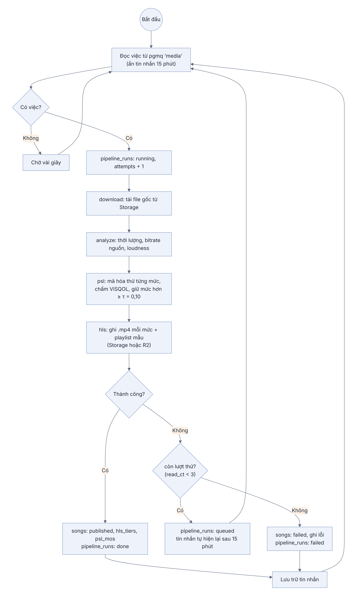
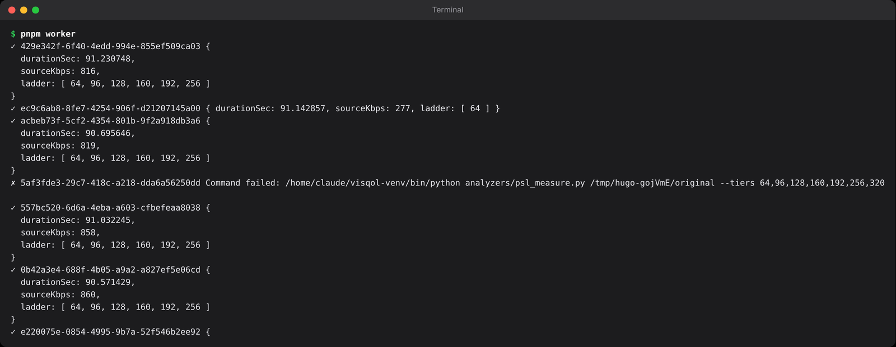
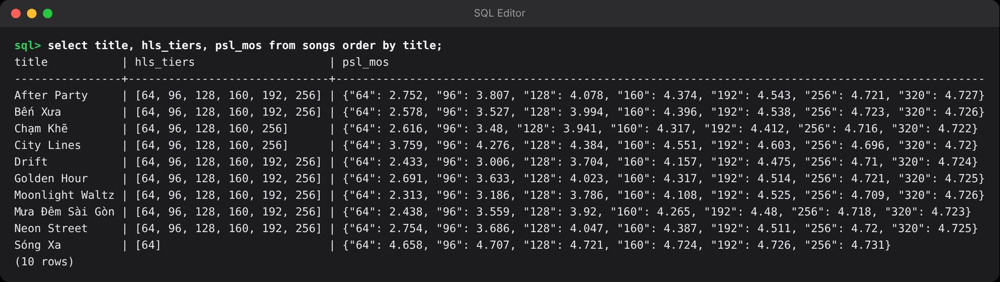
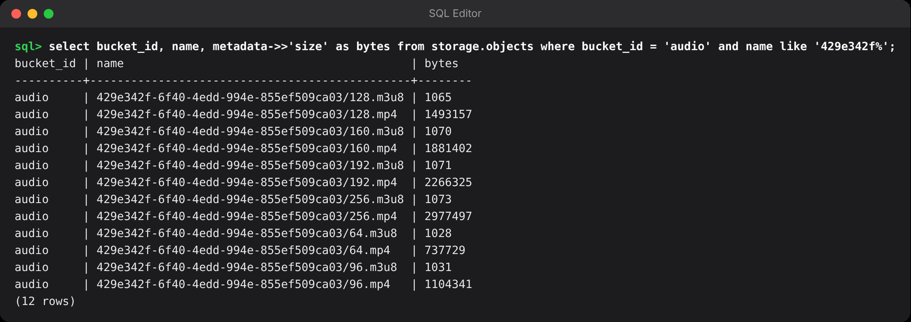

## Chương 10. Worker Node.js 26: xử lý âm thanh và PSL

### Chương này làm gì

Một tiến trình Node.js 26 lấy việc từ hàng đợi `media`, tải file gốc, đo độ dài và độ to, **đo thang chất lượng theo cảm nhận (PSL)**, mã hóa từng mức thành HLS, tải lên bucket `audio` và phát hành bài.

### Để làm gì

Trình phát cần nhiều mức chất lượng để tự hạ xuống khi mạng yếu (adaptive bitrate). Cách phổ biến là dựng sẵn cùng một thang cho mọi bài: 64, 96, 128, 192, 256, 320 kbps. Nhưng với một bản lo-fi đã nén sẵn, tai người không phân biệt được 192 và 320; mức 320 chỉ tốn chỗ và băng thông. PSL đo cho từng bài và chỉ giữ những mức mà tai người còn nghe ra khác biệt.

### Phân tích kỹ thuật

**Chạy ffmpeg ở đâu:**

| Nơi | Ghi chú |
|---|---|
| Edge Function | Giới hạn thời gian và CPU mỗi lượt gọi; không có ffmpeg đầy đủ. Không hợp. |
| Thư viện ffmpeg bằng WebAssembly trong Node | Chậm hơn nhiều so với ffmpeg gốc |
| **Tiến trình Node.js gọi ffmpeg gốc** (`child_process`) | Nhanh nhất; việc nặng chạy ở tiến trình khác nên event loop của Node không bị chặn |

**Định dạng HLS:**

| Cách | Ghi chú |
|---|---|
| Mỗi đoạn 6 giây một file `.ts` | Hàng trăm file mỗi bài, mỗi file một link ký |
| **fMP4 một file mỗi mức, playlist dùng byte range** | Một file `.mp4` mỗi mức; playlist chỉ ra đoạn byte của từng phần. Chỉ cần ký **một** link mỗi mức (chương 11). AVPlayer, ExoPlayer, hls.js đều hỗ trợ |

**Đo chất lượng cảm nhận:**

| Thước đo | Ghi chú |
|---|---|
| Bitrate | Không nói gì về việc tai người nghe ra hay không |
| PEAQ | Chuẩn cũ, ít công cụ mở |
| **ViSQOL** (Hines et al., 2015; Chinen et al., 2020) | Cho điểm MOS từ 1 tới 5, gần với đánh giá của người nghe; có bản Python |

### Chọn gì, vì sao

**Node.js 26 chạy thẳng TypeScript, gọi ffmpeg bằng `execFile`, HLS fMP4 một file, đo PSL bằng ViSQOL.** Quy tắc PSL: chỉ xét các mức *thấp hơn* bitrate nguồn; luôn giữ mức thấp nhất; giữ mức tiếp theo chỉ khi điểm MOS hơn mức **đã giữ** gần nhất ít nhất τ = 0,10 (lớn hơn nhiễu đo của ViSQOL, khoảng 0,03 tới 0,06).

### Sơ đồ hoạt động của worker



Bốn bước giữa (download, analyze, psl, hls) là bốn giá trị cột `step` của `pipeline_runs`, nên trang quản trị biết bài đang dừng ở đâu. Thử lại không cần code riêng: worker không xóa tin nhắn khi lỗi, hết 15 phút ẩn thì pgmq tự trả lại; tới lần thứ ba thì đánh dấu `failed` và rút khỏi hàng đợi.

### Làm từng bước

**Bước 1: package của worker.** Không có bước build: `node src/main.ts` chạy luôn.

```json
// worker/package.json (trích)
{
  "type": "module",
  "engines": { "node": ">=26" },
  "scripts": {
    "start": "node --env-file-if-exists=.env src/main.ts",
    "dev": "node --watch --env-file-if-exists=.env src/main.ts",
    "test": "node --test test/"
  },
  "dependencies": { "@supabase/supabase-js": "^2.118.0" }
}
```

`--env-file-if-exists` đọc `.env` mà không cần thư viện `dotenv`; `--watch` tự chạy lại khi sửa file; `node --test` là bộ test có sẵn của Node.

**Bước 2: kết nối bằng secret key.** Worker chạy trên server của mình nên được bỏ qua RLS.

```ts
// worker/src/supabase.ts
import { createClient } from '@supabase/supabase-js';

const { SUPABASE_URL, SUPABASE_SECRET_KEY } = process.env;
if (!SUPABASE_URL || !SUPABASE_SECRET_KEY) throw new Error('Thiếu SUPABASE_URL hoặc SUPABASE_SECRET_KEY trong .env');

export const db = createClient(SUPABASE_URL, SUPABASE_SECRET_KEY, { auth: { persistSession: false } });
```

**Bước 3: quy tắc PSL bằng TypeScript.** Phần đo điểm MOS do script Python (ViSQOL) làm; phần chọn mức là một hàm thuần, dễ test.

```ts
// worker/src/psl.ts (trích)
export const TAU = 0.1;

/** Giữ mức thấp nhất; giữ mức tiếp theo chỉ khi hơn mức ĐÃ GIỮ gần nhất ít nhất TAU điểm. */
export function applyTau(mos: Record<number, number>, tau = TAU) {
  const tiers = Object.keys(mos).map(Number).sort((a, b) => a - b);
  const ladder = tiers.slice(0, 1);
  for (const k of tiers.slice(1)) if (mos[k] - mos[ladder.at(-1)!] >= tau) ladder.push(k);
  return ladder;
}
```

So với mức *đã giữ* chứ không phải mức liền kề: đó là mức trình phát thật sự rơi xuống khi mạng yếu. Nếu 96 chỉ hơn 64 0,06 điểm và 128 hơn 64 0,12 điểm, thang là 64, 128.

**Bước 4: một mức HLS là một lệnh ffmpeg.**

```ts
// worker/src/ffmpeg.ts (trích)
export async function encodeTier(src: string, outDir: string, kbps: number) {
  await run('ffmpeg', ['-y', '-loglevel', 'error', '-i', src, '-map', '0:a:0', '-ac', '2',
    '-c:a', 'aac', '-b:a', `${kbps}k`,
    '-f', 'hls', '-hls_time', '6', '-hls_playlist_type', 'vod',
    '-hls_segment_type', 'fmp4', '-hls_flags', 'single_file',
    '-hls_segment_filename', `${outDir}/${kbps}.mp4`, `${outDir}/${kbps}.m3u8`]);
  return [`${kbps}.mp4`, `${kbps}.m3u8`];
}
```

Playlist sinh ra trông như sau: một file `128.mp4`, mỗi đoạn là một khoảng byte.

```text
#EXTM3U
#EXT-X-VERSION:7
#EXT-X-MAP:URI="128.mp4",BYTERANGE="765@0"
#EXTINF:6.013968,
#EXT-X-BYTERANGE:97467@765
128.mp4
...
#EXT-X-ENDLIST
```

**Bước 5: xử lý một bài.** Đọc từ trên xuống là thấy đủ các bước.

```ts
// worker/src/process-song.ts (trích)
export async function processSong(songId: string, log: (step: string) => Promise<void>) {
  const { data: song } = await db.from('songs').select('id, original_path').eq('id', songId).single();
  const dir = await mkdtemp(join(tmpdir(), 'hugo-'));
  try {
    await log('download');
    const { data: blob } = await db.storage.from('originals').download(song.original_path);
    const src = join(dir, 'original');
    await writeFile(src, Buffer.from(await blob.arrayBuffer()));

    await log('analyze');
    const { durationSec, sourceKbps } = await probe(src);
    const lufs = await loudness(src);

    await log('psl');
    const { ladder, mos } = await measurePsl(src, sourceKbps);

    await log('hls');
    for (const kbps of ladder)
      for (const name of await encodeTier(src, dir, kbps))
        await db.storage.from('audio').upload(`${songId}/${name}`, await readFile(join(dir, name)), { upsert: true });

    await db.from('songs').update({
      duration_sec: durationSec, loudness_lufs: lufs, hls_tiers: ladder, psl_mos: mos,
      status: 'published', published_at: new Date().toISOString(),
    }).eq('id', songId);
    return { durationSec, sourceKbps, ladder };
  } finally {
    await rm(dir, { recursive: true, force: true });
  }
}
```

**Bước 6: vòng lặp lấy việc.** Lấy một việc, xử lý, ghi nhật ký. Lỗi thì để hàng đợi tự trả việc sau thời gian ẩn; quá ba lần thì đánh dấu bài lỗi để admin xem.

```ts
// worker/src/main.ts (trích)
while (running) {
  const { data: messages } = await db.rpc('media_read', { p_count: 1, p_visibility_sec: 900 });
  if (!messages?.length) { await sleep(5_000); continue; }

  const msg = messages[0];
  const songId = msg.message.song_id;
  try {
    const result = await processSong(songId, (step) => updateRun(run, { step }));
    await updateRun(run, { status: 'done', meta: result });
    await db.rpc('media_archive', { p_msg_id: msg.msg_id });
  } catch (e) {
    if (msg.read_ct >= MAX_ATTEMPTS) {
      await db.from('songs').update({ status: 'failed', review_note: (e as Error).message }).eq('id', songId);
      await db.rpc('media_archive', { p_msg_id: msg.msg_id });
    }
  }
}
```

`process.on('SIGTERM', () => (running = false))` cho worker làm nốt việc đang dở rồi mới thoát khi deploy bản mới.

**Bước 7: nạp nhạc mẫu và chạy thử.** Script Python tạo 10 bài nhạc CC0 (tổng hợp bằng code, không dính bản quyền) kèm ảnh bìa. Script Node tải chúng lên Storage, tạo bài, rồi duyệt bằng tài khoản admin: đúng con đường mà admin đi trong app, nên hàng đợi nhận việc như thật.

```bash
python3 supabase/seed/make_demo_music.py demo
node --env-file=worker/.env supabase/seed/seed.ts demo admin@vidu.dev <mật-khẩu>
pnpm worker
```

```ts
// supabase/seed/seed.ts (trích): mỗi bài một vòng
await admin.storage.from('originals').upload(key, await readFile(join(dir, it.file)), { contentType: 'audio/flac' });
const { data: song } = await admin.from('songs').insert({ title: it.title, artist_id: artistId, license: 'cc0', original_path: key, ... }).select('id').single();
await asAdmin.rpc('review_song', { p_song_id: song.id, p_decision: 'publish' });   // bài vào hàng đợi media
```

### Kết quả

Đo thật bài mẫu "Mưa Đêm Sài Gòn" (FLAC, 816 kbps) với bảy mức ứng viên, τ = 0,10:

| Mức | MOS (ViSQOL) | Hơn mức đã giữ | Giữ? |
|---|---|---|---|
| 64 kbps | 2,44 | | Có (mức thấp nhất luôn giữ) |
| 96 kbps | 3,56 | +1,12 | Có |
| 128 kbps | 3,92 | +0,36 | Có |
| 160 kbps | 4,27 | +0,35 | Có |
| 192 kbps | 4,48 | +0,22 | Có |
| 256 kbps | 4,72 | +0,24 | Có |
| 320 kbps | 4,72 | +0,005 | **Không**: tai người không nghe ra khác biệt |







### Kiểm tra

```bash
cd worker && node --test test/       # quy tắc PSL: 3 test
node src/main.ts                     # chạy worker, duyệt một bài trong app, xem log
```

```sql
select status, hls_tiers, psl_mos from public.songs where id = '<id bài>';
select status, step, error from public.pipeline_runs order by id desc limit 5;
```

### Ví dụ tính tay

**PSL tiết kiệm bao nhiêu trên một bài thật.** Kích thước file các mức của "Mưa Đêm Sài Gòn" (91 giây) trong bucket `audio`, và mức 320 ước tính theo tỉ lệ bitrate:

```text
64: 737 729   96: 1 104 341   128: 1 493 157   160: 1 881 402   192: 2 266 325   256: 2 977 497   (byte)
thang PSL (6 mức)               = 10 460 451 byte ≈ 10,5 MB
mức 320 ≈ 2 977 497 × 320 ÷ 256 ≈ 3 721 871 byte
thang cố định (thêm 320)        ≈ 14 182 322 byte ≈ 14,2 MB
tiết kiệm ≈ 3,72 ÷ 14,18 ≈ 26 % dung lượng
```

Với "Sóng Xa" (chỉ giữ mức 64), con số tiết kiệm lên trên 90 %. Băng thông tiết kiệm còn lớn hơn dung lượng, vì người nghe mạng tốt luôn tải mức cao nhất.

### Thực hành

1. Chạy `python3 supabase/seed/make_demo_music.py demo`, nạp một bài, chạy `pnpm worker`, xem `psl_mos` của bài đó.
2. Đổi τ từ 0,10 lên 0,20 trong `worker/src/psl.ts`, chạy lại test. Bài "Mưa Đêm Sài Gòn" sẽ giữ những mức nào?

### Tự kiểm

1. Với số đo MOS 64: 3,0; 96: 3,05; 128: 3,6 và τ = 0,10, thang PSL giữ những mức nào? Tính từng bước.
2. Vì sao PSL so với mức **đã giữ** gần nhất chứ không so với mức liền kề?
3. Bài "Sóng Xa" chỉ giữ một mức. Điều đó nói gì về nội dung bài và về bitrate nguồn?

### Khi nào đổi

- **Nhiều bài chờ xử lý:** chạy thêm worker. Hàng đợi tự chia việc, không cần sửa code.
- **Muốn tự động hóa hoàn toàn trên Supabase:** tách bước nhẹ (đọc metadata, tìm lời bài hát) sang Edge Function, giữ worker cho ffmpeg và ViSQOL.
- **Dữ liệu blind test (chương 14) cho thấy τ = 0,10 vẫn giữ mức thừa:** tăng τ, chạy lại PSL cho cả danh mục bằng cách đưa lại việc vào hàng đợi.

### Code của chương

Các file chương này viết, trong repo đã clone ở phần Mở đầu:

- `worker/package.json`
- `worker/src/supabase.ts`
- `worker/src/psl.ts`
- `worker/src/ffmpeg.ts`
- `worker/src/process-song.ts`
- `worker/src/main.ts`
- `supabase/seed/seed.ts`
