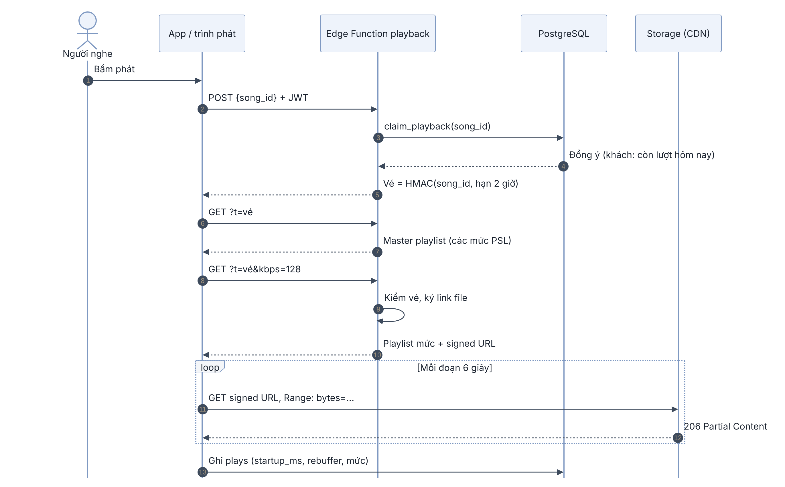
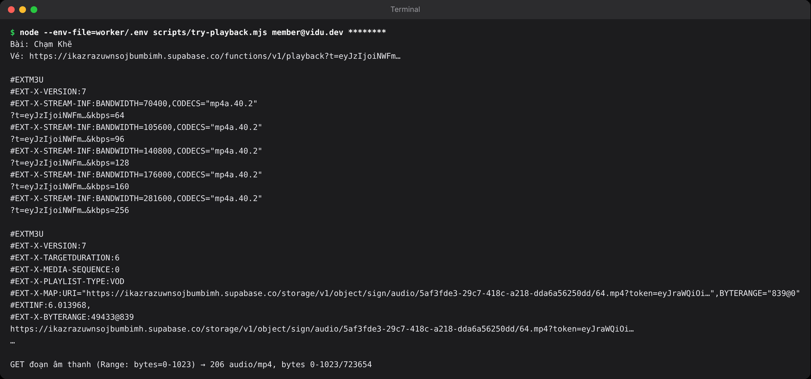
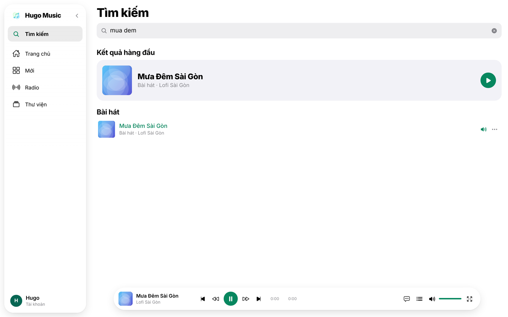

## Chương 11. Phát nhạc: Edge Function cấp vé và HLS

### Chương này làm gì

Bấm phát → app xin vé nghe từ Edge Function `playback` → nhận URL playlist HLS → trình phát tự chọn mức chất lượng theo tốc độ mạng. Khách đã nghe 3 bài trong ngày thì nhận lời mời đăng nhập; đăng nhập xong, bài đang dở phát tiếp.

### Để làm gì

File nhạc nằm trong bucket riêng tư. Cần một cách cho người được phép nghe, đúng bài, trong một khoảng thời gian ngắn, mà không làm chậm việc tải nhạc.

Có một khó khăn: trình phát (`<audio>` trên web, AVPlayer trên iOS, ExoPlayer trên Android) tự tải playlist và từng đoạn nhạc, **không gửi được header đăng nhập**. Quyền nghe phải nằm ngay trong URL.

### Phân tích kỹ thuật

| Cách | Mạnh | Yếu |
|---|---|---|
| Bucket công khai | Đơn giản nhất, CDN cache tốt | Ai có link cũng tải được; không giới hạn được lượt nghe của khách |
| Ký link cho từng đoạn nhạc | An toàn | Hàng trăm link mỗi bài; playlist phải viết lại mỗi lần |
| **Edge Function cấp vé + playlist trỏ vào link ký của file fMP4** | Kiểm quyền một lần lúc bấm phát; mỗi mức chỉ ký một link (chương 10 đã gom mỗi mức vào một file); dữ liệu nhạc đi thẳng từ Storage qua CDN, không qua function | Thêm một Edge Function |

### Chọn gì, vì sao

**Edge Function `playback` làm hai việc:** (1) `POST` kiểm quyền bằng chính phiên người nghe (gọi hàm SQL `claim_playback`) rồi trả một *vé* ký HMAC bằng `mintToken` của thư viện **hugo-stream**; (2) `GET ?song=<id>&t=<vé>` kiểm vé bằng `verifyToken` của cùng thư viện rồi trả playlist, trong đó đường dẫn file nhạc là link ký của Storage. Luật "khách 3 bài mỗi ngày" là SQL, nằm cạnh dữ liệu.

```text
App ── POST /functions/v1/playback {song_id} + phiên đăng nhập ──▶ Edge Function ── rpc claim_playback ──▶ Postgres
App ◀──────────── { url: .../playback?song=<id>&t=<vé> } ─────────┘
Trình phát ── GET ...?song=<id>&t=<vé> ──────────▶ master.m3u8 (các mức 64, 128, 192...)
Trình phát ── GET ...?song=<id>&t=<vé>&kbps=128 ─▶ 128.m3u8, file nhạc = link ký Storage
Trình phát ── GET link ký (byte range) ─────────▶ Storage + CDN (không qua function)
```

### Sơ đồ trình tự: một lượt phát



Database chỉ được hỏi một lần (bước 3). Từ bước 5, quyền nằm trong vé; Function kiểm vé bằng HMAC, không hỏi lại database. Vòng `loop` là phần tốn băng thông nhất và đi thẳng tới Storage qua CDN, không qua Function. Chương 23 thay riêng vòng này bằng Cloudflare.

### Làm từng bước

**Bước 1: luật nghe bằng SQL.** Khách nghe tối đa 3 bài khác nhau mỗi ngày (theo giờ Việt Nam); nghe lại bài đã nghe hôm nay không tốn lượt. Thành viên không giới hạn.

```sql
-- supabase/migrations/20261018000600_playback.sql (trích)
create table public.playback_grants (
  user_id uuid not null references auth.users (id) on delete cascade,
  song_id uuid not null references public.songs (id) on delete cascade,
  day     date not null default (now() at time zone 'Asia/Ho_Chi_Minh')::date,
  primary key (user_id, song_id, day)
);
alter table public.playback_grants enable row level security;   -- không có chính sách: chỉ đi qua hàm dưới

create or replace function public.claim_playback(p_song_id uuid)
returns jsonb language plpgsql security definer set search_path = '' as $$
declare
  v_today date := (now() at time zone 'Asia/Ho_Chi_Minh')::date;
  v_used  integer;
begin
  if public.is_guest() then
    select count(*) into v_used from public.playback_grants where user_id = auth.uid() and day = v_today;
    if v_used >= 3 and not exists (select 1 from public.playback_grants
                                    where user_id = auth.uid() and song_id = p_song_id and day = v_today) then
      return jsonb_build_object('allowed', false, 'reason', 'guest_limit', 'limit', 3);
    end if;
  end if;
  insert into public.playback_grants (user_id, song_id, day) values (auth.uid(), p_song_id, v_today)
  on conflict do nothing;
  return jsonb_build_object('allowed', true);
end;
$$;
```

**Bước 2: Edge Function kiểm quyền bằng phiên của người nghe.** Function tạo một client mang đúng header `Authorization` của request, nên `auth.uid()` trong SQL là người đang nghe.

```ts
// supabase/functions/playback/index.ts (trích)
async function grant(req: Request) {
  const { song_id } = await req.json();
  const asUser = createClient(url, Deno.env.get('SUPABASE_PUBLISHABLE_KEY')!, {
    global: { headers: { Authorization: req.headers.get('Authorization') ?? '' } },
  });
  const { data, error } = await asUser.rpc('claim_playback', { p_song_id: song_id });
  if (error) throw error;
  if (!data.allowed) return Response.json(data, { status: 403, headers: cors });

  const ticket = await sign({ s: song_id, e: Math.floor(Date.now() / 1000) + TICKET_TTL });
  return Response.json({ url: `${url}/functions/v1/playback?t=${ticket}` }, { headers: cors });
}
```

**Bước 3: vé nghe bằng hugo-stream.** Không tự viết phần ký vé: thư viện `hugo-stream` (chương Ứng dụng 1) có sẵn `mintToken` để ký và `verifyToken` để kiểm. Thư viện chỉ dùng Web Crypto, nên cùng một hàm chạy được trong Deno (Edge Function), trong Cloudflare Worker (chương 23) và trong test Node. Deno nạp thẳng gói từ npm bằng tiền tố `npm:`.

```ts
// supabase/functions/playback/index.ts (trích)
import { mintToken, verifyToken } from 'npm:hugo-stream@0.1.1';

const SECRET = Deno.env.get('PLAYBACK_SECRET')!;
const TICKET_WINDOW = 60 * 60;                     // vé sống 1–2 giờ
const scope = (songId: string) => `hls/${songId}/`; // vé gắn với cả bài: playlist và mọi mức

// POST: đã qua claim_playback
const ticket = await mintToken(scope(song_id), SECRET, { ttl: TICKET_WINDOW });
return Response.json({ url: `${url}/functions/v1/playback?song=${song_id}&t=${ticket}`, remaining });

// GET: trình phát gọi
if (!(await verifyToken(scope(songId), t, SECRET))) throw new Error('invalid ticket');
```

Vé có dạng `<hạn>.<chữ ký>`, chữ ký là HMAC-SHA256 của `"hls/<bài>|<hạn>"`. Ba tính chất có sẵn nhờ thư viện:

- **Một vé mở cả bài.** Mọi khóa nằm dưới `hls/<bài>/` đều được ký thành `hls/<bài>`, nên một vé dùng được cho master playlist, playlist từng mức và mọi đoạn nhạc.
- **Thân thiện với cache.** Hạn được làm tròn lên mốc giờ kế tiếp, nên mọi vé xin trong cùng một giờ là **cùng một chuỗi**. Link tải trước và link phát sau trùng nhau, CDN dùng lại được.
- **Kiểm an toàn.** `verifyToken` không bao giờ ném lỗi, từ chối vé hết hạn hoặc sai dạng, và so chữ ký trong thời gian không đổi. Kẻ gian không đoán được chữ ký bằng cách đo thời gian trả lời.

**Bước 4: trả playlist.** Không có `kbps`: danh sách các mức (master). Có `kbps`: lấy playlist worker đã ghi, thay tên file tương đối bằng link ký tuyệt đối.

```ts
async function playlist(u: URL) {
  const songId = u.searchParams.get('song') ?? '';
  const t = u.searchParams.get('t') ?? '';
  if (!(await verifyToken(scope(songId), t, SECRET))) throw new Error('invalid ticket');
  const kbps = u.searchParams.get('kbps');
  if (!kbps) {
    const { data: song } = await admin.from('songs').select('hls_tiers').eq('id', songId).single();
    const lines = ['#EXTM3U', '#EXT-X-VERSION:7'];
    for (const k of song.hls_tiers)
      lines.push(`#EXT-X-STREAM-INF:BANDWIDTH=${k * 1100},CODECS="mp4a.40.2"`, `?song=${songId}&t=${t}&kbps=${k}`);
    return new Response(lines.join('\n') + '\n', m3u8);
  }
  const base = `${songId}/${Number(kbps)}`;
  const [{ data: tpl }, { data: signed }] = await Promise.all([
    admin.storage.from('audio').download(`${base}.m3u8`),
    admin.storage.from('audio').createSignedUrl(`${base}.mp4`, TICKET_TTL),
  ]);
  return new Response((await tpl.text()).replaceAll(`${Number(kbps)}.mp4`, signed.signedUrl), m3u8);
}
```

**Bước 5: deploy.** Trình phát gọi `GET` không kèm phiên, nên tắt kiểm JWT ở cổng cho function này (function tự kiểm vé).

```toml
# supabase/config.toml (trích)
[functions.playback]
verify_jwt = false
```

```bash
supabase secrets set PLAYBACK_SECRET=$(openssl rand -base64 48)
supabase functions deploy playback
```

**Bước 6: app xin vé.** `functions.invoke` tự gắn phiên đăng nhập. Hết lượt thì ném lỗi có cờ `requiresLogin` để store mở hộp đăng nhập.

```ts
// app/src/api/api.ts (trích)
export async function resolvePlayback(song: PlayableSong, quality: string) {
  const { data, error } = await supabase.functions.invoke('playback', { body: { song_id: song._id } });
  if (error) {
    const body = await error.context?.json?.().catch(() => null);
    throw Object.assign(new Error('Khách nghe tối đa 3 bài mỗi ngày. Đăng nhập để nghe tiếp.'), {
      requiresLogin: body?.reason === 'guest_limit',
    });
  }
  const tier = song.hlsTiers?.includes(quality) ? quality : null;  // 'auto' = để trình phát tự chọn
  return { url: tier ? `${data.url}&kbps=${tier}` : data.url, cdn: 'supabase' };
}
```

Trình phát dùng sẵn của app: web dùng `hls.js` (Safari phát HLS gốc), iOS và Android dùng `expo-audio`.

### Nối lên app: bộ máy phát và trình phát

**Một lớp phát nhạc, hai cách chạy.** Trên web dùng thẻ `<audio>`: Safari phát HLS gốc, các trình duyệt khác cần hls.js. Trên iOS và Android dùng `expo-audio`, vốn phát HLS gốc. Phần còn lại của app chỉ gọi `audioEngine.load/play/pause/seek`, không cần biết đang chạy ở đâu.

```ts
// app/src/audio/deck.ts (trích)
export const createDeck = () => (Platform.OS === 'web' ? new WebDeck() : new NativeDeck());

// WebDeck.load: trình duyệt không tự phát HLS thì nạp hls.js (chỉ tải thư viện khi cần)
if (isHls(url) && el.canPlayType('application/vnd.apple.mpegurl') === '') {
  const Hls = (await import('hls.js')).default;
  this.hls = new Hls();
  this.hls.loadSource(url);
  this.hls.attachMedia(el);
}
```

**Bấm một bài: store lo mọi thứ.** `playSong(song, queue)` ghi hàng chờ, bài hiện tại và lịch sử. Sau đó nó xin link phát (vé, ở trên), nạp vào `audioEngine`, rồi tải trước phần đầu của bài kế tiếp.

```ts
// app/src/store/useStore.ts (rút gọn)
playSong: async (song, queue = [song]) => {
  set({ queue, currentSong: song, position: 0, isBuffering: true });
  const { url } = await resolvePlayback(song, get().audioQuality);   // Edge Function playback
  await audioEngine.load(url, true);
  const next = queue[queue.indexOf(song) + 1];
  if (next) prefetchNext(next, get().audioQuality);
},
```

Ô bài ở Trang chủ (chương Ứng dụng 2) giờ có `onPress={() => playOrToggleSong(song, list)}`: bấm bài đang phát thì tạm dừng, bấm bài khác thì phát bài đó, và cả kệ thành hàng chờ.

**Trình phát nhỏ nằm trên mọi màn hình.** `BottomPlayer` đọc `currentSong` và `isPlaying` từ store, nằm trong `AppLayout` (chương Ứng dụng 1) nên chuyển trang không làm ngắt nhạc. Bấm vào thì mở trình phát toàn màn hình.

```tsx
// app/src/components/Player/BottomPlayer.tsx (rút gọn)
const song = useStore((s) => s.currentSong);
const isPlaying = useStore((s) => s.isPlaying);
const { togglePlay, next } = useStore.getState();
if (!song) return null;
return (
  <Pressable onPress={onOpenFullPlayer} style={styles.bar}>
    <CoverArt uri={song.coverArt} size={44} radius={8} />
    <Text numberOfLines={1}>{song.title}</Text>
    <GlassButton icon={isPlaying ? 'pause' : 'play'} label={isPlaying ? 'Tạm dừng' : 'Phát'} onPress={togglePlay} />
    <GlassButton icon="play-forward" label="Bài tiếp" onPress={next} />
  </Pressable>
);
```

`useStore.getState()` lấy hàm mà không đăng ký vẽ lại, vì hàm không đổi. Trên máy tính, phím cách cũng tạm dừng hoặc phát tiếp.

### Kết quả





### Kiểm tra

```bash
# Vé giả bị từ chối
curl -s "$SUPABASE_URL/functions/v1/playback?t=gia.mao"          # {"error":"invalid ticket"}
```

Đăng nhập khách, phát 4 bài khác nhau: bài thứ tư mở hộp đăng nhập. Phát lại bài thứ nhất: vẫn nghe được.

### Ví dụ tính tay

**Vé sống bao lâu.** `mintToken` với `ttl` = 3 600 giây tính hạn = (phần nguyên của giờ hiện tại + 2) × 3 600:

```text
xin vé lúc 10:05 → hạn 12:00 (sống 1 giờ 55 phút)
xin vé lúc 10:59 → hạn 12:00 (sống 1 giờ 1 phút)   ← cùng một chuỗi với vé 10:05
xin vé lúc 11:00 → hạn 13:00                        ← vé mới
```

Vé luôn sống từ 1 tới 2 giờ, và trong cùng một giờ chỉ có một vé cho mỗi bài.

**Vé và lượt nghe của khách.** App giữ vé 30 phút (prefetch, chương 11):

```text
khách bấm phát bài A lúc 10:00   → claim_playback: lượt 1/3, vé hết hạn 12:00 (mốc giờ 10 + 2)
bấm lại bài A lúc 10:20          → app dùng vé đã giữ, không gọi Function: không tốn lượt
bấm lại bài A lúc 10:40          → vé trong app đã quá 30 phút, xin vé mới;
                                   claim_playback đếm bài KHÁC NHAU trong ngày → vẫn là lượt 1/3
bài B 10:45, bài C 10:50         → lượt 2/3, 3/3
bài D 10:55                      → từ chối: guest_limit, app mời đăng nhập
```

### Thực hành

1. Chạy `scripts/try-playback.mjs` với tài khoản của bạn và đọc từng phần đầu ra.
2. Đăng xuất (chế độ khách), phát bốn bài khác nhau. Mở Network xem request thứ tư trả gì.

### Tự kiểm

1. Trình phát gốc không gửi được header đăng nhập. Vé HMAC giải quyết điều đó thế nào?
2. Vì sao vé được ký cho `hls/<bài>/` thay vì cho từng file? Vì sao hai người xin vé cùng một bài trong cùng một giờ nhận cùng một chuỗi, và điều đó có lợi gì?
3. Kể lại sáu bước từ lúc bấm phát tới lúc Storage trả đoạn âm thanh đầu tiên.
4. Khách đã nghe 3 bài hôm nay bấm bài thứ tư: lớp nào từ chối, trả gì, app làm gì tiếp?

### Khi nào đổi

- **Danh mục có nhạc thương mại:** thêm mã hóa nội dung (HLS AES-128 hoặc DRM FairPlay/Widevine); vé ngắn hơn (vài phút).
- **Băng thông lớn:** đặt CDN riêng phía trước bucket `audio`; function chỉ đổi phần tạo link ký.
- **Muốn tính lượt nghe chính xác** (nghe từ 30 giây): app gửi số đo vào bảng `plays` (đã có trong migration) và xếp hạng bằng hàm `top_songs()`.

### Code của chương

Các file chương này viết, trong repo đã clone ở phần Mở đầu:

- `supabase/migrations/20261018000600_playback.sql`
- `supabase/functions/playback/index.ts`
- `supabase/config.toml`
- `app/src/api/api.ts`
- `app/src/audio/deck.ts`
- `app/src/audio/audioEngine.ts`
- `app/src/components/Player/BottomPlayer.tsx`
- `app/src/screens/Player/FullPlayer.tsx`
- `hugo-stream` trên npm: `mintToken`, `verifyToken` (https://www.npmjs.com/package/hugo-stream)
