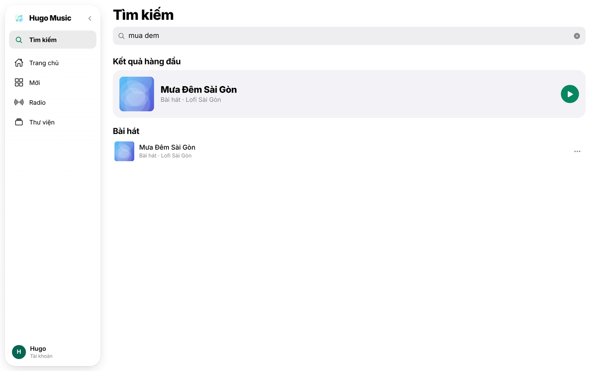
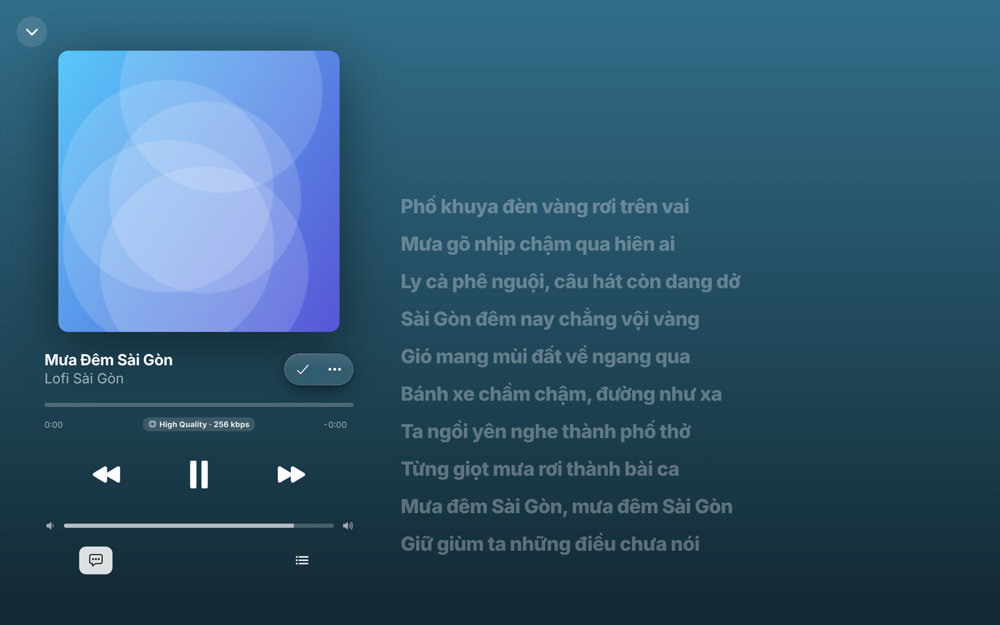

## Chương 12. Tìm kiếm tiếng Việt và lời bài hát

### Chương này làm gì

Ô tìm kiếm hiểu tiếng Việt: gõ "mua dem", "Mưa Đêm", "muadem" hay gõ sai "mua deem" đều ra bài *Mưa Đêm Sài Gòn*. Màn hình phát hiện lời bài hát chạy theo nhạc.

### Để làm gì

Người Việt gõ tìm kiếm đủ kiểu: có dấu, không dấu, bàn phím điện thoại không bật Telex, gõ thiếu chữ. Một ô tìm kiếm chỉ khớp đúng từng ký tự sẽ trả "không có kết quả" cho phần lớn lượt tìm.

### Phân tích kỹ thuật

| Cách | Mạnh | Yếu |
|---|---|---|
| `LIKE '%Mưa Đêm%'` | Có sẵn | Phân biệt dấu, quét cả bảng mỗi lần gõ |
| Full-text search của PostgreSQL (`tsvector`) | Nhanh, xếp hạng theo từ | Không có từ điển tiếng Việt; gõ sai một chữ là trượt |
| Dịch vụ tìm kiếm riêng (Meilisearch, Typesense, Algolia) | Rất mạnh | Thêm một hệ thống, phải đồng bộ dữ liệu |
| **`unaccent` + `pg_trgm` trong PostgreSQL** | Bỏ dấu rồi so khớp theo cụm 3 ký tự: chịu được gõ sai; có index GIN nên nhanh | Với vài triệu bài nên cân nhắc dịch vụ riêng |

### Chọn gì, vì sao

**Một cột `search_text` (tên bài, nghệ sĩ, album, bỏ dấu, chữ thường) do trigger giữ đúng; index trigram trên cột đó; một hàm SQL `search_songs(q)`.** Ở quy mô của Hugo Music, tìm kiếm ngay trong database đủ nhanh và không phải đồng bộ thêm hệ thống nào.

### Làm từng bước

**Bước 1: hàm bỏ dấu dùng được trong index.** `unaccent()` gốc được khai báo `STABLE` (kết quả có thể đổi theo cấu hình), nên PostgreSQL không cho dùng trong index. Bọc lại thành `IMMUTABLE` với từ điển ghi rõ.

```sql
-- supabase/migrations/20261018000100_catalog.sql (trích)
create extension if not exists unaccent with schema extensions;
create extension if not exists pg_trgm with schema extensions;

create or replace function public.f_unaccent(text) returns text
language sql immutable parallel safe strict set search_path = '' as $$
  select extensions.unaccent('extensions.unaccent'::regdictionary, $1)
$$;
```

**Bước 2: cột tìm kiếm do trigger giữ.** Tên nghệ sĩ nằm ở bảng khác, nên dùng trigger thay vì cột tự sinh.

```sql
-- supabase/migrations/20261018000700_search.sql (trích)
create or replace function public.songs_search_text() returns trigger language plpgsql set search_path = '' as $$
begin
  new.search_text := lower(public.f_unaccent(
    new.title || ' ' || coalesce((select a.name from public.artists a where a.id = new.artist_id), '')
    || ' ' || coalesce(new.album_title, '')));
  return new;
end;
$$;
create trigger songs_search_text before insert or update of title, artist_id, album_title on public.songs
  for each row execute function public.songs_search_text();
```

**Bước 3: index trigram, chỉ trên bài đã phát hành.**

```sql
create index songs_search_trgm on public.songs using gin (search_text extensions.gin_trgm_ops)
  where status = 'published';
```

**Bước 4: hàm tìm kiếm.** Khớp chuỗi con (`like`) cho trường hợp gõ đúng; khớp gần đúng (`<%`, word similarity) cho trường hợp gõ sai. Xếp theo độ giống, rồi theo lượt thích.

```sql
create or replace function public.search_songs(q text, p_limit integer default 30)
returns setof public.songs language sql stable set search_path = '' as $$
  with term as (select lower(public.f_unaccent(trim(q))) as t)
  select s.* from public.songs s, term
   where s.status = 'published' and length(term.t) > 0
     and (s.search_text like '%' || term.t || '%' or term.t operator(extensions.<%) s.search_text)
   order by extensions.word_similarity(term.t, s.search_text) desc, s.likes_count desc
   limit least(p_limit, 100)
$$;
```

`returns setof public.songs` nên app gọi được như một bảng, kể cả lấy kèm nghệ sĩ:

```ts
searchSongs: async (q: string) => must(await supabase.rpc('search_songs', { q }).select(SONG_COLUMNS)).map(toSong),
```

**Bước 5: lời bài hát đồng bộ.** Lời lưu dạng LRC trong cột `synced_lyrics`: mỗi dòng có mốc thời gian, ví dụ `[01:23.50]Mưa rơi trên phố vắng`. Phát tới đâu thì tìm dòng có mốc lớn nhất không vượt vị trí hiện tại; danh sách đã sắp theo thời gian nên tìm nhị phân, đủ rẻ để gọi vài lần mỗi giây. Phần phân tích LRC nằm trong thư viện `hugo-stream`, dùng chung cho web và app.

```ts
getLyrics: async (songId: string) => {
  const s = must(await supabase.from('songs').select('plain_lyrics, synced_lyrics').eq('id', songId).single());
  return { hasLyrics: !!(s.synced_lyrics || s.plain_lyrics), plainLyrics: s.plain_lyrics, syncedLyrics: s.synced_lyrics };
},
```

Cột lời không nằm trong `SONG_COLUMNS` của danh sách bài: chỉ tải khi mở màn hình lời.

### Kết quả





### Kiểm tra

```sql
select title from public.search_songs('mua dem');     -- Mưa Đêm Sài Gòn
select title from public.search_songs('MUA ĐÊM');     -- cùng kết quả
select title from public.search_songs('mua deem');    -- vẫn ra (gõ sai một chữ)
explain select * from public.search_songs('neon');   -- có dùng songs_search_trgm
```

### Khi nào đổi

- **Hàng triệu bài, cần gợi ý khi gõ dưới 50 ms:** chuyển sang Meilisearch hoặc Typesense, đồng bộ bằng trigger đưa việc vào hàng đợi (chương 9).
- **Tìm theo ý nghĩa** ("nhạc buồn mưa rơi"): thêm cột vector (pgvector) chứa embedding của tên và lời bài hát.

### Code của chương

Các file chương này viết, trong repo đã clone ở phần Mở đầu:

- `supabase/migrations/20261018000100_catalog.sql`
- `supabase/migrations/20261018000700_search.sql`
