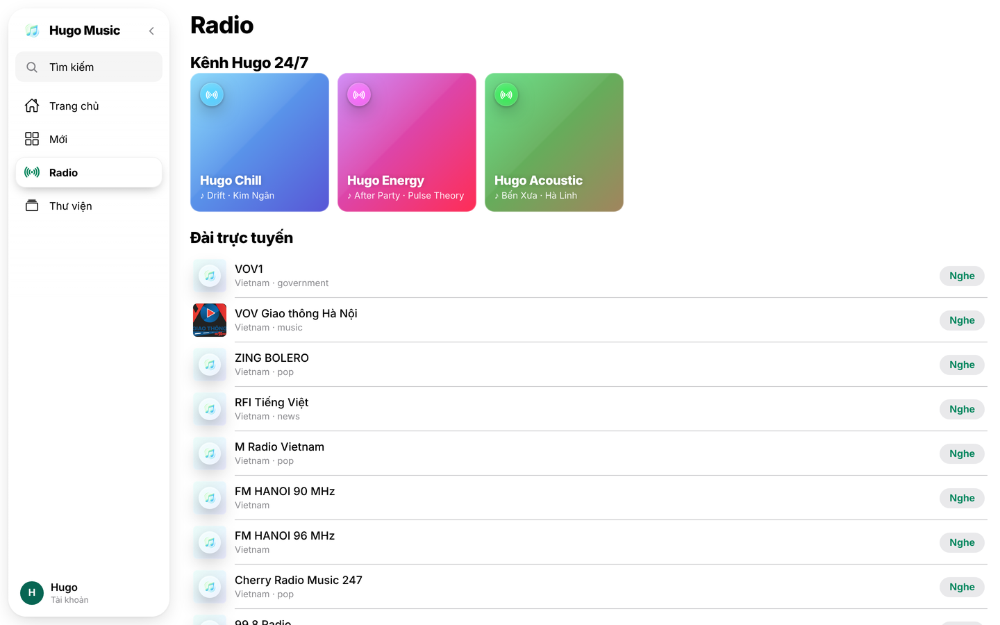
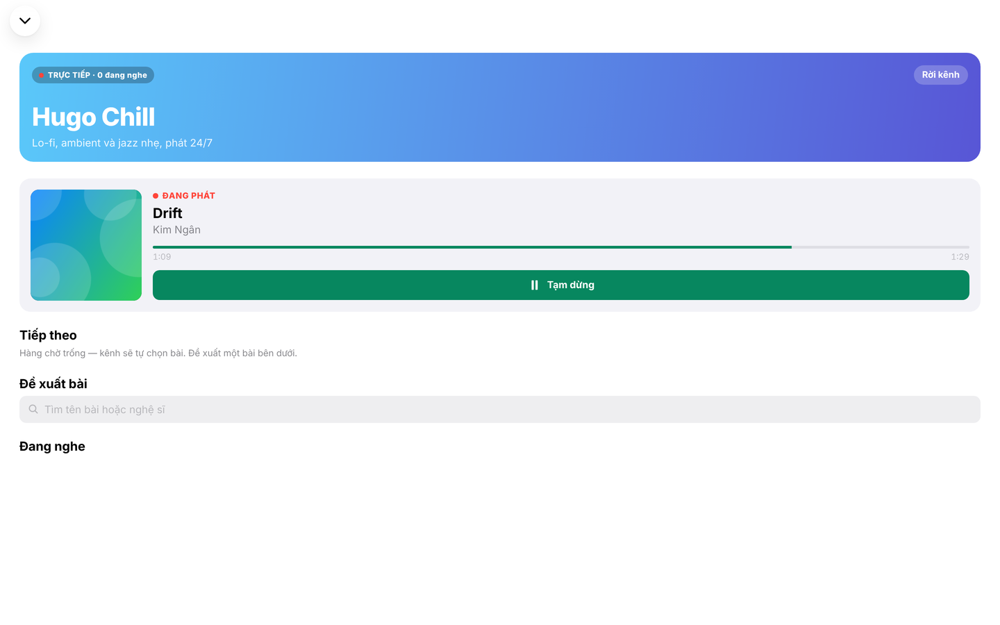
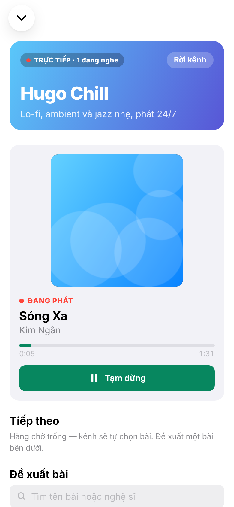

## Chương 13. Đài 24/7 nghe chung với Realtime

### Chương này làm gì

Các đài phát liên tục: ai vào đài cũng nghe đúng cùng một bài, cùng một giây. Thấy ai đang nghe cùng. Thành viên gợi ý và bỏ phiếu bài tiếp theo; bài nhiều phiếu nhất được phát kế. **Không có server WebSocket nào tự viết.**

### Để làm gì

Nghe chung chỉ có nghĩa khi mọi người thật sự nghe cùng một đoạn. Nếu mỗi máy tự bấm phát từ đầu, đài trở thành một danh sách phát bình thường. Đồng thời phải chuyển bài đúng lúc, kể cả khi không ai đang mở đài.

### Phân tích kỹ thuật

**Ai giữ "đài đang phát gì":**

| Cách | Ghi chú |
|---|---|
| Server WebSocket giữ trạng thái trong RAM | Server khởi động lại là mất; chạy nhiều bản phải đồng bộ qua Redis |
| **Database giữ một dòng mỗi đài: bài nào, bắt đầu lúc nào** | Bền, ai đọc cũng như nhau. Mỗi máy tự tính vị trí = giờ hiện tại − giờ bắt đầu |

**Ai chuyển bài:**

| Cách | Ghi chú |
|---|---|
| Client cuối cùng còn nghe báo hết bài | Không ai nghe thì đài đứng |
| **pg_cron mỗi 5 giây gọi hàm `advance_stations()`** | Chạy cả khi không ai nghe; trễ tối đa 5 giây |

**Đẩy cập nhật xuống máy đang nghe** (ba công cụ của Supabase Realtime):

| Công cụ | Dùng cho |
|---|---|
| **Broadcast** | Tin nhắn tức thời trên một kênh, gửi từ client hoặc **từ chính database** (`realtime.send`) |
| **Presence** | Ai đang có mặt trong kênh |
| **Postgres Changes** | Nghe thay đổi của một bảng (đã qua RLS) |

### Chọn gì, vì sao

**Bảng `station_now` giữ trạng thái; cron 5 giây chuyển bài; trigger trên `station_now` phát Broadcast `now_playing` từ database; Presence đếm người nghe; Postgres Changes cập nhật danh sách gợi ý.** Đồng hồ: mỗi máy hỏi giờ máy chủ (`server_now()`) vài lần, lấy lần trễ thấp nhất, để đồng hồ điện thoại có lệch cũng không ảnh hưởng.

### Làm từng bước

**Bước 1: bảng đài và trạng thái.**

```sql
-- supabase/migrations/20261018000800_stations.sql (trích)
create table public.stations (
  id            bigint generated always as identity primary key,
  slug          text not null unique,
  name          text not null,
  colors        text[] not null default array['#5E5CE6', '#0A84FF'],
  genre_pattern text,              -- regex trên songs.genre; null = mọi thể loại
  active        boolean not null default true
);

create table public.station_now (
  station_id bigint primary key references public.stations (id) on delete cascade,
  song_id    uuid not null references public.songs (id) on delete cascade,
  started_at timestamptz not null,
  ends_at    timestamptz not null
);
```

**Bước 2: chuyển bài bằng một hàm SQL.** Với mỗi đài đã hết bài: lấy bài được gợi ý nhiều phiếu nhất, không có thì chọn ngẫu nhiên đúng thể loại.

```sql
create or replace function public.advance_stations() returns integer
language plpgsql security definer set search_path = '' as $$
declare st record; v_song uuid; v_req bigint; v_dur numeric; n integer := 0;
begin
  for st in select s.* from public.stations s left join public.station_now sn on sn.station_id = s.id
             where s.active and (sn.ends_at is null or sn.ends_at <= now()) loop
    select r.id, r.song_id into v_req, v_song from public.station_requests r
     where r.station_id = st.id and r.played_at is null order by r.votes desc, r.created_at limit 1;
    if v_song is null then
      select so.id into v_song from public.songs so
       where so.status = 'published' and (st.genre_pattern is null or so.genre ~* st.genre_pattern)
       order by random() limit 1;
    else
      update public.station_requests set played_at = now() where id = v_req;
    end if;
    continue when v_song is null;
    select duration_sec into v_dur from public.songs where id = v_song;
    insert into public.station_now values (st.id, v_song, now(), now() + make_interval(secs => v_dur))
    on conflict (station_id) do update set song_id = excluded.song_id, started_at = excluded.started_at, ends_at = excluded.ends_at;
    n := n + 1; v_song := null; v_req := null;
  end loop;
  return n;
end;
$$;

select cron.schedule('advance-stations', '5 seconds', $$ select public.advance_stations() $$);
```

**Bước 3: database tự báo khi chuyển bài.** Trigger gọi `realtime.send` để phát sự kiện `now_playing` lên kênh `station:<id>`. Tham số cuối `false` là kênh công khai: khách cũng nghe đài được.

```sql
create or replace function public.broadcast_station_now() returns trigger
language plpgsql security definer set search_path = '' as $$
begin
  perform realtime.send(
    jsonb_build_object('song_id', new.song_id, 'started_at', new.started_at),
    'now_playing', 'station:' || new.station_id, false);
  return null;
end;
$$;
create trigger station_now_broadcast after insert or update on public.station_now
  for each row execute function public.broadcast_station_now();
```

**Bước 4: gợi ý và bỏ phiếu qua một hàm.** Mỗi người một phiếu cho mỗi bài, khách không được gợi ý. Ai gợi ý bài nào là thông tin riêng, nên cột `user_id` của `station_requests` không mở cho client (quyền theo cột, như chương 6).

```ts
// app/src/rooms/useRooms.ts (trích)
export async function suggestSong(songId: string) {
  const { error } = await supabase.rpc('request_song', { p_station_id: currentStationId(), p_song_id: songId });
  if (error) throw error;
}
```

**Bước 5: vào đài.** Một kênh, ba loại tin: Broadcast khi chuyển bài, Postgres Changes khi có gợi ý mới, Presence để biết ai đang nghe.

```ts
roomChannel = supabase.channel(`station:${id}`, { config: { presence: { key: user?._id } } })
  .on('broadcast', { event: 'now_playing' }, refresh)
  .on('postgres_changes', { event: '*', schema: 'public', table: 'station_requests', filter: `station_id=eq.${id}` }, refresh)
  .on('presence', { event: 'sync' }, () => {
    const listeners = Object.values(roomChannel!.presenceState()).flat();
    useRooms.setState((s) => (s.station ? { station: { ...s.station, listeners } } : {}));
  })
  .subscribe((status) => {
    if (status === 'SUBSCRIBED') roomChannel!.track({ userId: user?._id, name: user?.nickname || 'Người nghe' });
  });
```

**Bước 6: phát đúng giây.** Vị trí cần phát là giờ máy chủ trừ giờ bắt đầu. Sau khi phát, mỗi vài giây so vị trí thật với vị trí mong đợi; lệch ít thì chỉnh tốc độ phát rất nhẹ (người nghe không nhận ra), lệch nhiều thì tua.

```ts
// app/src/rooms/serverClock.ts
const clock = createServerClock(async () => {
  const { data, error } = await supabase.rpc('server_now');
  return error ? null : Date.parse(data as string);
});
export const serverNow = clock.now;

// app/src/rooms/useRooms.ts (trích)
const stationPosition = (now) => (serverNow() - now.startedAt) / 1000;
await startAligned(() => stationPosition(now), (pos) => store.playSong(now.song, [now.song], pos));
```

### Kết quả







### Kiểm tra

```sql
select * from cron.job_run_details where jobid = (select jobid from cron.job where jobname = 'advance-stations')
 order by start_time desc limit 3;                        -- chạy mỗi 5 giây, status succeeded
select s.name, sn.started_at, sn.ends_at from public.station_now sn join public.stations s on s.id = sn.station_id;
```

Mở cùng một đài ở hai trình duyệt: thanh tiến trình chạy trùng nhau; gợi ý một bài ở cửa sổ này, danh sách ở cửa sổ kia cập nhật ngay.

### Ví dụ tính tay

**Vị trí phát của một máy trong đài.** Đài đang phát bài 91 giây, `started_at` = 10:00:00,000 giờ máy chủ. Đồng hồ điện thoại chạy nhanh 3,2 giây:

```text
đo giờ máy chủ: gửi lúc t1 = 10:00:43,200 (giờ máy), máy chủ trả 10:00:40,060, nhận lúc t2 = 10:00:43,280
vòng đi về = 80 ms → giờ máy chủ lúc nhận ≈ 40,060 + 0,040 = 10:00:40,100
độ lệch = 40,100 − 43,280 = −3,180 giây
vị trí cần phát = (giờ máy + độ lệch) − started_at = 43,280 − 3,180 − 0 = 40,1 giây
```

Đo 8 lần, giữ lần có vòng đi về ngắn nhất: lần đó ít sai nhất vì thời gian chờ chia đều hai chiều.

### Thực hành

1. Mở cùng một đài ở hai cửa sổ trình duyệt, so thanh tiến trình. Đổi giờ hệ thống của máy đi 10 giây rồi tải lại một cửa sổ.
2. Gợi ý một bài ở cửa sổ A, xem danh sách ở cửa sổ B cập nhật. Mở tab WebSocket trong DevTools để thấy tin nhắn Postgres Changes.

### Tự kiểm

1. Database giữ "đài đang phát gì" bằng những cột nào? Mỗi máy tính vị trí phát ra sao?
2. Broadcast, Presence, Postgres Changes: mỗi loại dùng vào việc gì ở màn hình đài?
3. Đồng hồ điện thoại lệch 3 giây thì đài có lệch không? Vì sao?

### Khi nào đổi

- **Cần chuyển bài chính xác tới mili giây (gapless):** lên lịch trước cả hàng đợi bài sắp phát trong bảng, client tự nối bài theo giờ máy chủ thay vì chờ cron.
- **Hàng chục nghìn người cùng một đài:** Presence đầy đủ trở nên nặng; chỉ đếm số người (định kỳ gửi Broadcast con số) thay vì danh sách từng người.

### Code của chương

Các file chương này viết, trong repo đã clone ở phần Mở đầu:

- `supabase/migrations/20261018000800_stations.sql`
- `app/src/rooms/useRooms.ts`
- `app/src/rooms/serverClock.ts`
