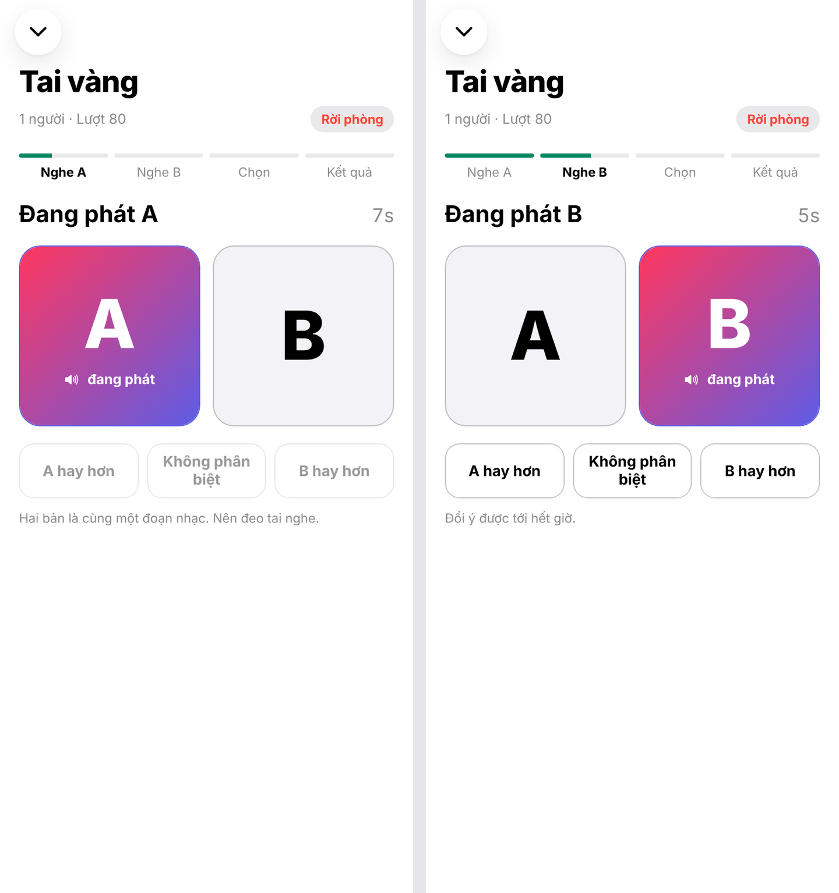
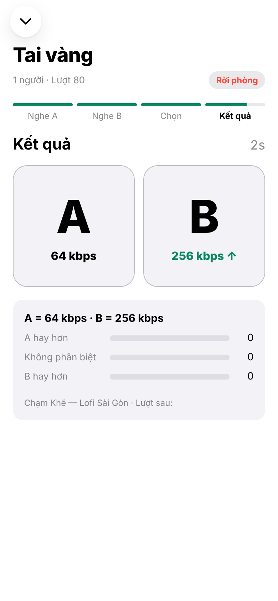

## Chương 14. Blind test: game nghe chung chạy trong database

### Chương này làm gì

Phòng *Tai vàng*: cả phòng nghe cùng một đoạn 10 giây ở hai mức chất lượng, A rồi B. Mỗi người chọn bản hay hơn hoặc "như nhau". Hết giờ, mọi người cùng thấy đáp án, số phiếu và bảng xếp hạng. Kết quả được tổng hợp để kiểm chứng PSL.

### Để làm gì

PSL (chương 10) dựa trên điểm của ViSQOL, một thuật toán. Câu hỏi thật là: **người nghe có phân biệt được không?** Blind test lấy câu trả lời từ chính người dùng, dưới dạng một trò chơi.

### Phân tích kỹ thuật

Một trò chơi nhiều người cần: đồng hồ chung (mọi người nghe A cùng lúc), giấu đáp án tới khi công bố, chấm điểm, và một "người dẫn" đẩy trò chơi qua từng bước.

| Người dẫn | Ghi chú |
|---|---|
| Server game riêng (Node.js + WebSocket) | Thêm một server phải chạy mãi, giữ trạng thái trong RAM |
| Một client làm "chủ phòng" | Chủ phòng thoát là phòng đứng; client gian lận được |
| **pg_cron mỗi giây gọi một hàm SQL** | Trạng thái nằm trong bảng; hàm đẩy phòng sang bước kế (tạo lượt, công bố) và phát sự kiện qua Realtime |

**Giấu đáp án:** biết bitrate của A và B là biết đáp án (bên cao hơn là bản tốt hơn). Vì vậy client **không được đọc** hai cột `a_kbps`, `b_kbps` trước khi công bố, kể cả khi tự gọi API. Hai lớp chặn:

| Lớp | Cách |
|---|---|
| Database | Quyền theo cột: `anon`, `authenticated` chỉ được `select` các cột thời gian, bài, số thứ tự; không có hai cột bitrate |
| Âm thanh | Client xin playlist bằng `?trial=<id>&side=A`; Edge Function `playback` tự tra bitrate bằng secret key. URL không chứa con số nào |

### Chọn gì, vì sao

**Bảng `blind_trials` lưu từng lượt với các mốc giờ tuyệt đối (nghe A lúc nào, B lúc nào, hết giờ bỏ phiếu lúc nào); hàm `advance_blind_rooms()` chạy mỗi giây; bỏ phiếu qua hàm `vote_blind()`; ba loại sự kiện Broadcast: `trial`, `votes`, `reveal`.** Một phần sáu số lượt là *lượt kiểm tra*: A và B giống hệt, đáp án đúng là "như nhau", để lọc người chọn bừa.

### Làm từng bước

**Bước 1: một lượt là một dòng với các mốc giờ.**

```sql
-- supabase/migrations/20261018000900_blind_test.sql (trích)
create table public.blind_trials (
  id            uuid primary key default gen_random_uuid(),
  room_id       bigint not null references public.blind_rooms (id) on delete cascade,
  no            integer not null,
  song_id       uuid not null references public.songs (id) on delete cascade,
  a_kbps        integer not null,
  b_kbps        integer not null,
  is_control    boolean not null,            -- A và B giống hệt
  excerpt_start numeric(8, 2) not null,
  excerpt_sec   numeric(6, 2) not null default 10,
  a_at          timestamptz not null,        -- lúc cả phòng bắt đầu nghe A
  b_at          timestamptz not null,
  vote_until    timestamptz not null,
  reveal_until  timestamptz not null,
  revealed      boolean not null default false
);
```

**Bước 2: hàm dẫn trò chơi.** Mỗi giây, với mỗi phòng: hết giờ bỏ phiếu thì chấm điểm và công bố; công bố xong thì tạo lượt mới. Trích phần tạo lượt:

```sql
v_low := s.hls_tiers[1];
v_high := s.hls_tiers[cardinality(s.hls_tiers)];
v_control := random() < 1.0 / 6;
v_a := v_low; v_b := case when v_control then v_low else v_high end;
if random() < 0.5 then select v_b, v_a into v_a, v_b; end if;   -- đảo vị trí
v_start := now() + interval '3 seconds';
insert into public.blind_trials (room_id, no, song_id, a_kbps, b_kbps, is_control, excerpt_start, excerpt_sec,
                                 a_at, b_at, vote_until, reveal_until)
values (r.id, coalesce(t.no, 0) + 1, s.id, v_a, v_b, v_control, ..., v_ex,
        v_start, v_start + make_interval(secs => v_ex + 1),
        v_start + make_interval(secs => 2 * v_ex + 9), v_start + make_interval(secs => 2 * v_ex + 15))
returning * into t;
perform realtime.send(public.blind_trial_json(t), 'trial', 'blind:' || r.id, false);
```

```sql
select cron.schedule('advance-blind-rooms', '1 seconds', $$ select public.advance_blind_rooms() $$);
```

**Bước 3: chấm điểm khi công bố.** Đúng khi: lượt kiểm tra chọn "như nhau", hoặc chọn bản có bitrate cao hơn. Chọn "như nhau" ở lượt thường không tính đúng sai: đó chính là dữ liệu quý cho PSL (người nghe không phân biệt được).

```sql
update public.blind_votes set correct = case
    when t.is_control then choice = 'same'
    when choice = 'same' then null
    else (choice = 'A') = (t.a_kbps > t.b_kbps)
  end
 where trial_id = t.id;
```

**Bước 4: bỏ phiếu.** Chỉ nhận phiếu trong khung giờ; đổi ý được trước khi hết giờ; báo cho phòng biết đã có bao nhiêu người chọn (không lộ ai chọn gì).

```sql
create or replace function public.vote_blind(p_trial_id uuid, p_choice text) returns void
language plpgsql security definer set search_path = '' as $$
declare t public.blind_trials; v_count integer;
begin
  select * into t from public.blind_trials where id = p_trial_id;
  if t.revealed or now() > t.vote_until or now() < t.b_at then
    raise exception 'voting is closed for this trial';
  end if;
  insert into public.blind_votes (trial_id, choice) values (p_trial_id, p_choice)
  on conflict (trial_id, user_id) do update set choice = excluded.choice;
  select count(*) into v_count from public.blind_votes where trial_id = p_trial_id;
  perform realtime.send(jsonb_build_object('trialId', p_trial_id, 'voted', v_count), 'votes', 'blind:' || t.room_id, false);
end;
$$;
```

**Bước 5: giấu bitrate bằng quyền theo cột.** RLS chọn dòng; quyền theo cột chọn cột.

```sql
revoke select on public.blind_trials from anon, authenticated;
grant select (id, room_id, no, song_id, excerpt_start, excerpt_sec, a_at, b_at, vote_until, reveal_until, revealed)
  on public.blind_trials to anon, authenticated;
```

Sự kiện `trial` phát lúc bắt đầu lượt cũng không mang bitrate; chỉ sự kiện `reveal` (sau khi hết giờ bỏ phiếu) mới có.

**Bước 6: âm thanh A/B qua Edge Function.** Client chỉ nói "bên A", function tra bitrate rồi trả playlist của đúng mức đó.

```ts
// supabase/functions/playback/index.ts (trích)
async function blindSideKbps(trialId: string, songId: string, side: string | null) {
  const { data } = await admin.from('blind_trials').select('song_id, a_kbps, b_kbps').eq('id', trialId).single();
  if (data.song_id !== songId || (side !== 'A' && side !== 'B')) throw new Error('ticket does not match trial');
  return side === 'A' ? data.a_kbps : data.b_kbps;
}
```

**Bước 7: app nghe ba sự kiện.** Mỗi lượt xin một vé nghe cho bài, rồi tạo hai URL chỉ ghi bên A, bên B.

```ts
// app/src/rooms/useRooms.ts (trích)
const { url } = await resolvePlayback({ _id: trial.song._id }, 'auto');
trialUrls = { A: `${url}&trial=${trial.id}&side=A`, B: `${url}&trial=${trial.id}&side=B` };

roomChannel = supabase.channel(`blind:${id}`)
  .on('broadcast', { event: 'trial' }, async ({ payload }) => runTrial(await toTrial(payload)))
  .on('broadcast', { event: 'votes' }, ({ payload }) => useRooms.setState({ votesIn: { voted: payload.voted } }))
  .on('broadcast', { event: 'reveal' }, ({ payload }) => showReveal(payload))
  .subscribe();
```

**Bước 8: kết quả cho nghiên cứu.** Một view tổng hợp theo cặp mức: bao nhiêu phần trăm người nghe phân biệt được.

```sql
create view public.blind_results with (security_invoker = true) as
  select least(t.a_kbps, t.b_kbps) as low_kbps, greatest(t.a_kbps, t.b_kbps) as high_kbps, count(*) as votes,
         round(avg(case when v.correct then 1.0 when v.correct = false then 0.0 end), 3) as hit_rate,
         round(avg(case when v.choice = 'same' then 1.0 else 0.0 end), 3) as same_rate
    from public.blind_votes v join public.blind_trials t on t.id = v.trial_id
   where not t.is_control group by 1, 2;
```

`security_invoker = true` cho view chạy bằng quyền của người đọc, nên RLS của `blind_votes` vẫn áp dụng: người thường chỉ thấy số của mình, admin thấy tất cả.

### Kết quả





### Kiểm tra

```sql
select no, a_kbps, b_kbps, is_control, revealed from public.blind_trials order by a_at desc limit 5;
select * from public.blind_results;          -- hit_rate gần 0,5 nghĩa là gần như đoán bừa: mức cao có thể thừa
```

### Ví dụ tính tay

**Dòng thời gian một lượt blind test** (đoạn 10 giây, cron tạo lượt lúc T):

```text
a_at         = T + 3 giây              cả phòng nghe A (10 giây)
b_at         = a_at + 11 giây          nghe B (10 giây), bắt đầu được bỏ phiếu
vote_until   = a_at + 29 giây          hết giờ bỏ phiếu (còn 8 giây sau khi B kết thúc)
reveal_until = a_at + 35 giây          công bố 6 giây, rồi cron tạo lượt mới
một lượt ≈ 3 + 35 = 38 giây → khoảng 94 lượt mỗi giờ
```

Mỗi mốc là giờ tuyệt đối trong database, nên ai vào phòng giữa chừng cũng biết ngay đang ở giai đoạn nào.

### Thực hành

1. Vào phòng Tai vàng với hai tài khoản, bỏ phiếu khác nhau, xem kết quả công bố.
2. Trong lúc đang bỏ phiếu, gọi `supabase.from('blind_trials').select('a_kbps')` từ console trình duyệt. Đọc lỗi trả về.

### Tự kiểm

1. Hai lớp nào ngăn người chơi biết trước bên nào bitrate cao hơn?
2. Lượt kiểm tra (A và B giống hệt) dùng để làm gì?
3. `hit_rate` của một cặp mức là 0,52 sau 300 phiếu. Bạn kết luận gì về mức cao hơn?

### Giới hạn cần biết

Quyền theo cột và tham số `side` giấu bitrate khỏi API và khỏi đường dẫn file. Nhưng playlist của mỗi bên vẫn ghi kích thước từng đoạn (`EXT-X-BYTERANGE`), và kích thước tỉ lệ với bitrate: người dùng mở DevTools so hai playlist là đoán được. Với người nghe bình thường thì không ảnh hưởng. Khi phân tích kết quả nghiên cứu, loại những người đoán đúng gần như 100 % ở các cặp mức mà số đông chỉ đúng quanh 50 %: đó là dấu hiệu đọc kích thước file chứ không phải nghe. Chương 23 nêu cách chặn triệt để.

### Khi nào đổi

- **Muốn so nhiều hơn hai mức:** đổi `a_kbps`, `b_kbps` thành mảng và bỏ phiếu theo thứ hạng (MUSHRA).
- **Kết quả blind test lệch nhiều so với PSL:** dùng `blind_results` để chỉnh τ theo từng thể loại thay vì một số cho cả danh mục.

Kiểm tra lỗ hổng: đăng nhập rồi gọi `supabase.from('blind_trials').select('a_kbps')` trong lúc đang bỏ phiếu phải báo lỗi `permission denied for table blind_trials`.

### Code của chương

Các file chương này viết, trong repo đã clone ở phần Mở đầu:

- `supabase/migrations/20261018000900_blind_test.sql`
- `supabase/functions/playback/index.ts`
- `app/src/rooms/useRooms.ts`
