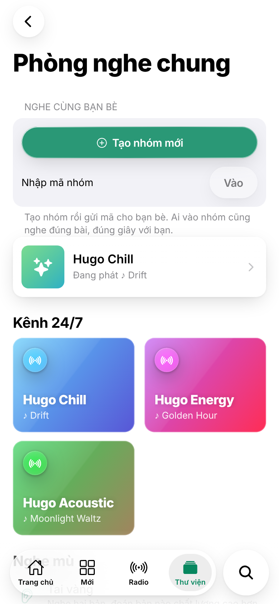
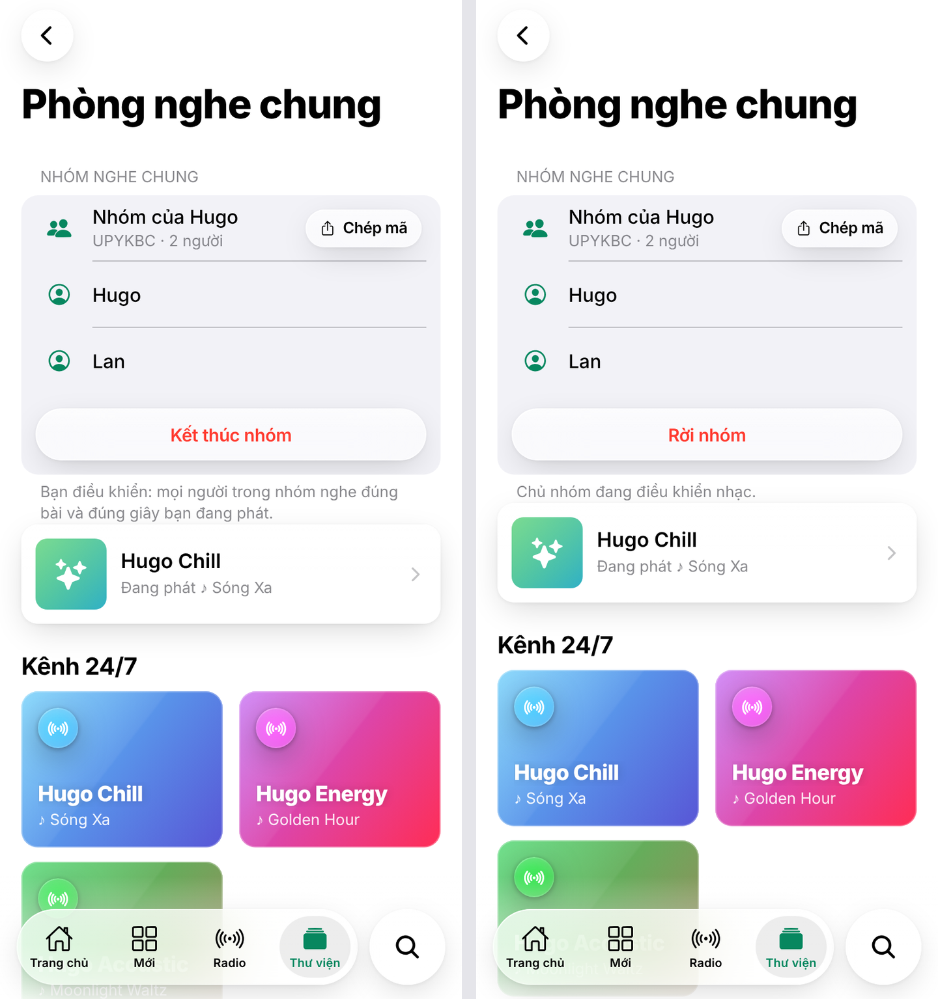
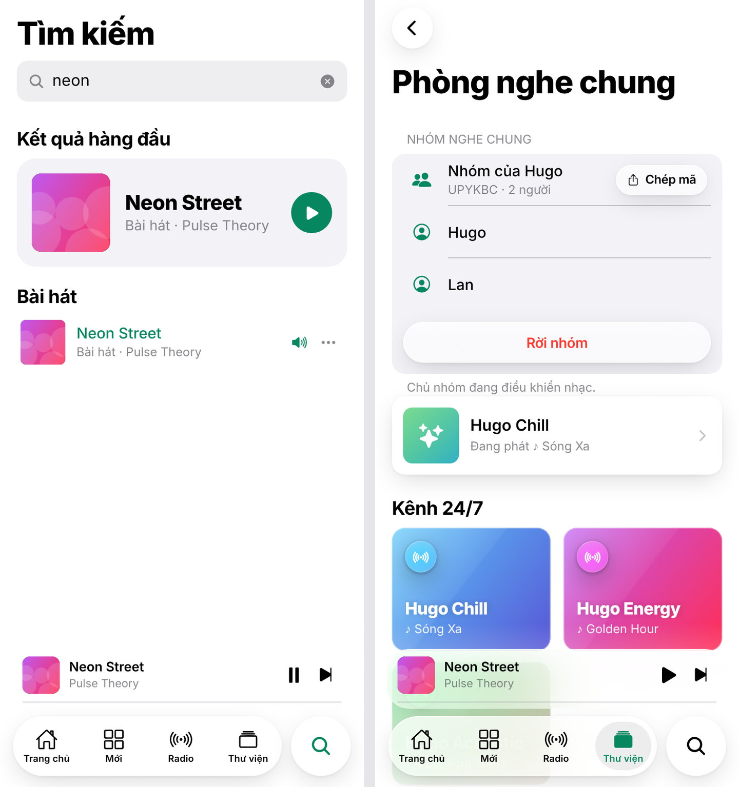

## Chương 15. Nhóm nghe chung và đồng bộ nhiều thiết bị

### Chương này làm gì

Hai tính năng dùng chung một cơ chế:

1. **Nhóm nghe chung.** Bấm *Tạo nhóm mới* để nhận mã 6 ký tự, gửi cho bạn bè. Ai nhập mã sẽ vào nhóm, thấy những người đang nghe, và nghe đúng bài, đúng giây với chủ nhóm. Chủ nhóm phát, dừng, tua, đổi bài; mọi máy làm theo.
2. **Đồng bộ các thiết bị của chính mình.** Bật *Đồng bộ* trên laptop và điện thoại: thao tác ở máy này, máy kia làm theo. Nghe ở nhà trên máy tính, ra đường mở điện thoại nghe tiếp.

### Để làm gì

Nghe nhạc là việc xã hội: nghe cùng người yêu ở xa, cùng nhóm bạn trong một buổi học, cùng đồng nghiệp lúc làm việc. Đài 24/7 (chương 13) là nghe cùng người lạ theo danh sách có sẵn; nhóm là nghe cùng người quen, theo nhạc người chủ nhóm chọn.

### Phân tích kỹ thuật

**Truyền trạng thái phát giữa các máy:**

| Cách | Ghi chú |
|---|---|
| Ghi trạng thái vào bảng, máy khác nghe Postgres Changes | Mỗi lần tua là một lượt ghi database; chậm, tốn |
| Server WebSocket riêng giữ "phòng" | Thêm server; khởi động lại là mất phòng |
| **Kênh Realtime riêng tư + Broadcast + Presence** | Tin nhắn đi thẳng giữa các máy qua Realtime, không ghi database; quyền vào kênh là chính sách RLS trên `realtime.messages` |

**Cách giữ đúng giây:** không gửi "đang ở giây 42" mà gửi **"ở giây 42 tại thời điểm T theo giờ máy chủ"**. Máy nhận tự cộng thời gian đã trôi qua, nên tin tới chậm vài trăm mili giây vẫn khớp. Sau đó mỗi vài giây so vị trí thật với vị trí mong đợi: lệch ít thì chỉnh tốc độ phát rất nhẹ (tai không nhận ra), lệch nhiều thì tua.

**Ai được điều khiển:**

| Chế độ | Ai điều khiển |
|---|---|
| Đồng bộ thiết bị (`workspace:<id người dùng>`) | Máy nào cũng điều khiển được: đều là của mình |
| Nhóm (`group:<id nhóm>`) | **Chỉ chủ nhóm** phát lệnh; thành viên phát theo. Tránh cảnh năm người cùng bấm đổi bài |

### Chọn gì, vì sao

**Database chỉ lưu "nhóm nào, ai là thành viên". Trạng thái phát đi qua kênh Realtime riêng tư. Chính sách RLS trên `realtime.messages` chỉ cho thành viên vào kênh nhóm, và chỉ cho chủ tài khoản vào kênh đồng bộ của mình.** Cùng một module `workspace.ts` phục vụ cả hai chế độ, chỉ khác tên kênh.

### Làm từng bước

**Bước 1: bảng nhóm và thành viên.**

```sql
-- supabase/migrations/20261018001300_groups.sql (trích)
create table public.listening_groups (
  id         uuid primary key default gen_random_uuid(),
  code       text not null unique check (code ~ '^[A-Z2-9]{6}$'),
  name       text not null,
  host_id    uuid not null default auth.uid() references auth.users (id) on delete cascade,
  created_at timestamptz not null default now(),
  ended_at   timestamptz
);

create table public.group_members (
  group_id uuid not null references public.listening_groups (id) on delete cascade,
  user_id  uuid not null default auth.uid() references auth.users (id) on delete cascade,
  primary key (group_id, user_id)
);
```

**Bước 2: "tôi có trong nhóm không?" là một hàm.** Chính sách của `group_members` không thể tự hỏi lại chính bảng đó (RLS đệ quy). Gói câu hỏi vào hàm `security definer`, mọi chính sách gọi hàm.

```sql
create or replace function public.is_group_member(p_group_id uuid) returns boolean
language sql stable security definer set search_path = '' as $$
  select exists (select 1 from public.group_members where group_id = p_group_id and user_id = auth.uid())
$$;

create policy "members see their groups" on public.listening_groups for select to authenticated
  using ((select public.is_group_member(id)));
```

**Bước 3: tạo nhóm và vào nhóm bằng mã.** Mã 6 ký tự bỏ các chữ dễ nhầm (0 và O, 1 và I). Mã hết hạn sau 24 giờ.

```sql
create or replace function public.create_group(p_name text) returns public.listening_groups
language plpgsql security definer set search_path = '' as $$
declare v_group public.listening_groups; v_code text;
  alphabet constant text := 'ABCDEFGHJKLMNPQRSTUVWXYZ23456789';
begin
  if auth.uid() is null or public.is_guest() then raise exception 'sign in to create a group' using errcode = '42501'; end if;
  loop
    select string_agg(substr(alphabet, 1 + floor(random() * length(alphabet))::int, 1), '') into v_code from generate_series(1, 6);
    exit when not exists (select 1 from public.listening_groups where code = v_code);
  end loop;
  insert into public.listening_groups (code, name) values (v_code, p_name) returning * into v_group;
  insert into public.group_members (group_id) values (v_group.id);
  return v_group;
end;
$$;
```

`join_group(p_code)` tìm nhóm còn hiệu lực theo mã rồi thêm người gọi vào `group_members`. Khách ẩn danh cũng vào được nhóm (chỉ nghe theo), nhưng phải đăng nhập mới tạo được nhóm.

**Bước 4: quyền trên kênh riêng tư.** `realtime.topic()` là tên kênh người dùng xin vào. Kênh nhóm có dạng `group:<id>`, nên cắt phần id ra để hỏi `is_group_member`.

```sql
create policy "members join their group channel" on realtime.messages for select to authenticated
  using ((select realtime.topic()) like 'group:%'
         and (select public.is_group_member(substr((select realtime.topic()), 7)::uuid)));

-- kênh đồng bộ thiết bị: chỉ chính chủ
create policy "users join their own workspace channel" on realtime.messages for select to authenticated
  using ((select realtime.topic()) = 'workspace:' || (select auth.uid())::text);
```

Hai chính sách `for insert` tương ứng cho phép gửi tin trên kênh (đầy đủ trong migration).

**Bước 5: một module cho cả hai chế độ.** `private: true` buộc Realtime kiểm quyền; `broadcast: { self: false }` để máy không nhận lại tin của chính mình; Presence cho danh sách người đang nghe.

```ts
// app/src/rooms/workspace.ts (trích)
export async function joinSyncChannel(topic: string, device: string, me: { name?: string }, h: Handlers) {
  await supabase.realtime.setAuth();
  channel = supabase.channel(topic, { config: { private: true, broadcast: { self: false }, presence: { key: device } } });
  channel
    .on('broadcast', { event: 'play_sync' }, ({ payload }) => h.onState(payload))
    .on('broadcast', { event: 'state_request' }, () => h.onStateRequest())
    .on('presence', { event: 'sync' }, () => h.onMembers(Object.values(channel!.presenceState()).map((p: any) => p[0])))
    .subscribe(async (status) => {
      if (status !== 'SUBSCRIBED') return;
      await channel!.track({ name: me.name });
      channel!.send({ type: 'broadcast', event: 'state_request', payload: {} });   // "đang phát gì?"
    });
}
```

**Bước 6: chọn kênh và luật điều khiển trong store.**

```ts
// app/src/store/useStore.ts (trích)
const topic = group ? `group:${group.id}` : `workspace:${user._id}`;

async function emitWorkspaceSync(playing?: boolean) {
  // ...
  if (group && group.hostId !== user._id) return;   // trong nhóm, chỉ chủ nhóm phát lệnh
  timeline = { songId: currentSong._id, pos, at: serverNow(), playing, device: DEVICE };
  sendSyncState({ ...timeline, queue: queue.map((s) => s._id).slice(0, 200), queueIndex });
}

const expectedOf = (t: Timeline) => () => t.pos + (t.playing ? (serverNow() - t.at) / 1000 : 0);
```

**Bước 7: giao diện nhóm.** Ở Thư viện → Phòng nghe chung: nút *Tạo nhóm mới*, ô nhập mã, và khi đã vào nhóm thì có danh sách người đang nghe, nút *Mời* (chia sẻ mã) và *Rời nhóm* (chủ nhóm: *Kết thúc nhóm*). Màn hình dựng bằng `InsetGroup`, `ListRow`, `TextField`, `ActionButton` của kit (chương 17).

### Kết quả







### Kiểm tra

- Tài khoản A tạo nhóm, tài khoản B nhập mã: cả hai thấy nhau trong danh sách. A đổi bài, tua: B làm theo trong vòng một giây. B bấm tua: không có gì thay đổi ở A.
- Tài khoản C không có trong nhóm thử `supabase.channel('group:<id>', { config: { private: true } }).subscribe()`: lỗi quyền, không nhận tin nào.
- Cùng tài khoản ở hai trình duyệt, bật Đồng bộ: thao tác ở bên nào bên kia cũng làm theo.

### Khi nào đổi

- **Muốn mọi người trong nhóm cùng điều khiển** (bữa tiệc): thêm cột `everyone_controls` vào `listening_groups` và bỏ điều kiện `group.hostId !== user._id` khi cột bật.
- **Muốn hàng đợi chung có bỏ phiếu như đài:** dùng lại `station_requests` theo `group_id`.
- **Muốn "nghe tiếp" cả khi máy kia đã tắt:** lưu trạng thái cuối vào một bảng mỗi 30 giây; máy mới đọc bảng nếu không ai trả lời `state_request`.

### Code của chương

Các file chương này viết, trong repo đã clone ở phần Mở đầu:

- `supabase/migrations/20261018001300_groups.sql`
- `app/src/rooms/workspace.ts`
- `app/src/store/useStore.ts`
