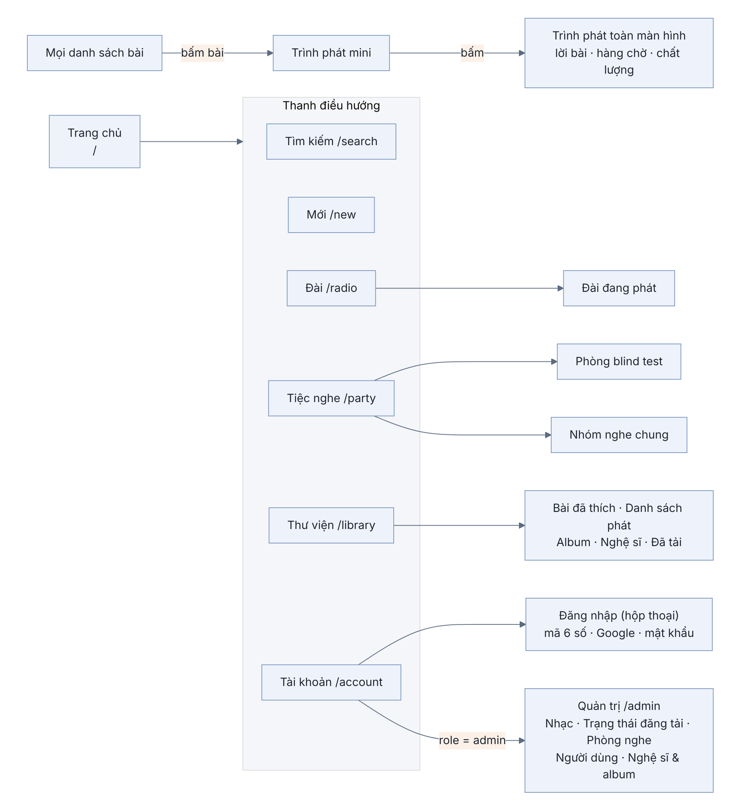
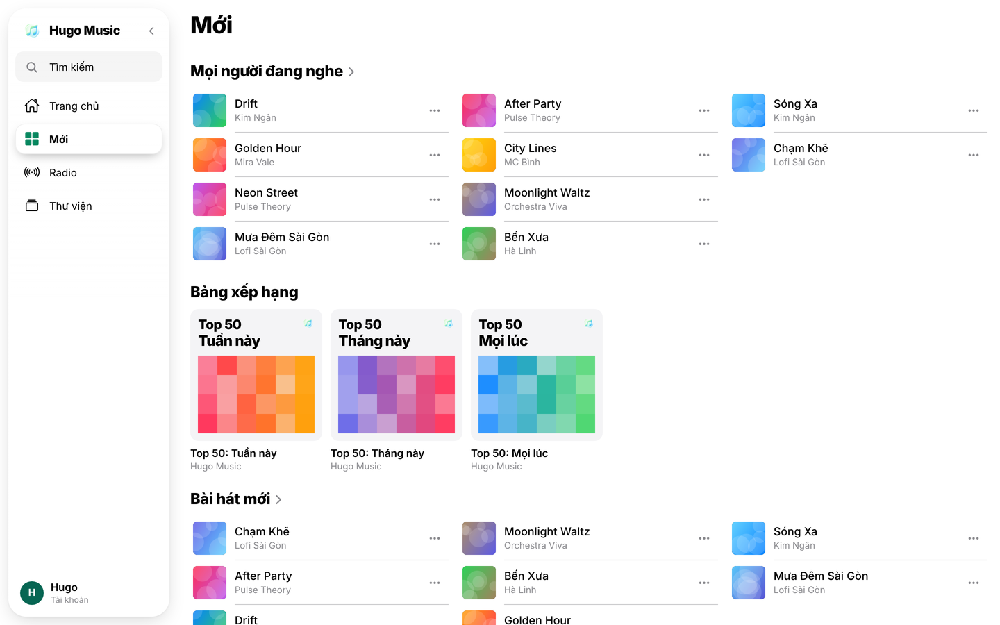
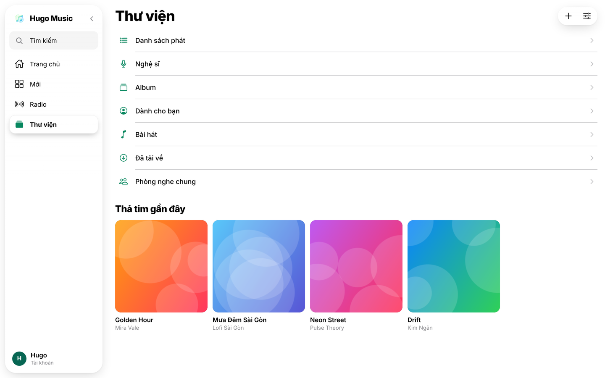
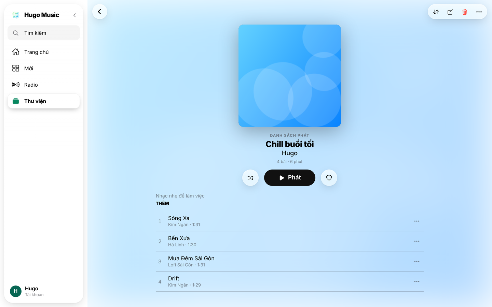

## Chương 16. Một app cho web, iOS và Android

### Chương này làm gì

Dựng app Expo SDK 58 với bộ giao diện kính mờ **hugo-music**: trang chủ, Mới, Radio, Thư viện, Tìm kiếm, trình phát đầy đủ. Một mã nguồn chạy trên trình duyệt, iPhone và điện thoại Android, nói chuyện với Supabase qua lớp dữ liệu ở chương 5 tới 15.

### Để làm gì

Viết ba app riêng (web React, iOS Swift, Android Kotlin) là gấp ba công sức và ba bộ lỗi. Người nghe lại muốn trải nghiệm giống nhau ở mọi nơi.

### Phân tích kỹ thuật

| Cách | Mạnh | Yếu |
|---|---|---|
| Web (React) + app riêng (React Native) | Mỗi bên tối ưu riêng | Hai bộ màn hình giống hệt nhau phải sửa song song |
| Flutter | Một mã nguồn, vẽ đẹp | Ngôn ngữ Dart, bản web nặng; không dùng chung code TypeScript với backend |
| **Expo (React Native + react-native-web)** | Một mã nguồn TypeScript cho ba nền tảng; build iOS/Android trên đám mây (EAS) không cần máy Mac; cập nhật JS qua mạng không cần duyệt lại app store | Một vài thứ phải viết riêng cho web (trình phát HLS) |

**Bộ giao diện:**

| Cách | Ghi chú |
|---|---|
| Thư viện có sẵn (React Native Paper, Tamagui) | Nhanh, nhưng app trông giống app khác |
| **Bộ giao diện tự làm `hugo-music`** | Kính mờ (frosted glass) nhất quán ở mọi nền tảng: dùng `expo-glass-effect` trên iOS mới, `expo-blur` ở nơi khác; token màu, khoảng cách, chữ dùng chung |

### Chọn gì, vì sao

**Một dự án Expo SDK 58 (React Native 0.88, React 19.3) duy nhất trong thư mục `app/`; giao diện từ `packages/ui` (hugo-music); trạng thái bằng Zustand; dữ liệu qua `app/src/api/api.ts`.** Màn hình không gọi Supabase trực tiếp mà gọi `api.*`, nên đổi backend chỉ sửa một file.

### Sơ đồ điều hướng



Sáu mục của thanh điều hướng là sáu đường dẫn web, nên mở thẳng `/radio` hay bấm nút quay lại của trình duyệt đều đúng. Trình phát không phải một màn hình: nó nằm trên mọi màn hình và giữ nhạc khi chuyển trang. Trang quản trị chỉ hiện khi `app_metadata.role = 'admin'`; RLS vẫn chặn ở database nếu ai đó gõ thẳng `/admin`.

### Làm từng bước

**Bước 1: cấu trúc mã nguồn của app.**

```text
app/src/
├─ api/          supabase.ts (client), api.ts (mọi lượt gọi dữ liệu), database.types.ts (sinh tự động)
├─ store/        useStore.ts: người dùng, danh mục, hàng đợi phát, thư viện (Zustand)
├─ audio/        audioEngine (expo-audio trên điện thoại, hls.js trên web), chuyển bài mượt
├─ rooms/        đài 24/7, blind test, đồng bộ nhiều máy (Realtime)
├─ screens/      Home, New, Rooms (Radio), Library, Search, Player, Account, Auth, Admin
├─ navigation/   thanh tab dưới (điện thoại) hoặc thanh bên (máy tính)
└─ ui/           phần mở rộng của hugo-music riêng cho app
```

**Bước 2: khung app, biến môi trường, Metro, gốc của app** đã dựng ở chương Ứng dụng 1; trang chủ và đăng nhập ở Ứng dụng 2 và 3. Chương này ráp phần còn lại và thêm hai thứ vào `App.tsx`: chế độ sáng, tối theo lựa chọn của người dùng (`themeMode` trong store) và `loadMeta()` nạp thể loại, giấy phép từ `get_meta()` lúc mở app.

**Bước 3: thêm mix theo thể loại vào trang chủ.** Các kệ (mix theo thể loại, mới phát hành, nghệ sĩ) tính từ danh sách bài trong store bằng `useMemo`, không gọi thêm API. Mix theo thể loại dùng chính regex trong bảng `genre_groups`, nên thêm một nhóm thể loại trong database là trang chủ có thêm một mix.

```ts
// app/src/screens/Home/useHomeSections.ts (trích)
const mixes = groups.map((g) => ({
  key: g.key, title: `${groupLabel(g)} Mix`, colors: g.colors,
  songs: music.filter((s) => g.match.test(s.genre || '')).slice(0, 40),
})).filter((m) => m.songs.length >= 5);
```

**Bước 4: chạy.**

```bash
pnpm web                         # trình duyệt, http://localhost:8081
pnpm --filter @hugo/app start    # quét mã QR bằng Expo Go trên điện thoại
pnpm build:web                   # bản web tĩnh trong app/dist
```

### Kết quả







### Kiểm tra

```bash
pnpm --filter @hugo/app typecheck
pnpm build:web && npx serve app/dist     # mở bản build tĩnh, mọi màn hình hiện dữ liệu thật
```

### Thực hành

1. Chạy app trên điện thoại bằng Expo Go (`pnpm dev`, quét mã QR). So bố cục với bản web.
2. Thêm một mục vào thanh bên (ví dụ "Lịch sử") trên máy tính, và kiểm tra nó xuất hiện đúng chỗ trên thanh tab dưới của điện thoại.

### Tự kiểm

1. Một mã nguồn chạy được web, iOS và Android nhờ những thành phần nào?
2. Phiên đăng nhập trên web và trên điện thoại được lưu ở đâu?
3. Khi nào một màn hình nên có bản riêng cho máy tính và bản riêng cho điện thoại?

### Khi nào đổi

- **Cần SEO cho trang nghệ sĩ, trang bài hát:** bật xuất web theo từng trang tĩnh của Expo Router (`web.output: "static"`) hoặc thêm một Edge Function chèn thẻ xem trước cho bot mạng xã hội.
- **Màn hình chậm trên điện thoại cũ:** danh sách dài chuyển sang `FlashList`, ảnh bìa dùng `expo-image` có cache.

### Code của chương

Các file chương này viết, trong repo đã clone ở phần Mở đầu:

- `app/src/screens/Home/useHomeSections.ts`
- `app/src/App.tsx`
