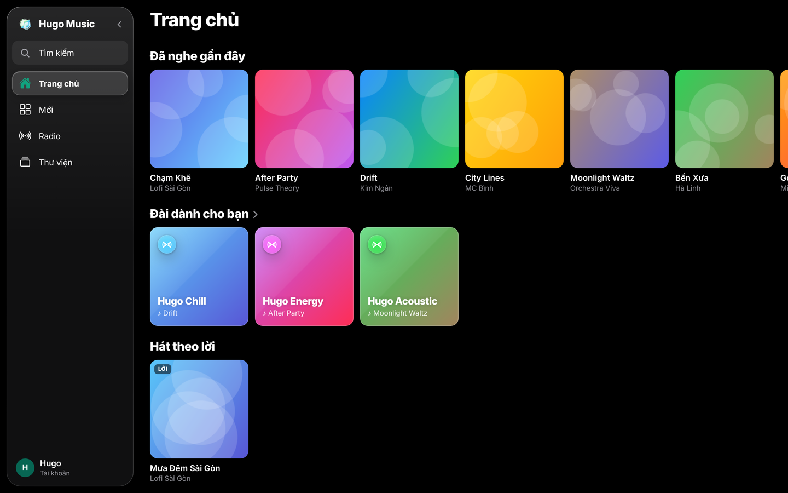
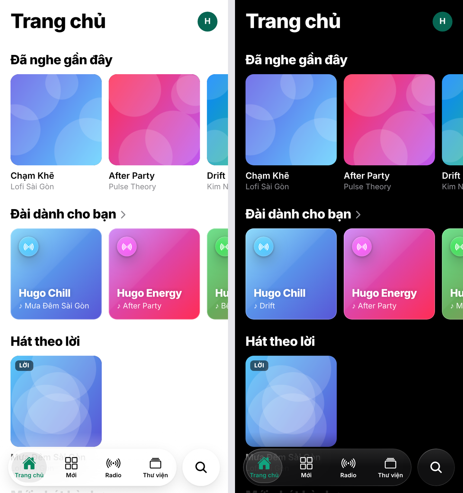

## Chương 17. Chuẩn giao diện và trải nghiệm

### Chương này làm gì

Đặt ra bộ luật giao diện mà mọi màn hình của Hugo Music tuân theo: lưới khoảng cách, thang chữ, vùng chạm, điều hướng, chuyển động, chế độ tối, trợ năng. Luật nằm trong bộ token và component của **hugo-music**, nên màn hình mới làm đúng ngay từ đầu mà không cần nhớ.

### Để làm gì

Người dùng không đọc hướng dẫn. Họ mong một nút trông như nút, một danh sách cuộn như danh sách, cử chỉ vuốt quay lại hoạt động như mọi app khác trên máy họ. Một app "lạ tay" bị xóa trong vài phút, dù tính năng tốt đến đâu.

### Phân tích kỹ thuật

| Cách làm giao diện | Mạnh | Yếu |
|---|---|---|
| Mỗi màn hình tự chọn màu, cỡ chữ, khoảng cách | Nhanh lúc đầu | Mỗi màn hình một kiểu; sửa một màu phải sửa mười chỗ |
| Thư viện giao diện có sẵn (Material, Paper) | Đủ component | Trông giống hàng nghìn app khác; khó làm hiệu ứng kính mờ đẹp |
| **Bộ token + component tự làm, theo các nguyên tắc giao diện nền tảng đã được kiểm chứng** | Nhất quán, mang bản sắc riêng; người dùng thấy quen tay | Phải tự giữ kỷ luật: màn hình không được tự chế giá trị |

### Chọn gì, vì sao

**Mọi giá trị hình ảnh lấy từ token; mọi màn hình ghép từ component của kit; mười nguyên tắc dưới đây là "luật".** Các nguyên tắc này là những quy ước giao diện di động đã thành chuẩn chung: người dùng đã quen chúng ở hầu hết các app họ dùng hằng ngày, nên app tuân theo sẽ "dùng là biết".

### Mười nguyên tắc

| # | Nguyên tắc | Trong Hugo Music |
|---|---|---|
| 1 | **Nội dung là trung tâm.** Giao diện lùi lại để ảnh bìa, tên bài nổi lên | Thanh điều hướng và trình phát mini là kính mờ trong suốt, nội dung cuộn bên dưới |
| 2 | **Tiêu đề lớn ở đầu màn hình cấp cao nhất**, thu nhỏ khi cuộn | Component `LargeTitle` (34 pt) ở Trang chủ, Mới, Radio, Thư viện |
| 3 | **Vùng chạm tối thiểu 44 × 44 điểm** | Token `TOUCH = 44`; `ListRow` cao tối thiểu 56 |
| 4 | **Lưới khoảng cách 4 điểm** | Token `space`: 2, 4, 8, 12, 16, 20, 24, 32; lề ngang `GUTTER = 18` trên điện thoại |
| 5 | **Thang chữ cố định, có vai trò** | Token `type`: largeTitle 34, title1 28, title2 22, title3 20, headline 17 đậm, body 17, callout 16, subhead 15, footnote 13, caption 12 |
| 6 | **Điều hướng theo nền tảng**: thanh tab dưới trên điện thoại, thanh bên trên màn hình rộng; vuốt từ cạnh trái để quay lại | `GlassTabBar` và `NavigationSidebar` đổi theo độ rộng; stack điều hướng gốc của từng nền tảng |
| 7 | **Danh sách nhóm trong thẻ bo góc** (inset grouped) cho cài đặt và biểu mẫu | `InsetGroup` + `ListRow` ở Tài khoản, nhóm nghe chung, trang quản trị |
| 8 | **Chế độ sáng, tối và theo hệ thống** | `HugoProvider scheme="system"`; mọi màu lấy từ `useHugoTheme().colors`, không viết mã màu trong màn hình |
| 9 | **Chuyển động có ý nghĩa và ngắn** (140 tới 420 ms); tôn trọng cài đặt *giảm chuyển động* | Hiệu ứng "giọt nước" khi chạm (`useDroplet`); khi máy bật giảm chuyển động thì bỏ hiệu ứng nảy |
| 10 | **Trợ năng là mặc định**: nút chỉ có biểu tượng phải có nhãn đọc màn hình; tương phản chữ đủ cao; cỡ chữ to theo cài đặt máy | `accessibilityLabel` bắt buộc cho `GlassButton`; màu chữ phụ đạt tỉ lệ tương phản 4.5:1 |

### Làm từng bước

**Bước 1: màn hình chỉ dùng token.** Sai: `padding: 16, color: '#8E8E93'`. Đúng: lấy từ token và theme, để đổi một chỗ là đổi cả app.

```tsx
// đúng: mọi giá trị đến từ kit
import { space, type, useHugoTheme } from 'hugo-music';

const { colors } = useHugoTheme();
<Text style={[type.footnote, { color: colors.textSecondary, marginTop: space.sm }]}>{subtitle}</Text>
```

**Bước 2: nhóm thao tác trong thẻ bo góc.** Màn hình nhóm nghe chung (chương 15) là ví dụ điển hình: tiêu đề nhóm, hàng có biểu tượng, chú thích dưới thẻ.

```tsx
<InsetGroup header="Nghe cùng bạn bè" footer="Tạo nhóm rồi gửi mã cho bạn bè.">
  <ActionButton icon="add-circle-outline" title="Tạo nhóm mới" onPress={create} />
  <TextField value={code} onChangeText={setCode} placeholder="Nhập mã nhóm" autoCapitalize="characters" />
</InsetGroup>
```

**Bước 3: tôn trọng cài đặt giảm chuyển động.** React Native báo cài đặt này qua `AccessibilityInfo`; khi bật, hiệu ứng chạm chỉ đổi độ mờ thay vì nảy.

```ts
// packages/ui/src/glass/useReducedMotion.ts
import { useEffect, useState } from 'react';
import { AccessibilityInfo } from 'react-native';

export function useReducedMotion() {
  const [reduced, setReduced] = useState(false);
  useEffect(() => {
    AccessibilityInfo.isReduceMotionEnabled().then(setReduced);
    const sub = AccessibilityInfo.addEventListener('reduceMotionChanged', setReduced);
    return () => sub.remove();
  }, []);
  return reduced;
}
```

**Bước 4: phản hồi bằng rung nhẹ cho thao tác quan trọng** (thích bài, vào nhóm, bỏ phiếu). Chỉ trên điện thoại, chỉ cho thao tác người dùng chủ động.

```ts
import * as Haptics from 'expo-haptics';
if (Platform.OS !== 'web') Haptics.impactAsync(Haptics.ImpactFeedbackStyle.Light);
```

**Bước 5: trạng thái trống và trạng thái lỗi có hướng dẫn.** Không bao giờ để màn hình trắng: `EmptyState` nói điều gì đang xảy ra và người dùng làm gì tiếp; `ErrorText` hiện câu dễ hiểu, không hiện mã lỗi kỹ thuật.

### Kết quả





### Kiểm tra

Danh sách soát trước khi một màn hình mới được merge:

- [ ] Không có mã màu, cỡ chữ hay khoảng cách viết tay (tìm `#[0-9A-F]{6}` và số lẻ trong `style`).
- [ ] Mọi vùng chạm từ 44 điểm trở lên.
- [ ] Mọi nút chỉ có biểu tượng có `accessibilityLabel`.
- [ ] Chạy thử ở chế độ tối, cỡ chữ lớn nhất và giảm chuyển động.
- [ ] Bật trình đọc màn hình, đi hết màn hình chỉ bằng vuốt: thứ tự đọc hợp lý.

### Khi nào đổi

- **Muốn thương hiệu riêng mạnh hơn:** chỉ đổi token màu và gradient; cấu trúc, khoảng cách và vùng chạm giữ nguyên vì đó là thói quen của người dùng.
- **Lên máy tính bảng và màn hình lớn:** thêm bố cục hai cột (danh sách bên trái, chi tiết bên phải) thay vì phóng to giao diện điện thoại.

### Code của chương

Các file chương này viết, trong repo đã clone ở phần Mở đầu:

- `packages/ui/src/glass/useReducedMotion.ts`
