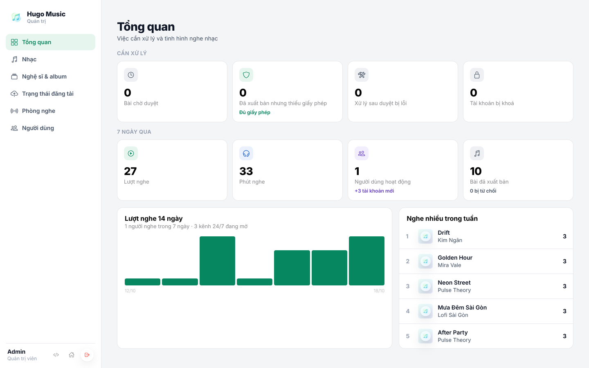
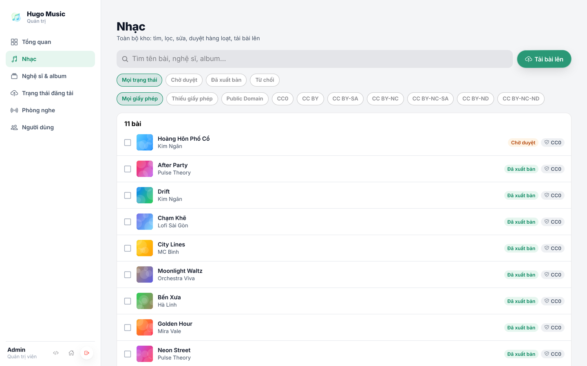
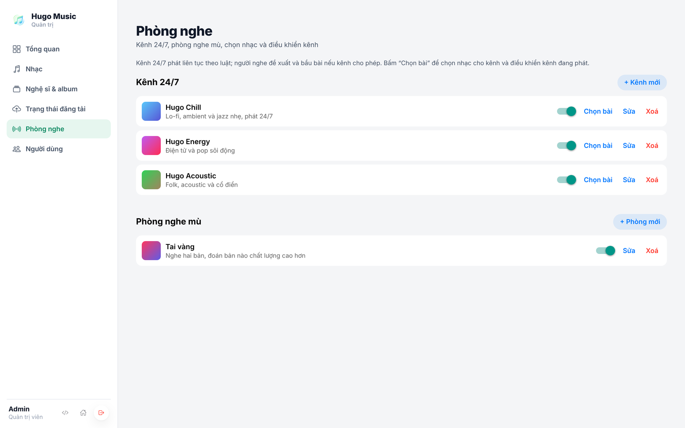
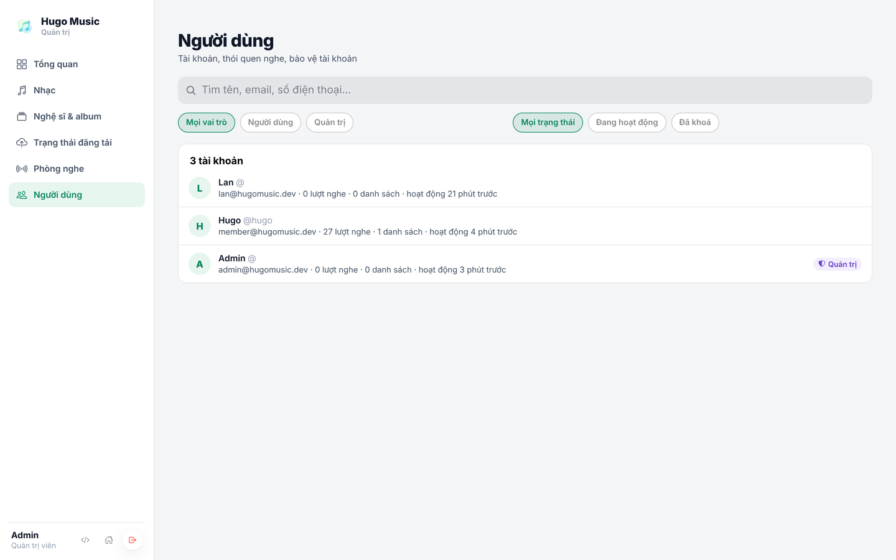
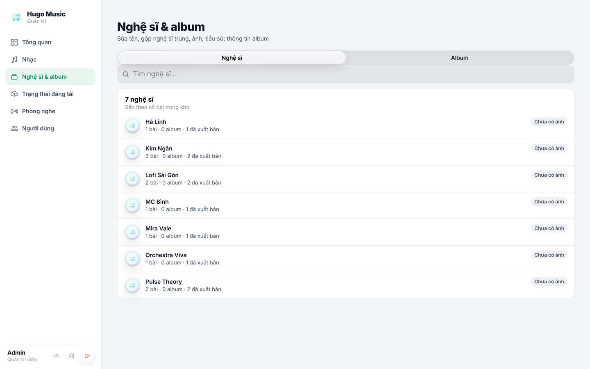

## Chương 18. Trang quản trị

### Chương này làm gì

Trang `/admin` cho tài khoản admin: tổng quan số liệu, hàng chờ duyệt, theo dõi từng bài đang xử lý ở bước nào, thử lại bài lỗi, quản lý đài.

### Để làm gì

Admin là người nhập danh mục mỗi ngày. Nếu phải mở dashboard Supabase để sửa dữ liệu bằng tay, sớm muộn sẽ sửa nhầm. Trang quản trị chỉ cho làm những việc đúng luật, bằng đúng các hàm SQL đã có.

### Phân tích kỹ thuật

| Cách | Ghi chú |
|---|---|
| Dùng dashboard Supabase làm trang quản trị | Có sẵn, nhưng sửa thẳng bảng, bỏ qua luật (duyệt mà không đưa việc vào hàng đợi) |
| Công cụ admin dựng sẵn (Retool, Appsmith) | Nhanh, thêm dịch vụ và chi phí |
| **Màn hình admin ngay trong app** | Dùng lại lớp dữ liệu và giao diện; mọi thao tác đi qua RLS và hàm SQL như app thường |

### Chọn gì, vì sao

**Màn hình Admin trong app, ẩn với người không phải admin.** Ẩn chỉ để gọn giao diện; bảo vệ thật nằm ở RLS và ở dòng `if not public.is_admin()` đầu mỗi hàm. Người thường mở `/admin` cũng chỉ thấy danh sách rỗng.

### Làm từng bước

**Bước 1: hàng chờ duyệt.** Chính sách "admins manage songs" (chương 7) cho admin đọc cả bài chưa phát hành.

```ts
// app/src/api/api.ts (trích)
getReviewQueue: async (status: 'pending' | 'published' | 'rejected') =>
  must(await supabase.from('songs').select(SONG_COLUMNS).eq('status', status)
    .order('created_at', { ascending: false }).limit(200)).map(toSong),
```

**Bước 2: theo dõi xử lý.** Đọc `pipeline_runs` kèm tên bài; trạng thái và bước hiện tại do worker ghi (chương 10).

```ts
pipeline: async () =>
  must(await supabase.from('pipeline_runs')
    .select('id, status, step, error, attempts, created_at, finished_at, song:songs(id, title, status)')
    .order('created_at', { ascending: false }).limit(100)),
```

**Bước 3: thử lại bài lỗi.** Bài `failed` duyệt lại bằng chính `review_song()`: hàm cho phép chuyển từ `failed` sang `processing` và đưa việc mới vào hàng đợi.

```ts
retryPipeline: (songId: string) => api.reviewSong(songId, 'publish'),
```

**Bước 4: tổng quan.** Đếm bằng `count: 'exact', head: true`: chỉ lấy con số, không tải dòng nào.

```ts
overview: async () => {
  const count = async (q: any) => (await q).count ?? 0;
  const [published, pending, failed, plays] = await Promise.all([
    count(supabase.from('songs').select('*', { count: 'exact', head: true }).eq('status', 'published')),
    count(supabase.from('songs').select('*', { count: 'exact', head: true }).eq('status', 'pending')),
    count(supabase.from('songs').select('*', { count: 'exact', head: true }).eq('status', 'failed')),
    count(supabase.from('plays').select('*', { count: 'exact', head: true })),
  ]);
  return { published, pending, failed, plays };
},
```

**Bước 5: cập nhật tự động khi worker xong.** Màn hình theo dõi nghe Postgres Changes trên `pipeline_runs`: RLS chỉ gửi thay đổi cho admin, nên bật bảng này trong publication `supabase_realtime` là đủ.

```sql
alter publication supabase_realtime add table public.pipeline_runs;
```

```ts
supabase.channel('admin-pipeline')
  .on('postgres_changes', { event: '*', schema: 'public', table: 'pipeline_runs' }, reload)
  .subscribe();
```

### Kết quả











### Kiểm tra

- Đăng nhập tài khoản thường, mở `/admin`: không có dữ liệu, gọi `review_song` báo `only admins can review songs`.
- Duyệt một bài, để worker chạy: bảng theo dõi tự chuyển qua các bước `download → analyze → psl → hls → done` mà không cần tải lại trang.

### Khi nào đổi

- **Cần quản lý người dùng (khóa tài khoản, xóa):** các thao tác này cần secret key; viết một Edge Function `admin-users` kiểm `is_admin` rồi gọi `auth.admin.*`.
- **Nhiều admin, cần biết ai đã làm gì:** thêm bảng nhật ký và trigger ghi lại mọi thay đổi trên `songs`.

### Code của chương

Các file chương này viết, trong repo đã clone ở phần Mở đầu:

- `app/src/api/api.ts`
