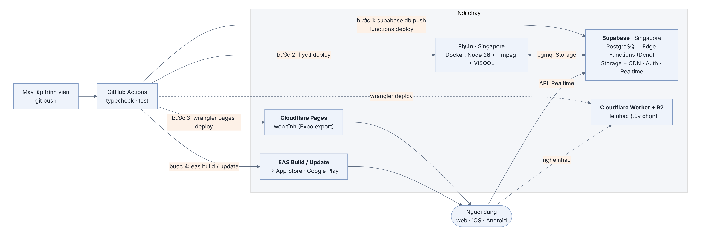

## Chương 20. Deploy: đưa từng phần lên đúng chỗ

### Chương này làm gì

Bốn phần, bốn nơi chạy, một quy trình tự động: database và Edge Function lên Supabase, worker lên Fly.io, web lên Cloudflare Pages, app iOS và Android qua EAS. Mỗi lần merge vào nhánh `main`, GitHub Actions tự làm hết.

### Để làm gì

Deploy bằng tay dễ quên một bước: đẩy code app mà quên chạy migration là app gọi vào bảng chưa tồn tại. Một quy trình tự động chạy đúng thứ tự mỗi lần.

### Phân tích kỹ thuật

| Phần | Lựa chọn | Chọn |
|---|---|---|
| Database, Auth, Storage, Realtime, Edge Function | Supabase cloud; tự host bằng Docker | **Supabase cloud**, vùng Singapore |
| Worker (cần ffmpeg, chạy liên tục) | Fly.io, Render, Railway, một VPS | **Fly.io**: chạy từ Docker image, vùng Singapore, dừng máy khi rảnh để tiết kiệm |
| Web tĩnh | Cloudflare Pages, Vercel, Netlify | **Cloudflare Pages**: CDN toàn cầu, băng thông không giới hạn ở gói miễn phí |
| App iOS/Android | Build bằng Xcode/Android Studio; EAS | **EAS Build + EAS Update**: build trên đám mây, sửa JS gửi qua mạng không cần duyệt lại |

### Chọn gì, vì sao

**Thứ tự luôn là: database trước (migration chỉ *thêm*, không phá code cũ đang chạy) → Edge Function → worker → web → app.** Migration theo kiểu mở rộng rồi thu gọn: thêm cột mới, deploy code dùng cột mới, lần sau mới xóa cột cũ.

### Sơ đồ triển khai



Số trên mũi tên là thứ tự deploy: database trước, app sau cùng. Worker và Supabase cùng vùng Singapore để việc tải file gốc và ghi file đã mã hóa không đi xa. Nét đứt là phần tùy chọn của chương 23.

### Làm từng bước

**Bước 1: Docker image cho worker.** Node 26, ffmpeg, Python có ViSQOL. Không có bước build TypeScript.

```dockerfile
# worker/Dockerfile
FROM node:26-slim
RUN apt-get update && apt-get install -y --no-install-recommends ffmpeg python3 python3-venv \
 && python3 -m venv /opt/visqol && /opt/visqol/bin/pip install --no-cache-dir visqol-python \
 && rm -rf /var/lib/apt/lists/*
WORKDIR /app
COPY package.json ./
RUN npm install --omit=dev
COPY src ./src
COPY analyzers ./analyzers
ENV PSL_PYTHON=/opt/visqol/bin/python NODE_ENV=production
CMD ["node", "src/main.ts"]
```

```toml
# worker/fly.toml (trích)
app = "hugo-music-worker"
primary_region = "sin"

[[vm]]
  size = "shared-cpu-2x"
  memory = "2gb"
```

```bash
fly secrets set SUPABASE_URL=https://<ref>.supabase.co SUPABASE_SECRET_KEY=sb_secret_... --config worker/fly.toml
fly deploy --config worker/fly.toml
```

**Bước 2: quy trình tự động.** Có hai workflow. `ci.yml` chạy ở mọi lần push và pull request: cài đặt, kiểm tra kiểu, test, build web. Nó không cần khóa nào. `deploy.yml` chạy khi push lên `main`. Mỗi phần chỉ deploy khi bạn đã đặt biến bật phần đó; chưa đặt thì job được bỏ qua, không báo lỗi.

```yaml
# .github/workflows/deploy.yml (trích)
on:
  push: { branches: [main] }
  workflow_dispatch:                 # chạy tay: Actions → Deploy → Run workflow
jobs:
  supabase:
    if: ${{ vars.SUPABASE_PROJECT_REF != '' }}
    env:
      SUPABASE_ACCESS_TOKEN: ${{ secrets.SUPABASE_ACCESS_TOKEN }}
      SUPABASE_DB_PASSWORD: ${{ secrets.SUPABASE_DB_PASSWORD }}
    steps:
      - run: supabase link --project-ref "${{ vars.SUPABASE_PROJECT_REF }}" --password "$SUPABASE_DB_PASSWORD"
      - run: supabase db push                     # 1. migration trước
      - run: supabase functions deploy --project-ref "${{ vars.SUPABASE_PROJECT_REF }}"   # 2. mọi Edge Function
  worker:
    needs: supabase
    if: ${{ vars.DEPLOY_WORKER == 'true' }}
    # 3. flyctl deploy --config worker/fly.toml
  edge:
    needs: supabase
    if: ${{ vars.DEPLOY_EDGE == 'true' }}
    # 4. wrangler deploy (Cloudflare Worker phát nhạc, chương 23)
  web:
    needs: supabase
    if: ${{ vars.CLOUDFLARE_PAGES_PROJECT != '' }}
    # 5. build web với EXPO_PUBLIC_*, rồi wrangler pages deploy
```

Vì sao không để job báo lỗi khi thiếu biến: repo công khai, ai fork về cũng chạy workflow. Báo lỗi đỏ ở mỗi lần push vì một phần chưa dùng tới chỉ làm người ta quen bỏ qua dấu đỏ, kể cả dấu đỏ thật.

**Đặt biến trên GitHub.** Vào repo → *Settings → Secrets and variables → Actions*. Thứ gì bí mật thì đặt ở tab *Secrets* (bị che trong log); thứ công khai thì đặt ở tab *Variables*.

| Bật phần | Variables | Secrets |
|---|---|---|
| Database + Edge Function | `SUPABASE_PROJECT_REF` | `SUPABASE_ACCESS_TOKEN`, `SUPABASE_DB_PASSWORD` |
| Worker (Fly.io) | `DEPLOY_WORKER` = `true` | `FLY_API_TOKEN` |
| Cloudflare Worker | `DEPLOY_EDGE` = `true`, `CLOUDFLARE_ACCOUNT_ID` | `CLOUDFLARE_API_TOKEN` |
| Web (Cloudflare Pages) | `CLOUDFLARE_PAGES_PROJECT`, `CLOUDFLARE_ACCOUNT_ID`, `SUPABASE_URL`, `SUPABASE_PUBLISHABLE_KEY` | `CLOUDFLARE_API_TOKEN` |

Mỗi giá trị lấy ở đâu: Phụ lục C. Đặt xong, vào *Actions → Deploy → Run workflow* để chạy thử mà không cần push.

**Bước 3: cấu hình Auth cho production.** Ở *Authentication → URL Configuration*: Site URL là tên miền web thật; thêm `hugomusic://auth` vào Redirect URLs cho app. Ở Google Cloud Console, thêm `https://<ref>.supabase.co/auth/v1/callback` vào Authorized redirect URIs.

**Bước 4: app iOS và Android.**

```bash
cd app
eas build --platform all --profile production    # build trên đám mây
eas submit --platform all                         # gửi lên App Store, Google Play
eas update --channel production -m "sửa lỗi"      # sửa JS sau này, không cần duyệt lại
```

### Kết quả


### Kiểm tra

```bash
supabase migration list --linked     # Local và Remote khớp
fly logs --config worker/fly.toml    # worker đang chờ việc
curl -sI https://<tên miền web> | head -1
```

### Thực hành

1. Push một nhánh có lỗi kiểu TypeScript cố ý, xem CI báo đỏ ở bước typecheck.
2. Build bản web (`pnpm build:web`) và mở thư mục `dist` bằng một server tĩnh bất kỳ.

### Tự kiểm

1. Mỗi phần của hệ thống (database, Edge Function, worker, web, app) được deploy lên đâu?
2. CI chạy những bước nào trước khi cho gộp code?
3. Sửa một lỗi giao diện trên app điện thoại đã phát hành thì có cần nộp lại cho App Store không?

### Khi nào đổi

- **Cần môi trường thử trước production:** bật Supabase Branching: mỗi pull request có một nhánh database riêng với migration của nó.
- **Worker xử lý không kịp:** `fly scale count 3`; hàng đợi tự chia việc.

### Code của chương

Các file chương này viết, trong repo đã clone ở phần Mở đầu:

- `worker/fly.toml`
- `.github/workflows/deploy.yml`
