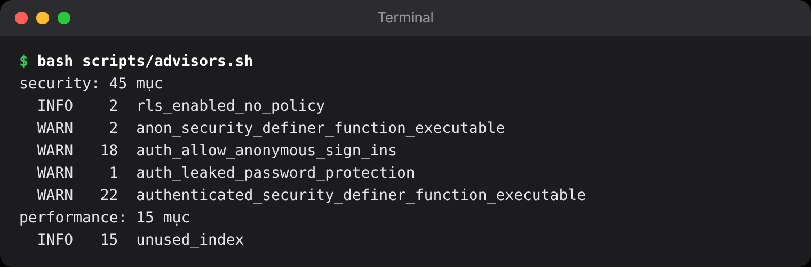

## Chương 21. Vận hành: theo dõi, sao lưu, chi phí

### Chương này làm gì

Ba việc sau ngày ra mắt: biết hệ thống đang khỏe hay không, không bao giờ mất dữ liệu, và giữ hóa đơn trong tầm kiểm soát.

### Để làm gì

App chạy được hôm nay chưa có nghĩa ngày mai vẫn chạy: một truy vấn chậm dần khi dữ liệu lớn lên, một bucket đầy dung lượng gói miễn phí, một worker chết mà không ai biết.

### Phân tích kỹ thuật

| Việc | Supabase có sẵn | Cần thêm |
|---|---|---|
| Lỗi bảo mật, thiếu index | **Advisors** (Security, Performance) trong dashboard | Không |
| Log API, Auth, Edge Function, Realtime | **Logs Explorer** | Không |
| Truy vấn chậm | **Query Performance** (dựa trên `pg_stat_statements`) | Không |
| Lỗi trong app | | Sentry cho app và worker |
| Worker còn sống | | Kiểm tra bằng SQL: việc nằm trong hàng đợi quá lâu |
| Sao lưu | Sao lưu hằng ngày (gói Pro: khôi phục về thời điểm bất kỳ) | Bản dump định kỳ sang nơi khác cho sự cố lớn |

### Chọn gì, vì sao

**Dùng công cụ có sẵn của Supabase trước; thêm Sentry cho lỗi phía app; một truy vấn SQL làm "nhịp tim" cho worker; dump database hằng đêm sang nơi lưu trữ khác bằng GitHub Actions.**

### Làm từng bước

**Bước 1: xem Advisors mỗi khi thêm migration.** Security Advisor báo bảng quên bật RLS, hàm thiếu `set search_path`, hàm `security definer` gọi được qua API; Performance Advisor báo khóa ngoại thiếu index, nhiều chính sách cùng chạy cho một hành động. Xem trên dashboard (*Advisors*) hoặc bằng dòng lệnh:

```bash
bash scripts/advisors.sh        # gọi Management API, gom theo loại cảnh báo
```

Lần chạy đầu trên project của sách báo 72 mục. Migration `20261018001700_advisor_fixes.sql` sửa những mục thật sự là lỗi:

| Cảnh báo | Sửa |
|---|---|
| Hàm trigger (`handle_new_user`, `sync_likes_count`, `broadcast_station_now`) gọi được qua `/rest/v1/rpc` | `revoke execute ... from public, anon, authenticated` |
| `server_now` thiếu `search_path` | `alter function ... set search_path = ''` |
| Chính sách admin `for all` chồng lên chính sách đọc công khai | Tách thành một chính sách đọc gộp và ba chính sách ghi chỉ admin |
| 12 khóa ngoại thiếu index | Thêm index |

Những mục còn lại là cố ý, và cần biết vì sao:

| Cảnh báo còn lại | Vì sao giữ |
|---|---|
| `authenticated_security_definer_function_executable` | Đây chính là API của app (`review_song`, `vote_blind`, `admin_*`...). Mỗi hàm tự kiểm quyền ở dòng đầu |
| `auth_allow_anonymous_sign_ins` | Khách nghe thử là tính năng (chương 6); chính sách nào cho khách đều đã xét `is_guest()` |
| `rls_enabled_no_policy` (`playback_grants`, `station_votes`) | Bảng chỉ ghi qua hàm; không chính sách nghĩa là client không đọc được, đúng ý |
| `unused_index` | Index vừa tạo chưa có truy vấn nào dùng; xem lại sau vài tuần chạy thật |

**Bước 2: nhịp tim của worker.** Việc nằm trong hàng đợi quá 15 phút mà chưa ai đọc nghĩa là không có worker nào đang chạy.

```sql
select count(*) as stuck
  from pgmq.q_media
 where enqueued_at < now() - interval '15 minutes' and read_ct = 0;
```

Đặt truy vấn này vào một lịch pg_cron 5 phút một lần, gọi Edge Function gửi cảnh báo (Slack, Telegram) khi `stuck > 0`.

**Bước 2b: dọn nhật ký của pg_cron.** Lịch chạy mỗi giây (blind test) ghi 86.400 dòng mỗi ngày vào `cron.job_run_details`. Một lịch nữa dọn nhật ký cũ:

```sql
-- supabase/migrations/20261018001800_cron_cleanup.sql
select cron.schedule('cron-log-cleanup', '17 * * * *',
  $$ delete from cron.job_run_details where end_time < now() - interval '1 day' $$);
```

**Bước 3: sao lưu ra khỏi nhà cung cấp.** Bản sao lưu của Supabase nằm cùng nhà cung cấp; một bản dump mã hóa hằng đêm sang nơi khác (Backblaze B2, Cloudflare R2) cho sự cố lớn. File nhạc gốc trong bucket `originals` không tạo lại được, nên sao lưu cùng.

```bash
supabase db dump --linked -f backup.sql --data-only
age -r "$AGE_PUBLIC_KEY" backup.sql > backup-$(date +%F).sql.age     # mã hóa trước khi tải đi
```

Một bản sao lưu chưa từng khôi phục thử thì chưa phải bản sao lưu: mỗi tháng khôi phục vào một project trống và đếm số dòng.

**Bước 4: chi phí.** Biết thứ gì đẩy hóa đơn lên:

| Thành phần | Tính tiền theo | Giữ thấp bằng |
|---|---|---|
| Supabase database | Gói + dung lượng | Index đúng, dọn khách ẩn danh (cron chương 9), không lưu file trong database |
| Supabase Storage | Dung lượng + băng thông ra | PSL bỏ mức bitrate thừa; ảnh bìa nén WebP; CDN cache |
| Edge Function | Số lượt gọi | Function chỉ trả playlist (rất nhỏ); nhạc đi thẳng từ Storage |
| Worker (Fly.io) | Thời gian máy chạy | Tự dừng máy khi hàng đợi trống |

Bảng giá thay đổi thường xuyên nên sách không in số tiền; xem trang giá của từng dịch vụ và đo bằng hóa đơn thật mỗi tháng. Chỉ số nên theo dõi là **chi phí trên 1.000 người nghe**, không phải tổng hóa đơn.

### Kết quả



### Kiểm tra

- Advisors: 0 mục mức *error*; mỗi mục *warn* còn lại nằm trong bảng "cố ý" ở trên.
- Tắt worker 20 phút, duyệt một bài: truy vấn nhịp tim trả `stuck = 1`.
- Khôi phục bản dump vào project trống: số dòng `songs`, `profiles` khớp với bản gốc.

### Tự kiểm

1. Kể ba loại cảnh báo Advisors đã sửa và ba loại cố ý giữ lại.
2. Truy vấn "nhịp tim" phát hiện worker chết bằng cách nào?
3. Vì sao lịch pg_cron chạy mỗi giây cần thêm một lịch dọn nhật ký?

### Khi nào đổi

- **Vượt giới hạn gói miễn phí** (dung lượng database, băng thông Storage, số người dùng hoạt động): lên gói Pro, đồng thời có thêm khôi phục về thời điểm bất kỳ.
- **Có người dùng ở châu Âu:** quy trình xóa dữ liệu theo yêu cầu (GDPR) đã có sẵn nhờ Edge Function `delete-account` và `on delete cascade`; ghi rõ thời gian giữ bản sao lưu trong chính sách quyền riêng tư.

### Code của chương

Các file chương này viết, trong repo đã clone ở phần Mở đầu:

- `supabase/migrations/20261018001800_cron_cleanup.sql`
