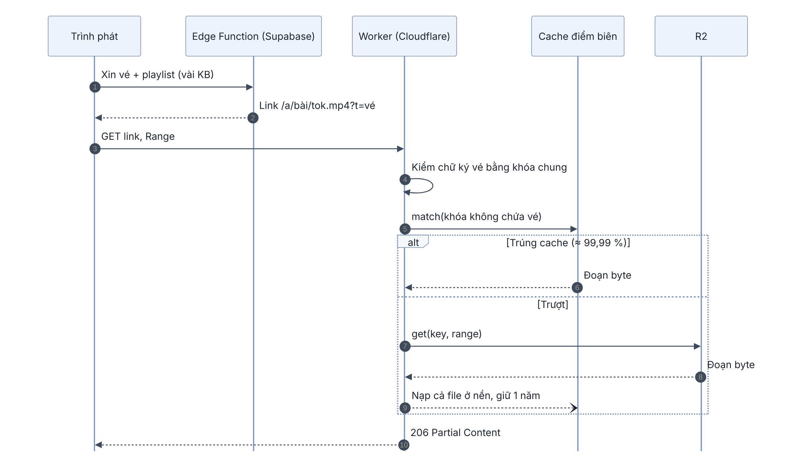
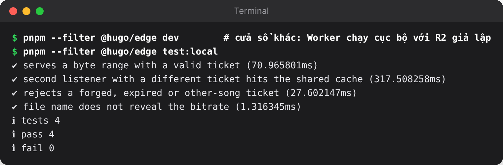

## Chương 23. Một triệu người nghe: băng thông và chi phí

### Chương này làm gì

Tính chi phí của Hugo Music ở quy mô một triệu người dùng và một danh mục ít nhất 100 bài gốc, tìm ra khoản tốn nhất (băng thông âm thanh), và chuyển riêng phần đó sang Cloudflare R2 với một Worker ở điểm biên. Database, đăng nhập, realtime, hàng đợi vẫn ở Supabase.

### Để làm gì

Ở quy mô đồ án, Supabase Storage là đủ. Ở quy mô một triệu người, phí băng thông ra của file nhạc lớn hơn mọi khoản khác cộng lại, và thiết kế signed URL hiện tại làm CDN gần như không cache được. Sửa hai điều này trước khi có người dùng thì rẻ hơn nhiều so với sửa khi hóa đơn đã tới.

### Phân tích kỹ thuật

**Giả định:** một triệu tài khoản, 10 % nghe mỗi ngày (100 000 người), mỗi người 20 bài, trung bình 160 kbps, bài 4 phút.

```text
một bài     = 160 000 × 240 ÷ 8 = 4,8 MB
mỗi ngày    = 100 000 × 20 × 4,8 MB = 9,6 TB
mỗi tháng  ≈ 290 TB băng thông âm thanh
```

| Khoản | Ước lượng | Ghi chú |
|---|---|---|
| Băng thông âm thanh | ~290 TB/tháng | Khoản lớn nhất, quyết định kiến trúc |
| Lưu trữ 100 bài | ~5–6 GB (gốc + 6 mức) | Không đáng kể |
| Đăng nhập | 1 triệu người dùng hoạt động/tháng | Tính theo đầu người; đáng kể nhưng nhỏ hơn băng thông nhiều |
| Edge Function | ~2 triệu lượt nghe/ngày × 2–3 lần gọi | Mỗi lần trả vài KB |
| Realtime | 5–10 % mở đài, nhóm cùng lúc: 50–100 nghìn kết nối | Vượt mức mặc định của gói Pro |
| Bảng `plays` | ~2 triệu dòng/ngày | Cần chia bảng theo tháng |

Bảng giá thay đổi theo thời gian, nên sách không in số tiền; tính lại bằng trang giá hiện hành. Kết luận không phụ thuộc con số cụ thể: **phí băng thông ra tính theo GB nhân với 290 TB là khoản áp đảo**.

**Nơi đặt file âm thanh:**

| Lựa chọn | Phí băng thông ra | CDN | Ghi chú |
|---|---|---|---|
| Supabase Storage | Tính theo GB | Có | Đơn giản nhất, đang dùng |
| Amazon S3 + CloudFront | Tính theo GB | Có | Linh hoạt, đắt ở băng thông |
| **Cloudflare R2 + Worker** | **Không tính** (Cloudflare, n.d.a) | Mạng Cloudflare | Tính theo số lần đọc ghi; Worker tính theo lượt gọi |

**Vì sao danh mục nhỏ là lợi thế.** 100 bài × 6 mức = 600 file, ai cũng nghe cùng những file đó. Nếu cache dùng chung được, gần như mọi request trúng cache ở điểm biên, R2 chỉ bị đọc khi một điểm biên lần đầu cần file.

**Vì sao signed URL hiện tại phá cache.** Mỗi lần ký ra một `token` khác nhau, nên với cache, `64.mp4?token=A` và `64.mp4?token=B` là hai file. Một triệu người nghe là một triệu bản cache của cùng một file, tức là gần như không cache.

### Chọn gì, vì sao

**File âm thanh lên R2; một Cloudflare Worker kiểm vé ở điểm biên và dùng khóa cache không chứa vé** (Cloudflare, n.d.b). Supabase chỉ còn cấp vé (mỗi lượt nghe một lần `claim_playback()`) và trả playlist vài KB. Vé dùng lại đúng định dạng HMAC của chương 11 và cùng khóa bí mật, nên không thêm hệ thống phân quyền nào.

Thêm một lợi ích: đường dẫn file trên Worker không chứa bitrate (`/a/<bài>/<tok>.mp4`, `tok` là 16 ký tự HMAC), nên blind test không lộ đáp án qua tên file như link ký của Supabase (`…/64.mp4`).

### Sơ đồ trình tự: phát nhạc qua Cloudflare



So với sơ đồ ở chương 11, phần xin vé và playlist không đổi; chỉ vòng tải file đi sang Cloudflare. Supabase và Cloudflare không gọi nhau: Worker tự kiểm vé bằng khóa bí mật dùng chung. Nhánh "trượt" chỉ xảy ra một lần cho mỗi file ở mỗi điểm biên.

### Làm từng bước

**Bước 1: Worker kiểm vé, đọc cache, rồi mới tới R2.**

```ts
// edge/src/index.ts (trích)
const ticket = await verifyTicket(env.PLAYBACK_SECRET, url.searchParams.get('t') ?? '');
if (!ticket || ticket.s !== songId) return fail(403);

const key = `${songId}/${kbps}.mp4`;
const cacheKey = new Request(`https://audio-cache/${key}`, { headers: range ? { range } : {} });  // không có vé
const hit = await caches.default.match(cacheKey);
if (hit) return withCors(hit, 'HIT');

const obj = await env.AUDIO.get(key, range ? { range: req.headers } : {});   // R2
ctx.waitUntil(fillCache(env, key));       // nạp cả file vào cache ở nền, giữ một năm
```

`tok` được dịch ngược bằng cách thử 7 mức có thể: 7 phép HMAC rẻ hơn nhiều so với một lần hỏi database.

**Bước 2: Edge Function trỏ playlist về Worker khi đã cấu hình.**

```ts
// supabase/functions/playback/index.ts (trích)
const fileUrl = CDN
  ? `${CDN}/a/${songId}/${await tierToken(songId, Number(kbps))}.mp4?t=${ticket}`
  : await signedUrl(`${base}.mp4`);       // chưa có R2: giữ cách cũ
```

Playlist mẫu của mỗi mức không bao giờ đổi, nên function giữ nó trong bộ nhớ thay vì tải lại từ Storage ở mỗi lượt.

**Bước 3: worker xử lý âm thanh ghi file lên R2.** Có biến `R2_*` trong `worker/.env` thì file `.mp4` đi R2 (qua API kiểu S3, thư viện `aws4fetch`), playlist mẫu vẫn ở Supabase. Không có thì như cũ. Cả hai đặt `Cache-Control` một năm, vì mã hóa lại luôn sinh file mới.

```ts
// worker/src/storage.ts (trích)
if (r2 && !isPlaylist) {
  await r2.fetch(`https://${R2_ACCOUNT_ID}.r2.cloudflarestorage.com/${R2_BUCKET}/${path}`, {
    method: 'PUT', body, headers: { 'content-type': 'audio/mp4', 'cache-control': 'public, max-age=31536000, immutable' },
  });
}
```

**Bước 4: triển khai.**

```bash
npx wrangler r2 bucket create hugo-music-audio
cd edge && npx wrangler secret put PLAYBACK_SECRET && npx wrangler deploy   # cùng giá trị với secret của Supabase
supabase secrets set AUDIO_CDN_URL=https://hugo-music-audio.<tài khoản>.workers.dev
# worker/.env: thêm R2_ACCOUNT_ID, R2_ACCESS_KEY_ID, R2_SECRET_ACCESS_KEY
node --env-file=worker/.env scripts/move-audio-to-r2.mjs                       # chuyển file đã có
```

Thứ tự quan trọng: chuyển file lên R2 **trước** khi đặt `AUDIO_CDN_URL`, để không có lúc playlist trỏ tới file chưa có.

### Ví dụ tính tay

**1. Cache trúng bao nhiêu.** 600 file, Cloudflare có khoảng vài trăm điểm biên; mỗi điểm biên cần đọc mỗi file từ R2 một lần rồi giữ:

```text
lần đọc R2 tối đa ≈ 600 file × 300 điểm biên = 180 000 lần (một lần, rồi nằm trong cache)
request tới Worker mỗi tháng ≈ 2 triệu lượt nghe/ngày × ~45 request/lượt × 30 ≈ 2,7 tỷ
tỉ lệ trúng cache ≈ 1 − 180 000 ÷ 2 700 000 000 ≈ 99,99 %
```

Chi phí còn lại nằm ở số lượt gọi Worker. Giảm được bằng cách để trình phát tải đoạn lớn hơn (đoạn 10 giây cho các mức cao), hoặc gộp nhiều đoạn vào một Range request.

**2. PSL tiết kiệm bao nhiêu ở quy mô này.** Mạng tốt, trình phát luôn chọn mức cao nhất. Bỏ mức 320 (chương 10):

```text
nếu còn 320: 320 000 × 240 ÷ 8 = 9,6 MB/bài; với 256: 7,68 MB/bài → ít hơn 20 %
290 TB × 20 % ≈ 58 TB/tháng không phải truyền
```

Với R2, phần này không còn là tiền băng thông, nhưng vẫn là dữ liệu di động của người nghe và thời gian tải.

### Kết quả

Worker chạy cục bộ bằng `wrangler dev` với R2 giả lập, file mẫu thật từ bài "Mưa Đêm Sài Gòn". Người nghe thứ hai, vé khác, vẫn trúng cùng một bản cache; vé giả, vé hết hạn, vé của bài khác đều bị từ chối:



### Kiểm tra

```bash
curl -sI "<link file trong playlist>" -H "range: bytes=0-1023" | grep -iE "^HTTP|content-range|x-cache"
# lần đầu: x-cache: MISS; gọi lại (kể cả với vé khác): x-cache: HIT
```

Trên dashboard Supabase, mục Usage: băng thông Storage giảm về gần chỉ còn playlist.

### Tự kiểm

1. Vì sao băng thông âm thanh là khoản quyết định kiến trúc ở quy mô này, không phải database hay đăng nhập?
2. Vì sao signed URL của Supabase làm cache gần như vô dụng khi có nhiều người nghe?
3. Worker biết `tok` ứng với mức nào bằng cách nào? Vì sao không lưu bảng ánh xạ?
4. Vì sao phải chuyển file lên R2 trước khi đặt `AUDIO_CDN_URL`?
5. Tên file không còn lộ bitrate. Người dùng có DevTools vẫn đoán được bên nào bitrate cao hơn trong blind test bằng cách nào? (Gợi ý: `EXT-X-BYTERANGE`.)

### Khi nào đổi

- **Số lượt gọi Worker thành khoản lớn:** chuyển phần kiểm vé sang cookie có chữ ký cho cả bài và bật cache của Cloudflare cho cả đường dẫn, để file đi thẳng từ cache mà không chạy Worker.
- **Realtime vượt giới hạn gói:** tách đài 24/7 sang Broadcast với số người nghe đếm định kỳ thay vì Presence đầy đủ (chương 13), hoặc nâng gói.
- **Blind test cần chống gian lận cả với người dùng kỹ thuật:** đệm các đoạn của hai bên về cùng kích thước, hoặc chuyển blind test sang phát qua Web Audio từ một file đã trộn sẵn.

### Code của chương

- `edge/src/index.ts`
- `edge/src/ticket.ts`
- `edge/test/edge.test.ts`
- `edge/wrangler.toml`
- `worker/src/storage.ts`
- `supabase/functions/playback/index.ts`
- `scripts/move-audio-to-r2.mjs`
