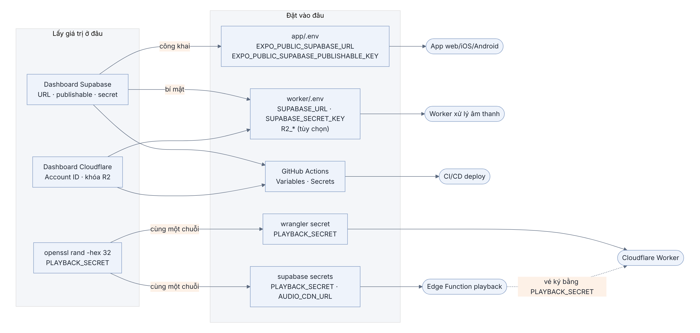

## Phụ lục C. Biến môi trường, khóa và cách nối các phần với nhau

### Chương này làm gì

Liệt kê mọi biến môi trường mà code của Hugo Music đọc: tên biến, lấy giá trị ở đâu, đặt vào file nào, phần nào của hệ thống dùng, có được công khai không. Cuối phụ lục là các lỗi hay gặp khi đặt sai biến, kèm cách sửa.

### Để làm gì

Năm phần của hệ thống (app, database, Edge Function, worker, Cloudflare Worker) chạy ở năm nơi khác nhau. Chúng chỉ nhận ra nhau qua biến môi trường: app biết địa chỉ project nhờ `EXPO_PUBLIC_SUPABASE_URL`, Edge Function và Cloudflare Worker tin vé của nhau nhờ cùng một `PLAYBACK_SECRET`. Đặt thiếu một biến là phần đó chạy một mình, không nối được với phần còn lại.

### Sơ đồ: giá trị nào đi tới đâu



Mỗi mũi tên là một lần chép giá trị. Hai điểm cần nhớ:

- **Publishable key** đi vào app, ai mở app cũng đọc được. Nó an toàn vì chỉ làm được những gì RLS cho phép (chương 7).
- **Secret key** và **`PLAYBACK_SECRET`** chỉ ở phía server: worker, Edge Function, Cloudflare Worker. Không bao giờ nằm trong app, không bao giờ commit lên Git.

### Bước 1: lấy giá trị từ Supabase

Trong dashboard của project:

| Giá trị | Ở đâu | Ví dụ |
|---|---|---|
| Project ref | Phần đầu của Project URL; hoặc *Project Settings → General* | `ikazrazuwnsojbumbimh` |
| Project URL | *Project Settings → API Keys* (hoặc *Data API*) | `https://<ref>.supabase.co` |
| Publishable key | *Project Settings → API Keys* | `sb_publishable_...` |
| Secret key | *Project Settings → API Keys*, bấm hiện | `sb_secret_...` |
| Mật khẩu database | Đặt lúc tạo project; quên thì *Project Settings → Database → Reset password* | |
| Access token (cho CLI, CI) | *Account → Access Tokens → Generate new token* | `sbp_...` |

`PLAYBACK_SECRET` không lấy ở đâu cả, bạn tự sinh một chuỗi ngẫu nhiên đủ dài:

```bash
openssl rand -hex 32
```

Lưu chuỗi này vào trình quản lý mật khẩu. Supabase không cho đọc lại secret đã đặt, nên chương 23 cần đặt **đúng chuỗi này** cho Cloudflare Worker.

### Bước 2: đặt vào đúng nơi

**`app/.env`**: app web, iOS, Android. Chỉ biến bắt đầu bằng `EXPO_PUBLIC_` mới được đưa vào app lúc build.

| Biến | Giá trị | Code đọc | Chương |
|---|---|---|---|
| `EXPO_PUBLIC_SUPABASE_URL` | Project URL | `app/src/api/supabase.ts` | 5, Ứng dụng 1 |
| `EXPO_PUBLIC_SUPABASE_PUBLISHABLE_KEY` | Publishable key | `app/src/api/supabase.ts` | 5, Ứng dụng 1 |

**`worker/.env`**: worker xử lý âm thanh, và các script chạy bằng `node --env-file=worker/.env`.

| Biến | Giá trị | Bắt buộc | Code đọc | Chương |
|---|---|---|---|---|
| `SUPABASE_URL` | Project URL | Có | `worker/src/supabase.ts` | 10 |
| `SUPABASE_SECRET_KEY` | Secret key | Có | `worker/src/supabase.ts` | 10 |
| `SUPABASE_PUBLISHABLE_KEY` | Publishable key | Chỉ để nạp nhạc mẫu | `supabase/seed/seed.ts` | 10 |
| `PSL_PYTHON` | Đường dẫn Python có `visqol-python` | Không (để trống: thang 64/128/256) | `worker/src/psl.ts` | 10 |
| `R2_ACCOUNT_ID` | Account ID của Cloudflare | Không (để trống: lưu ở Supabase) | `worker/src/storage.ts` | 23 |
| `R2_ACCESS_KEY_ID`, `R2_SECRET_ACCESS_KEY` | Khóa API kiểu S3 của R2 | Đi cùng `R2_ACCOUNT_ID` | `worker/src/storage.ts` | 23 |
| `R2_BUCKET` | Tên bucket, mặc định `hugo-music-audio` | Không | `worker/src/storage.ts` | 23 |

**Secret của Edge Function**: đặt bằng `supabase secrets set`, không nằm trong file nào của repo.

| Biến | Giá trị | Ai đặt | Chương |
|---|---|---|---|
| `SUPABASE_URL`, `SUPABASE_ANON_KEY`, `SUPABASE_SERVICE_ROLE_KEY` | | Supabase tự đặt cho mọi function | 11 |
| `PLAYBACK_SECRET` | Chuỗi tự sinh ở bước 1 | Bạn: `supabase secrets set PLAYBACK_SECRET=...` | 11 |
| `AUDIO_CDN_URL` | Địa chỉ Cloudflare Worker, ví dụ `https://hugo-music-audio.<tài-khoản>.workers.dev` | Bạn, sau khi chuyển file lên R2 | 23 |

Code đọc `SUPABASE_SECRET_KEY ?? SUPABASE_SERVICE_ROLE_KEY` và `SUPABASE_PUBLISHABLE_KEY ?? SUPABASE_ANON_KEY`, nên chạy được với cả khóa kiểu mới lẫn kiểu cũ mà không phải đặt thêm.

**Cloudflare Worker (`edge/`)**: chương 23.

| Biến | Đặt ở đâu | Ghi chú |
|---|---|---|
| `PLAYBACK_SECRET` | `npx wrangler secret put PLAYBACK_SECRET` | Phải trùng với secret của Edge Function |
| `PLAYBACK_SECRET` khi chạy thử trên máy | `edge/.dev.vars` | File này đã nằm trong `.gitignore` |
| `AUDIO` | `edge/wrangler.toml`, mục `[[r2_buckets]]` | Không phải biến chữ mà là bucket R2 được gắn vào Worker |

**GitHub Actions**: *Settings → Secrets and variables → Actions*. "Variables" thì ai có quyền xem log cũng thấy; "Secrets" thì bị che.

| Tên | Loại | Job dùng | Bắt buộc khi |
|---|---|---|---|
| `SUPABASE_PROJECT_REF` | Variable | `supabase` | Muốn deploy database và Edge Function |
| `SUPABASE_ACCESS_TOKEN` | Secret | `supabase` | Cùng trên |
| `SUPABASE_DB_PASSWORD` | Secret | `supabase` | Cùng trên |
| `DEPLOY_WORKER` = `true` | Variable | `worker` | Muốn deploy worker lên Fly.io |
| `FLY_API_TOKEN` | Secret | `worker` | Cùng trên |
| `DEPLOY_EDGE` = `true` | Variable | `edge` | Muốn deploy Cloudflare Worker |
| `CLOUDFLARE_PAGES_PROJECT` | Variable | `web` | Muốn deploy bản web |
| `CLOUDFLARE_ACCOUNT_ID` | Variable | `edge`, `web` | Một trong hai job trên |
| `CLOUDFLARE_API_TOKEN` | Secret | `edge`, `web` | Một trong hai job trên |
| `SUPABASE_URL`, `SUPABASE_PUBLISHABLE_KEY` | Variable | `web` | Build web (hai giá trị công khai) |

Job nào chưa có biến điều kiện (`SUPABASE_PROJECT_REF`, `DEPLOY_WORKER`, `DEPLOY_EDGE`, `CLOUDFLARE_PAGES_PROJECT`) thì được bỏ qua, không báo lỗi. Nhờ vậy repo mới clone về vẫn chạy CI xanh, và bạn bật từng phần khi sẵn sàng.

**Script phụ** (chụp ảnh cho sách, chạy trên máy):

| Biến | Script |
|---|---|
| `SHOT_ADMIN_PASSWORD`, `SHOT_MEMBER_PASSWORD` | `scripts/screenshots.mjs`, `scripts/group-shot.mjs` |
| `CHROMIUM_PATH`, `PLAYWRIGHT_PATH`, `MERMAID_JS` | `scripts/diagrams.mjs`, `docs/print/print.mjs`: chỉ cần khi trình duyệt hoặc thư viện không nằm ở chỗ mặc định |

### Bước 3: tạo file và kiểm tra

```bash
cp app/.env.example app/.env          # điền 2 biến EXPO_PUBLIC_
cp worker/.env.example worker/.env    # điền SUPABASE_URL, SUPABASE_SECRET_KEY, SUPABASE_PUBLISHABLE_KEY
supabase secrets set PLAYBACK_SECRET=<chuỗi ở bước 1>
git status --short                    # không được thấy .env nào trong danh sách
```

Kiểm tra từng chỗ nối:

```bash
# app → Supabase: publishable key đúng thì trả về JSON, sai thì 401
curl -s "$EXPO_PUBLIC_SUPABASE_URL/rest/v1/songs?select=title&limit=1" -H "apikey: $EXPO_PUBLIC_SUPABASE_PUBLISHABLE_KEY"
# worker → Supabase: secret key đúng thì in "worker ready" rồi chờ việc
pnpm worker
# Edge Function có PLAYBACK_SECRET chưa (chỉ thấy tên, không thấy giá trị)
supabase secrets list
```

`.gitignore` của repo đã chặn: `.env`, `app/.env`, `worker/.env`, `supabase/.env.deploy`, `edge/.dev.vars`. Trước mỗi lần commit, `git status` là cách nhanh nhất để chắc không có khóa nào lọt vào.

### Lỗi hay gặp

| Thông báo | Nguyên nhân | Sửa |
|---|---|---|
| `supabaseUrl is required` (app) | Chưa có `app/.env`, hoặc tên biến thiếu tiền tố `EXPO_PUBLIC_` | Tạo file; dừng rồi chạy lại `pnpm web`, vì Expo chỉ đọc `.env` lúc khởi động |
| `Invalid API key` / HTTP 401 | Dán nhầm khóa của project khác, hoặc thừa dấu cách | Chép lại từ dashboard |
| `Thiếu SUPABASE_URL hoặc SUPABASE_SECRET_KEY` (worker) | Chưa có `worker/.env` | `cp worker/.env.example worker/.env` rồi điền |
| `new row violates row-level security policy` từ worker | Dùng publishable key thay cho secret key | Worker phải dùng `SUPABASE_SECRET_KEY` |
| Edge Function trả 500 khi xin vé | Chưa đặt `PLAYBACK_SECRET` | `supabase secrets set PLAYBACK_SECRET=...` |
| Cloudflare Worker trả 403 với mọi vé | `PLAYBACK_SECRET` hai bên khác nhau | Đặt lại cùng một chuỗi cho cả hai bên |
| CI: `flag needs an argument: --project-ref` | Chưa đặt Variable `SUPABASE_PROJECT_REF` | Đặt biến, hoặc để trống để bỏ qua job deploy |
| CI: `ERR_PNPM_IGNORED_BUILDS` | pnpm chặn script cài đặt của gói không có trong `allowBuilds` | Thêm tên gói vào `allowBuilds` trong `pnpm-workspace.yaml` |

### Tự kiểm

1. Vì sao publishable key được nằm trong app còn secret key thì không?
2. Bạn đổi `PLAYBACK_SECRET` của Edge Function nhưng quên Cloudflare Worker. Người nghe gặp gì?
3. Đổi `app/.env` khi `pnpm web` đang chạy thì app có nhận giá trị mới không?
4. Variable và Secret của GitHub Actions khác nhau thế nào? `SUPABASE_PUBLISHABLE_KEY` nên đặt ở loại nào?
5. Vì sao job deploy được viết để bỏ qua khi chưa cấu hình, thay vì báo lỗi?
