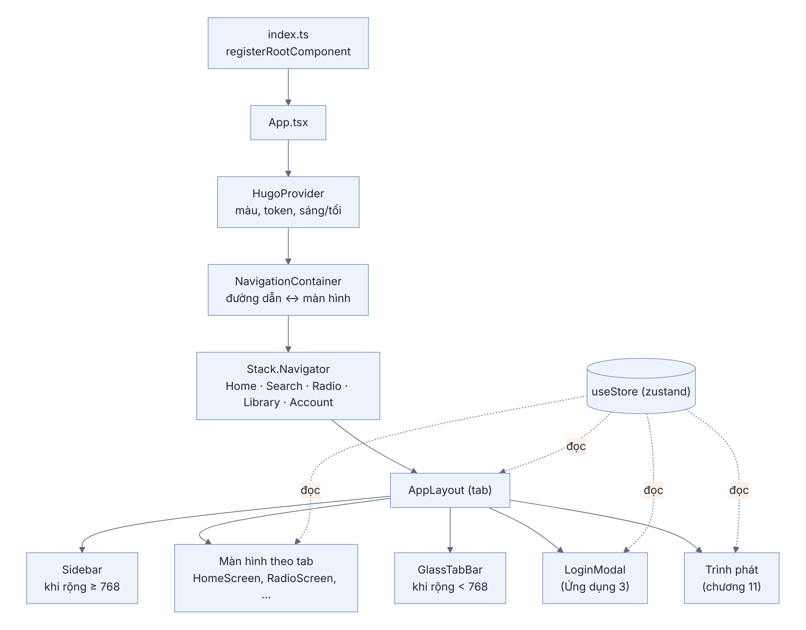

## Ứng dụng 1. Khung app: Expo, React và điều hướng

### Chương này làm gì

Tạo app Expo trong monorepo, chạy được trên trình duyệt và điện thoại. App có khung điều hướng: thanh bên trên máy tính, thanh tab dưới trên điện thoại, mỗi màn hình một đường dẫn web. Năm màn hình lúc này còn trống. Từ chương 5, mỗi chương backend gắn thêm một phần vào khung này.

### Để làm gì

Có khung sớm thì mỗi tính năng backend làm xong là thấy ngay trên màn hình, không phải đợi tới cuối sách. Khung cũng chốt sớm những thứ khó đổi về sau: cấu trúc thư mục, cách điều hướng, nơi giữ trạng thái, bộ token giao diện.

### Phân tích kỹ thuật

**Một mã nguồn cho ba nền tảng:**

| Lựa chọn | Web | iOS, Android | Ngôn ngữ | Ghi chú |
|---|---|---|---|---|
| **Expo (React Native)** | Có, qua react-native-web | Có, gốc | TypeScript | Chung ngôn ngữ với worker và Edge Function |
| Flutter | Có, vẽ bằng canvas | Có | Dart | Web kém thân thiện với công cụ tìm kiếm và trình đọc màn hình |
| Swift + Kotlin + web riêng | Viết riêng | Viết riêng | Ba ngôn ngữ | Ba lần công sức cho mỗi tính năng |
| Next.js + Capacitor | Rất tốt | Bọc web trong app | TypeScript | Trình phát nhạc nền và cảm giác chạm kém app gốc |

**Điều hướng:**

| Lựa chọn | Cách khai báo | Hợp khi |
|---|---|---|
| **React Navigation** | Khai báo trong code, ánh xạ đường dẫn bằng `linking` | Bố cục tự kiểm soát, giữ màn hình đã mở |
| Expo Router | Mỗi file trong `app/` là một đường dẫn | App nhiều trang độc lập, muốn quy ước sẵn |

**Trạng thái dùng chung** (người dùng, danh sách bài, bài đang phát):

| Lựa chọn | Viết | Ghi chú |
|---|---|---|
| React Context | Ít | Mọi màn hình dùng context vẽ lại khi một giá trị đổi |
| Redux Toolkit | Nhiều | Mạnh, nhiều quy ước |
| **zustand** | Rất ít | Màn hình chỉ vẽ lại khi phần nó chọn thay đổi |

### Chọn gì, vì sao

**Expo SDK 58, React Navigation với `linking`, zustand, và thư viện giao diện `hugo-music` trong `packages/ui`.** Expo cho một mã nguồn TypeScript chạy cả web lẫn điện thoại. React Navigation cho mỗi màn hình một đường dẫn web (`/radio`, `/library`) mà vẫn để app tự quyết bố cục. Thư viện giao diện tách riêng nên màn hình không bao giờ viết màu hay khoảng cách bằng số (chương 17).

**Khi code lại từ đầu:** chép nguyên hai thư mục `packages/ui` (thư viện giao diện `hugo-music`) và `packages/stream` (đồng bộ, lời bài hát) từ repo. Hai thư viện này không phải trọng tâm của sách. Phần app trong `app/src` thì bạn tự viết theo các chương.

### React trong mười phút

Nền tảng 2 đã nói về JavaScript và TypeScript. React thêm bốn ý:

| Ý | Nghĩa | Ví dụ |
|---|---|---|
| Component | Hàm trả về giao diện | `function SongRow() { return <Text>…</Text>; }` |
| Props | Tham số truyền từ ngoài vào | `<SongRow title="Mưa Đêm" />` |
| State | Giá trị component tự nhớ; đổi là vẽ lại | `const [open, setOpen] = useState(false)` |
| Effect | Việc chạy sau khi vẽ (gọi API, hẹn giờ) | `useEffect(() => { fetchSongs(); }, [])` |

React Native dùng thẻ riêng thay cho thẻ HTML: `View` thay `div`, `Text` thay `span`/`p` (mọi chữ phải nằm trong `Text`), `Pressable` thay `button`, `ScrollView` cho vùng cuộn. Kiểu viết bằng đối tượng JavaScript, mặc định xếp theo cột (`flexDirection: 'column'`).

```tsx
function Counter() {
  const [n, setN] = useState(0);
  return (
    <Pressable onPress={() => setN(n + 1)} style={{ padding: 12 }}>
      <Text>Đã bấm {n} lần</Text>
    </Pressable>
  );
}
```

Quy tắc của hook (`useState`, `useEffect`, `useStore`…): chỉ gọi ở cấp đầu của component, không gọi trong `if` hay vòng lặp, vì React nhận ra hook theo thứ tự gọi.

### Sơ đồ cây component



Mỗi tầng chỉ biết tầng ngay dưới nó. `HugoProvider` cấp màu và token cho mọi thứ bên trong. `NavigationContainer` đọc đường dẫn. `AppLayout` quyết định thanh bên hay thanh tab theo độ rộng màn hình. Hộp thoại đăng nhập và trình phát nằm cạnh màn hình, không nằm trong màn hình, nên mở được từ bất cứ đâu.

### Làm từng bước

**Bước 1: tạo app trong monorepo.**

```bash
npx create-expo-app@latest app --template blank-typescript --no-install
```

Sửa `app/package.json`: đặt `"name": "@hugo/app"`, thêm script `"web": "expo start --web"` và `"typecheck": "tsc --noEmit"`. Thư mục `app` đã có trong `pnpm-workspace.yaml` từ chương 3. Cài thư viện bằng `expo install` để lấy đúng phiên bản hợp với SDK:

```bash
cd app
npx expo install react-dom react-native-web @expo/metro-runtime \
  @react-navigation/native @react-navigation/native-stack react-native-screens react-native-safe-area-context \
  @supabase/supabase-js expo-sqlite zustand
```

**Bước 2: nối thư viện giao diện.** Thêm `"hugo-music": "workspace:*"` và `"hugo-stream": "workspace:*"` vào `dependencies` của app, chạy `pnpm install`. Metro (trình đóng gói của Expo) được chỉ thẳng vào mã nguồn của hai thư viện, nên sửa thư viện là thấy ngay mà không phải build trước:

```js
// app/metro.config.js (trích)
const sources = /* { 'hugo-music': '../packages/ui/src/index.ts', 'hugo-stream': '...' } */;
config.resolver.resolveRequest = (context, moduleName, platform) =>
  sources[moduleName] ? { type: 'sourceFile', filePath: sources[moduleName] } : resolve(context, moduleName, platform);
```

TypeScript cũng cần biết hai thư viện này nằm đâu: thêm `"paths"` trong `app/tsconfig.json`, trỏ tới cùng hai file nguồn.

**Bước 3: biến môi trường.** Biến bắt đầu bằng `EXPO_PUBLIC_` được đưa vào app lúc build, ai mở app cũng đọc được, nên chỉ đặt ở đây những thứ công khai được.

```bash
# app/.env
EXPO_PUBLIC_SUPABASE_URL=https://<project-ref>.supabase.co
EXPO_PUBLIC_SUPABASE_PUBLISHABLE_KEY=sb_publishable_...
```

**Bước 4: gốc của app.**

```tsx
// app/src/App.tsx (bản đầu)
import { StatusBar } from 'expo-status-bar';
import { HugoProvider } from 'hugo-music';
import AppNavigator from './navigation/AppNavigator';

export default function App() {
  return (
    <HugoProvider scheme="system">
      <StatusBar style="auto" />
      <AppNavigator />
    </HugoProvider>
  );
}
```

`scheme="system"` là theo chế độ sáng, tối của máy. Chương 16 thêm lựa chọn của người dùng và nạp dữ liệu danh mục lúc mở app.

**Bước 5: mỗi màn hình một đường dẫn.**

```tsx
// app/src/navigation/AppNavigator.tsx (bản đầu)
const PATHS = { Home: '', Search: 'search', Radio: 'radio', Library: 'library', Account: 'account' };
const Stack = createNativeStackNavigator();
const linking = { prefixes: [], config: { screens: PATHS } };

export default function AppNavigator() {
  return (
    <NavigationContainer linking={linking}>
      <Stack.Navigator screenOptions={{ headerShown: false }}>
        {Object.entries(PATHS).map(([name, path]) => (
          <Stack.Screen key={name} name={name}>{() => <AppLayout tab={path || 'home'} />}</Stack.Screen>
        ))}
      </Stack.Navigator>
    </NavigationContainer>
  );
}
```

Mọi đường dẫn dùng chung một `AppLayout`, chỉ khác tham số `tab`. Nhờ vậy thanh bên và trình phát không bị dựng lại khi chuyển trang.

**Bước 6: bố cục theo độ rộng.** Dưới 768 điểm là điện thoại hoặc cửa sổ hẹp: thanh tab dưới. Từ 768 trở lên: thanh bên trái.

```ts
// app/src/lib/responsive.ts
export const useIsMobile = () => useWindowDimensions().width < 768;
```

```tsx
// app/src/navigation/AppLayout.tsx (bản đầu)
const TABS: TabItem[] = [
  { key: 'home', label: 'Trang chủ', icon: 'home-outline' },
  { key: 'radio', label: 'Đài', icon: 'radio-outline' },
  { key: 'library', label: 'Thư viện', icon: 'albums-outline' },
  { key: 'account', label: 'Tài khoản', icon: 'person-circle-outline' },
];
const ROUTE: Record<string, string> = { home: 'Home', search: 'Search', radio: 'Radio', library: 'Library', account: 'Account' };

export default function AppLayout({ tab }: { tab: string }) {
  const isMobile = useIsMobile();
  const { colors } = useHugoTheme();
  const nav = useNavigation<any>();
  const go = (t: string) => nav.navigate(ROUTE[t]);
  return (
    <View style={{ flex: 1, flexDirection: isMobile ? 'column' : 'row', backgroundColor: colors.background }}>
      {!isMobile && <Sidebar items={TABS} active={tab} onPress={go} />}
      <View style={{ flex: 1 }}>{renderScreen(tab)}</View>
      {isMobile && <GlassTabBar items={TABS} value={tab} onChange={go} />}
    </View>
  );
}
```

`Sidebar` ở bản đầu chỉ là một cột `Pressable`, mỗi nút một mục của `TABS`. `renderScreen` là một `switch` trả về màn hình theo `tab`. Bản đầy đủ trong repo làm thêm hai việc: giữ các màn hình đã mở (không dựng lại khi quay về, nên vị trí cuộn còn nguyên) và thu thanh bên thành dải biểu tượng khi cửa sổ hẹp.

**Bước 7: năm màn hình trống.**

```tsx
// app/src/screens/Home/HomeScreen.tsx (bản đầu)
import { ScrollView } from 'react-native';
import { LargeTitle } from 'hugo-music';

export default function HomeScreen() {
  return <ScrollView><LargeTitle title="Trang chủ" /></ScrollView>;
}
```

Làm tương tự cho Search, Radio, Library, Account.

**Bước 8: chạy.**

```bash
pnpm web                         # trình duyệt, http://localhost:8081
pnpm --filter @hugo/app start    # quét mã QR bằng Expo Go trên điện thoại (cùng mạng Wi-Fi)
```

Trong cửa sổ terminal của Expo: phím `w` mở trình duyệt, `r` tải lại app, `j` mở công cụ gỡ lỗi.

### Kết quả

Trình duyệt hiện thanh bên với bốn mục và tiêu đề lớn "Trang chủ". Bấm "Đài" thì đường dẫn đổi thành `/radio`. Thu nhỏ cửa sổ dưới 768 điểm thì thanh bên biến mất, thanh tab kính mờ hiện ở dưới. Trên điện thoại qua Expo Go thấy đúng bố cục thanh tab.

### Kiểm tra

1. Gõ thẳng `http://localhost:8081/library` vào thanh địa chỉ: mở đúng màn hình Thư viện.
2. Bấm nút quay lại của trình duyệt: về màn hình trước.
3. `pnpm --filter @hugo/app typecheck` không báo lỗi.

### Ví dụ tính tay

**1. Chỗ còn lại cho nội dung trên máy tính.** Cửa sổ rộng 1 440 điểm, thanh bên đầy đủ rộng 232 điểm, cách mép 12 điểm mỗi bên:

```text
thanh bên chiếm = 232 + 2 × 12 = 256 điểm
nội dung        = 1 440 − 256 = 1 184 điểm
```

**2. Cỡ ô bài hát trên điện thoại.** Trang chủ lấy cỡ ô = min(170, 40 % độ rộng màn hình). Máy rộng 390 điểm:

```text
0,4 × 390 = 156 < 170 → ô rộng 156 điểm; khoảng cách 12 → vừa 2 ô và một phần ô thứ ba
```

Một phần ô thứ ba lộ ra là cố ý: người dùng biết kệ này vuốt ngang được.

### Thực hành

1. Thêm mục "Tìm kiếm" vào `TABS`, có biểu tượng `search-outline`, và kiểm tra đường dẫn `/search`.
2. Đổi `scheme="system"` thành `"dark"` trong `App.tsx`, xem cả app chuyển sang nền tối mà không sửa màn hình nào.
3. Viết component `Counter` ở mục React trong mười phút vào màn hình Tài khoản, bấm thử, rồi xóa đi.

### Tự kiểm

1. Vì sao mọi đường dẫn dùng chung một `AppLayout` thay vì mỗi màn hình một bố cục riêng?
2. Biến nào được đặt trong `app/.env`, biến nào tuyệt đối không? Vì sao?
3. Hook là gì? Vì sao không được gọi hook trong câu `if`?
4. App quyết định hiện thanh bên hay thanh tab dựa vào gì? Cửa sổ rộng 800 điểm thì hiện gì?
5. Vì sao dùng `npx expo install` thay vì `pnpm add` để cài thư viện cho app?

### Khi nào đổi

- **App có nhiều trang độc lập, ít trạng thái dùng chung:** Expo Router (mỗi file một đường dẫn) gọn hơn khai báo `PATHS` bằng tay.
- **Cần hiệu ứng chuyển trang gốc của từng nền tảng:** dùng `Stack.Screen` thật cho từng màn hình thay vì đổi nội dung trong `AppLayout`.

### Code của chương

- `app/index.ts`, `app/app.json`, `app/metro.config.js`, `app/tsconfig.json`
- `app/src/App.tsx`
- `app/src/navigation/AppNavigator.tsx`, `app/src/navigation/AppLayout.tsx`
- `app/src/lib/responsive.ts`
- `packages/ui/src/index.ts` (thư viện giao diện, chép nguyên)
