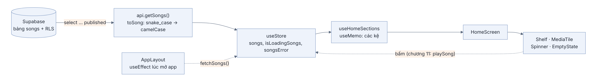
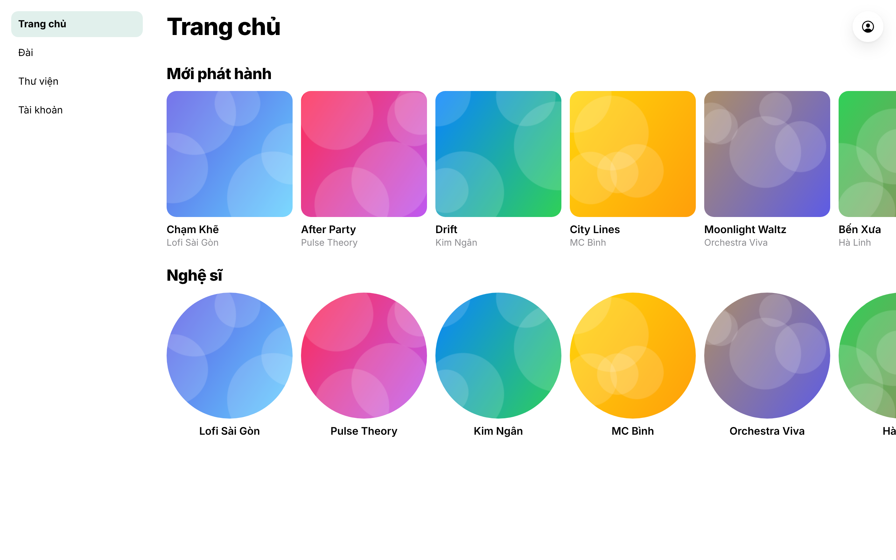
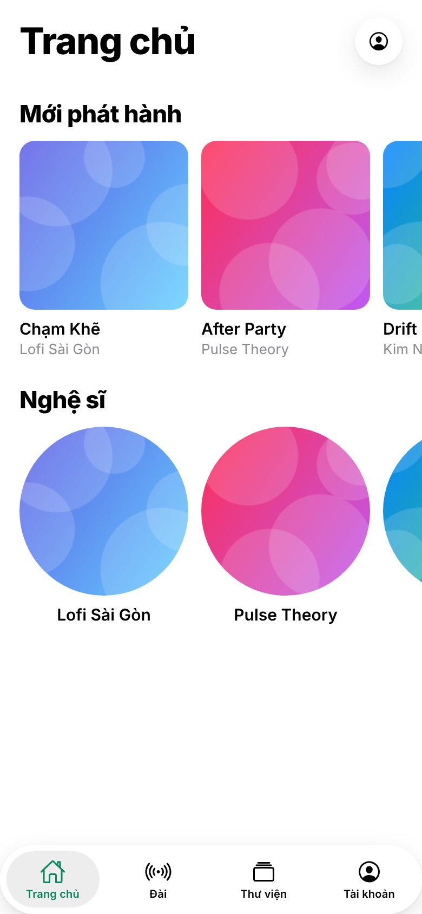

## Ứng dụng 2. Trang chủ: từ API tới màn hình

### Chương này làm gì

Đưa danh sách bài của chương 5 lên màn hình Trang chủ: tải dữ liệu một lần vào store, tính các kệ bài từ store, vẽ bằng các thành phần của thư viện giao diện. Màn hình có đủ ba trạng thái phụ: đang tải, chưa có bài, lỗi mạng.

### Để làm gì

Chương 5 dừng ở hàm `api.getSongs()` trả về mảng `Song`. Chương này nối hàm đó vào giao diện theo một cách mà mọi màn hình sau (Mới, Thư viện, Tìm kiếm) dùng lại: dữ liệu đi một chiều, màn hình chỉ đọc.

### Phân tích kỹ thuật

**Nơi gọi API:**

| Cách | Ưu | Nhược |
|---|---|---|
| Mỗi màn hình tự gọi trong `useEffect` | Dễ hiểu | Chuyển màn hình là tải lại; ba màn hình cùng cần danh sách bài thì gọi ba lần |
| Thư viện cache truy vấn (TanStack Query) | Tự cache, tự thử lại, tự làm mới | Thêm một khái niệm và một thư viện |
| **Tải một lần vào store, màn hình đọc từ store** | Một nguồn dữ liệu, chuyển màn hình tức thì | Tự lo làm mới khi dữ liệu đổi |

**Tính các kệ (mới phát hành, theo thể loại, nghệ sĩ):**

| Cách | Ghi chú |
|---|---|
| Mỗi kệ một API riêng | Nhiều lượt gọi; với danh mục vài trăm bài là thừa |
| **Tính trên máy từ danh sách đã tải** | Không gọi thêm; dùng `useMemo` để chỉ tính lại khi danh sách đổi |

### Chọn gì, vì sao

**Store zustand giữ `songs`; `AppLayout` gọi `fetchSongs()` một lần khi mở app; hook `useHomeSections` tính các kệ bằng `useMemo`; màn hình chỉ vẽ.** Danh mục của Hugo Music là vài trăm bài (500 bài đầu, chương 5), tải một lần vài chục KB, nên tính trên máy rẻ hơn mọi lượt gọi thêm. Khi danh mục lên hàng chục nghìn bài thì đổi (mục Khi nào đổi).

### Sơ đồ luồng dữ liệu



Mũi tên liền là dữ liệu đi xuống, chỉ một chiều. Màn hình không sửa `songs`; muốn đổi gì thì gọi một hàm của store (nét đứt), store đổi trạng thái, mọi màn hình đang đọc phần đó tự vẽ lại.

### Làm từng bước

**Bước 0: vài bài để thử giao diện.** Bài thật có file nhạc chỉ xuất hiện sau chương 10, khi worker xử lý xong. Để có dữ liệu xem ngay, chạy đoạn SQL này trong *SQL Editor* của dashboard. Bài thử chưa có file nhạc nên chưa phát được, nhưng đủ để dựng giao diện.

```sql
insert into public.artists (name) values ('Nghệ sĩ thử') on conflict (name) do nothing;
insert into public.songs (title, artist_id, license, source_url, status, published_at, genre)
select t, (select id from public.artists where name = 'Nghệ sĩ thử'), 'cc0', 'https://example.com', 'published', now(), 'Pop'
  from unnest(array['Bài thử 1', 'Bài thử 2', 'Bài thử 3']) as t;
```

Tới chương 10, khi đã có nhạc thật, xóa chúng đi: `delete from public.songs where title like 'Bài thử%';`.

**Bước 1: store giữ danh sách bài.** zustand tạo một hook (`useStore`). Mọi component gọi hook này để đọc hoặc gọi hàm.

```ts
// app/src/store/useStore.ts (bản đầu)
import { create } from 'zustand';
import { api, type Song } from '../api/api';

type State = {
  songs: Song[];
  isLoadingSongs: boolean;
  songsError: string | null;
  fetchSongs: () => Promise<void>;
};

export const useStore = create<State>()((set) => ({
  songs: [], isLoadingSongs: false, songsError: null,
  fetchSongs: async () => {
    set({ isLoadingSongs: true, songsError: null });
    try {
      set({ songs: await api.getSongs(), isLoadingSongs: false });
    } catch (e: any) {
      set({ isLoadingSongs: false, songsError: e.message });
    }
  },
}));
```

`set` gộp phần mới vào trạng thái cũ, không thay cả đối tượng. Bản đầy đủ trong repo thêm người dùng (chương Ứng dụng 3), hàng chờ phát (chương 11) và lưu một phần trạng thái xuống máy (`persist`).

**Bước 2: tải một lần khi mở app.**

```tsx
// app/src/navigation/AppLayout.tsx (thêm vào)
const fetchSongs = useStore((s) => s.fetchSongs);
useEffect(() => { fetchSongs(); }, []);
```

Mảng rỗng `[]` ở cuối nghĩa là "chỉ chạy một lần sau lần vẽ đầu". Đặt ở `AppLayout` chứ không ở `HomeScreen`, vì Thư viện và Tìm kiếm cũng cần danh sách này.

**Bước 3: chọn đúng phần cần đọc.** Mỗi lần gọi `useStore` chỉ lấy một giá trị. Component chỉ vẽ lại khi giá trị nó lấy thay đổi.

```ts
const songs = useStore((s) => s.songs);              // đúng: chỉ vẽ lại khi songs đổi
const everything = useStore();                        // sai: vẽ lại khi bất cứ thứ gì trong store đổi
```

**Bước 4: tính các kệ trong một hook.**

```ts
// app/src/screens/Home/useHomeSections.ts (bản đầu)
export function useHomeSections(rowCount: number) {
  const songs = useStore((s) => s.songs);
  return useMemo(() => {
    const newest = [...songs].sort((a, b) => (b.createdAt ?? '').localeCompare(a.createdAt ?? ''));
    const byArtist = new Map<string, Song>();
    for (const s of newest) if (!byArtist.has(s.artist)) byArtist.set(s.artist, s);
    return { newReleases: newest.slice(0, rowCount), artists: [...byArtist.values()].slice(0, rowCount) };
  }, [songs, rowCount]);
}
```

`useMemo` nhớ kết quả và chỉ tính lại khi `songs` hoặc `rowCount` đổi. Chương 16 thêm các mix theo thể loại, dùng chính regex trong bảng `genre_groups`.

**Bước 5: màn hình chỉ vẽ.**

```tsx
// app/src/screens/Home/HomeScreen.tsx (bản đầu)
export default function HomeScreen() {
  const { width } = useWindowDimensions();
  const isMobile = useIsMobile();
  const { isLoadingSongs, songsError, songs } = useStore(useShallow((s) => ({
    isLoadingSongs: s.isLoadingSongs, songsError: s.songsError, songs: s.songs })));
  const { newReleases, artists } = useHomeSections(12);
  const tile = isMobile ? Math.min(170, width * 0.4) : 180;

  return (
    <ScrollView contentContainerStyle={{ paddingBottom: 120 }}>
      <LargeTitle title="Trang chủ" />
      {isLoadingSongs && !songs.length && <Spinner />}
      {songsError && <EmptyState icon="cloud-offline-outline" title="Không tải được nhạc" hint={songsError} />}
      {!isLoadingSongs && !songsError && !songs.length && <EmptyState title="Chưa có bài nào" hint="Bài đã duyệt sẽ hiện ở đây." />}
      <Shelf title="Mới phát hành">
        {newReleases.map((s) => <MediaTile key={s._id} uri={s.coverArt} title={s.title} subtitle={s.artist} size={tile} onPress={() => {}} />)}
      </Shelf>
      <Shelf title="Nghệ sĩ">
        {artists.map((s) => <MediaTile key={s.artist} uri={s.coverArt} title={s.artist} size={tile} round onPress={() => {}} />)}
      </Shelf>
    </ScrollView>
  );
}
```

`useShallow` (nhập từ `zustand/react/shallow`) cho phép lấy nhiều giá trị một lần mà vẫn chỉ vẽ lại khi một trong số đó đổi. `key` giúp React biết ô nào là ô nào khi danh sách thay đổi; dùng id của bài, không dùng chỉ số trong mảng. `MediaTile` bắt buộc có `onPress`; tạm để hàm rỗng `() => {}`, chương 11 thay bằng lệnh phát khi đã có vé nghe.

### Kết quả

Trang chủ hiện hai kệ vuốt ngang với bài thật từ database. Hai ảnh dưới chụp từ một app dựng mới, gõ đúng code của chương Ứng dụng 1 và chương này, không thêm gì khác. Ảnh bìa là ảnh tạm theo màu, vì các bài mẫu chưa có ảnh bìa riêng.





### Kiểm tra

1. Tắt mạng (DevTools → Network → Offline), tải lại: hiện "Không tải được nhạc" thay vì màn hình trắng.
2. Trong SQL Editor, đổi một bài sang `status = 'pending'`, tải lại app: bài đó biến mất (RLS lọc, chương 7).
3. Mở Trang chủ, sang Thư viện rồi quay về: không thấy vòng tải lần hai.

### Ví dụ tính tay

**Tải cả danh mục có nặng không.** Mỗi bài khoảng 600 byte JSON khi chưa có lời bài hát (tên, nghệ sĩ, thể loại, đường dẫn ảnh, các mức chất lượng):

```text
500 bài × 600 byte = 300 000 byte ≈ 300 KB; nén gzip còn khoảng 50–60 KB
ở 5 Mbps: 60 000 × 8 ÷ 5 000 000 ≈ 0,1 giây
```

Một ảnh bìa đã khoảng 50 KB, nên tải cả danh mục chỉ tốn ngang tải thêm một ảnh.

### Thực hành

1. Thêm kệ "Có lời bài hát" chỉ gồm bài có `lyricsSource`.
2. Thêm nút "Thử lại" vào trạng thái lỗi, bấm thì gọi `fetchSongs()`.
3. Đặt `console.log('vẽ HomeScreen')` trong `HomeScreen`, rồi đổi `useStore((s) => s.songs)` thành `useStore()`. So số lần in ra khi chuyển màn hình.

### Tự kiểm

1. Vì sao gọi `fetchSongs()` trong `AppLayout` thay vì trong `HomeScreen`?
2. `useMemo` giải quyết vấn đề gì trong `useHomeSections`? Bỏ nó đi thì app sai hay chỉ chậm?
3. Vì sao không nên dùng chỉ số mảng làm `key`?
4. Kể ba trạng thái phụ của một màn hình có dữ liệu, và điều người dùng thấy ở mỗi trạng thái.
5. Danh mục lên 50 000 bài. Cách "tải một lần, tính trên máy" gặp vấn đề gì?

### Khi nào đổi

- **Danh mục lên hàng chục nghìn bài:** chuyển các kệ thành hàm SQL (như `top_songs()`), mỗi kệ một lượt gọi có `limit`, và tải theo trang.
- **Nhiều màn hình cần dữ liệu khác nhau, cần làm mới theo thời gian:** dùng TanStack Query cho phần đọc, giữ zustand cho trạng thái của app (bài đang phát, người dùng).

### Code của chương

- `app/src/store/useStore.ts` (phần `songs`, `fetchSongs`)
- `app/src/screens/Home/useHomeSections.ts`
- `app/src/screens/Home/HomeScreen.tsx`
- `app/src/navigation/AppLayout.tsx` (gọi `fetchSongs`)
- `examples/app-ung-dung/`: app gõ đúng theo ba chương Ứng dụng, đã kiểm tra kiểu và chạy với dữ liệu thật; dùng để đối chiếu
