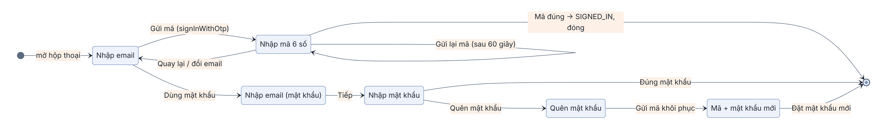

## Ứng dụng 3. Đăng nhập: hộp thoại, phiên và màn hình Tài khoản

### Chương này làm gì

Đưa các hàm đăng nhập của chương 6 lên giao diện. Phần này gồm:

- Hộp thoại đăng nhập hai bước: nhập email, rồi nhập mã 6 số.
- Store biết ai đang dùng app: khách, thành viên hay quản trị viên.
- Nút Tài khoản đổi theo trạng thái đăng nhập.
- Hộp thoại hoàn thiện hồ sơ cho người mới.
- Màn hình Tài khoản có nút đăng xuất.

### Để làm gì

Từ chương 7 trở đi, nhiều thao tác cần biết người dùng là ai: thích bài, tạo danh sách phát, nghe chung. Chương này dựng sẵn hai thứ dùng chung cho mọi thao tác đó: hook `useMember()` cho biết người đang dùng có phải thành viên không, và một cách mở hộp thoại đăng nhập từ bất cứ đâu.

### Phân tích kỹ thuật

**Đặt giao diện đăng nhập ở đâu:**

| Cách | Ưu | Nhược |
|---|---|---|
| Một màn hình riêng `/login` | Đơn giản | Đang nghe nhạc mà bấm "thích" thì bị chuyển trang, mất ngữ cảnh |
| **Hộp thoại nổi trên màn hình hiện tại** | Đăng nhập xong vẫn ở đúng chỗ, nhạc không dừng | Phải giữ trạng thái mở/đóng ở store |

**Ai giữ phiên đăng nhập:**

| Cách | Ghi chú |
|---|---|
| App tự lưu token, tự gia hạn | Dễ sai: quên gia hạn thì người dùng bị đăng xuất giữa chừng |
| **supabase-js giữ phiên, app nghe sự kiện** | Thư viện tự lưu (chương 5, `localStorage`), tự gia hạn; app chỉ phản ứng với `SIGNED_IN`, `SIGNED_OUT` |

### Chọn gì, vì sao

**Hộp thoại đăng nhập nằm trong `AppLayout`, mở bằng `setLoginModalVisible(true)` từ bất kỳ đâu. Store nghe `onAuthStateChange` để nạp hồ sơ. Người chưa đăng nhập được vào thẳng với tư cách khách ẩn danh.** Nhờ vậy thao tác cần đăng nhập chỉ cần một dòng kiểm tra: chưa phải thành viên thì mở hộp thoại; đăng nhập xong thì đóng hộp thoại, người dùng vẫn ở nguyên chỗ cũ.

### Sơ đồ trạng thái của hộp thoại



Mỗi ô là một giá trị của biến `step` trong `LoginModal`. Đường chính chỉ hai bước: nhập email, nhập mã. Đường mật khẩu là tùy chọn, dành cho người đã đặt mật khẩu ở màn hình Tài khoản (chương 6, bước 4b). Nút quay lại luôn đưa về đúng bước trước, không đóng cả hộp thoại.

### Làm từng bước

**Bước 1: store biết người dùng.** Thêm vào store của chương Ứng dụng 2:

```ts
// app/src/store/useStore.ts (thêm vào)
user: null as User | null,
isLoginModalVisible: false,
setLoginModalVisible: (v: boolean) => set({ isLoginModalVisible: v }),
startPasswordlessLogin: (email: string) => auth.sendCode(email),
loginPasswordless: (email: string, code: string) => auth.verifyCode(email, code),
logout: () => auth.signOut(),
```

`auth.sendCode` và `auth.verifyCode` là hai hàm đã viết ở chương 6.

**Bước 2: nghe sự kiện phiên, nạp hồ sơ.** Đặt trong hàm tạo store, chạy một lần khi app mở:

```ts
supabase.auth.onAuthStateChange((event) => {
  if (event === 'SIGNED_IN' || event === 'USER_UPDATED')
    setTimeout(async () => set({ user: await me(), isLoginModalVisible: false }));
  if (event === 'SIGNED_OUT') set({ user: null });
});
// Chưa có phiên nào: vào thẳng với tư cách khách để nghe thử (3 bài mỗi ngày, chương 11).
supabase.auth.getSession().then(({ data }) => { if (!data.session) auth.continueAsGuest(); });
```

`me()` đọc dòng `profiles` của người vừa đăng nhập. Gọi nó trong `setTimeout`, không gọi thẳng trong callback, vì supabase-js đang giữ khóa phiên trong lúc chạy callback; gọi API ngay lúc đó có thể bị treo.

**Bước 3: hook phân biệt khách và thành viên.** Khách ẩn danh cũng có `user` (có phiên, có `id`), nhưng chưa được thích bài hay tạo danh sách phát.

```ts
export const useMember = () => useStore((s) => (s.user && !s.user.isGuest ? s.user : null));
```

**Bước 4: hộp thoại hai bước.**

```tsx
// app/src/screens/Auth/LoginModal.tsx (bản đầu)
export default function LoginModal({ visible, onClose }: { visible: boolean; onClose: () => void }) {
  const [step, setStep] = useState<'email' | 'code'>('email');
  const [email, setEmail] = useState('');
  const [code, setCode] = useState('');
  const [error, setError] = useState<string | null>(null);
  const [busy, setBusy] = useState(false);
  const { startPasswordlessLogin, loginPasswordless } = useStore(useShallow((s) => ({
    startPasswordlessLogin: s.startPasswordlessLogin, loginPasswordless: s.loginPasswordless })));

  const run = async (fn: () => Promise<unknown>) => {
    setBusy(true); setError(null);
    try { await fn(); } catch (e: any) { setError(e.message); } finally { setBusy(false); }
  };
  const send = () => run(async () => { await startPasswordlessLogin(email.trim()); setStep('code'); });
  const verify = () => run(async () => { await loginPasswordless(email.trim(), code.trim()); onClose(); });

  return (
    <Sheet visible={visible} title={step === 'email' ? 'Đăng nhập' : 'Nhập mã'} onClose={onClose}>
      {step === 'email' ? (
        <TextField value={email} onChangeText={setEmail} placeholder="Email"
          textContentType="emailAddress" keyboardType="email-address" autoCapitalize="none" onSubmitEditing={send} />
      ) : (
        <TextField value={code} onChangeText={setCode} placeholder="Mã 6 số"
          textContentType="oneTimeCode" keyboardType="number-pad" maxLength={6} onSubmitEditing={verify} />
      )}
      <ErrorText message={error} />
      <ActionButton title={step === 'email' ? 'Gửi mã' : 'Xác nhận'} loading={busy}
        disabled={step === 'email' ? !email.includes('@') : code.length !== 6} onPress={step === 'email' ? send : verify} />
    </Sheet>
  );
}
```

Bốn chi tiết làm hộp thoại dễ dùng:

- `textContentType="oneTimeCode"` cho điện thoại gợi ý mã vừa nhận ngay trên bàn phím.
- `keyboardType` mở đúng bàn phím: có `@` cho email, chỉ có số cho mã.
- Nút bị khóa khi dữ liệu chưa hợp lệ.
- Nút hiện vòng xoay trong lúc chờ, nên người dùng không bấm hai lần.

Bản đầy đủ trong repo thêm đếm ngược 60 giây trước khi cho gửi lại mã, đường mật khẩu và quên mật khẩu.

**Bước 5: mở được từ bất cứ đâu.** Hộp thoại nằm trong `AppLayout`, cạnh màn hình. `Sheet` của thư viện giao diện lo phần trượt lên và lớp nền mờ:

```tsx
// app/src/navigation/AppLayout.tsx (thêm vào)
const visible = useStore((s) => s.isLoginModalVisible);
const setVisible = useStore((s) => s.setLoginModalVisible);
// ...
<LoginModal visible={visible} onClose={() => setVisible(false)} />
```

Thao tác nào cần thành viên thì kiểm tra trước khi làm:

```ts
const member = useMember();
const guard = (fn: () => void) => () => (member ? fn() : setLoginModalVisible(true));
// <Pressable onPress={guard(() => likeSong(song))}>
```

**Bước 6: nút Tài khoản đổi theo trạng thái.** Đặt ở góc phải tiêu đề lớn của Trang chủ:

```tsx
// app/src/ui/kit/AccountButton.tsx (bản đầu)
export default function AccountButton({ onNavigate }: { onNavigate: (tab: string) => void }) {
  const member = useMember();
  const open = useStore((s) => s.setLoginModalVisible);
  return (
    <GlassButton icon="person-circle-outline" label={member ? 'Tài khoản' : 'Đăng nhập'}
      onPress={() => (member ? onNavigate('account') : open(true))} />
  );
}
```

`label` là chữ mà trình đọc màn hình đọc lên cho nút chỉ có biểu tượng (chương 17, nguyên tắc 10).

**Bước 7: hoàn thiện hồ sơ cho người mới.** Đăng nhập bằng mã hay Google chỉ cho biết email. `CompleteProfileModal` tự hiện khi thành viên chưa có tên hiển thị hoặc chưa chọn thể loại yêu thích, và tự ẩn khi đã đủ:

```tsx
// app/src/screens/Auth/CompleteProfileModal.tsx (trích)
const user = useStore((s) => s.user);
if (!user || user.isGuest || user.role === 'admin') return null;
const missing = !user.nickname || !user.musicGenres?.length;
if (!missing) return null;
```

Lưu bằng `update` trên bảng `profiles`. RLS của chương 6 bảo đảm mỗi người chỉ sửa được dòng của chính mình.

**Bước 8: màn hình Tài khoản.** Khách thấy lời mời đăng nhập; thành viên thấy email, tên hiển thị và nút đăng xuất:

```tsx
const member = useMember();
if (!member) return <EmptyState icon="person-circle-outline" title="Bạn đang nghe với tư cách khách" hint="Đăng nhập để lưu bài yêu thích." />;
return (
  <>
    <InsetGroup header="Tài khoản">
      <ListRow icon="mail-outline" title="Email" subtitle={member.email} />
      <ListRow icon="person-outline" title="Tên hiển thị" subtitle={member.nickname} separator={false} />
    </InsetGroup>
    <ActionButton title="Đăng xuất" variant="danger" onPress={logout} />
  </>
);
```

Đăng xuất phát sự kiện `SIGNED_OUT`, store xóa `user` (bước 2), rồi app tự vào lại với tư cách khách.

### Kết quả


Bấm nút tài khoản khi chưa đăng nhập thì hộp thoại trượt lên. Nhập email, nhận mã trong hộp thư, nhập mã: hộp thoại đóng, người mới thấy hộp thoại hoàn thiện hồ sơ. Tải lại trang vẫn còn đăng nhập.

### Kiểm tra

1. Đăng nhập, tải lại trang: vẫn đăng nhập, không phải nhập lại mã.
2. Nhập sai mã: hiện lỗi dưới ô nhập, hộp thoại không đóng.
3. Đăng xuất: nút tài khoản chuyển về "Đăng nhập"; trong Supabase, mục *Authentication → Users* có thêm một người dùng ẩn danh.
4. Mở DevTools → Application → Local Storage: có khóa `sb-<project-ref>-auth-token`. App không tự lưu token ở chỗ nào khác.

### Ví dụ tính tay

**Đoán mã 6 số có khả thi không.** Có 10⁶ = 1 000 000 mã. Supabase giới hạn số lần thử. Giả sử kẻ gian được thử 5 lần cho mỗi mã đã gửi:

```text
xác suất đoán trúng = 5 ÷ 1 000 000 = 0,0005 %
muốn có 50 % cơ hội trúng ≈ 500 000 ÷ 5 = 100 000 lần yêu cầu gửi mã mới
```

Supabase còn giới hạn số lần gửi mã cho mỗi email trong một giờ, nên con số 100 000 lần là không làm được. Mã ngắn vẫn an toàn khi có giới hạn tốc độ thử.

### Thực hành

1. Thêm đếm ngược "Gửi lại mã sau 60s" ở bước nhập mã, dùng `useEffect` với `setTimeout`.
2. Bọc nút "Tạo danh sách phát" của màn hình Thư viện bằng `guard`, thử bấm khi đang là khách.
3. Thêm dòng "Vai trò" vào màn hình Tài khoản, chỉ hiện khi `member.role === 'admin'`.

### Tự kiểm

1. Vì sao hộp thoại đăng nhập nằm trong `AppLayout` mà không là một màn hình riêng?
2. Khách ẩn danh và thành viên khác nhau thế nào trong store? `useMember()` trả về gì cho mỗi loại?
3. Vì sao gọi `me()` trong `setTimeout` mà không gọi thẳng trong callback của `onAuthStateChange`?
4. `textContentType="oneTimeCode"` giúp người dùng điều gì?
5. Ẩn nút quản trị trên giao diện có đủ bảo vệ trang quản trị không? Lớp bảo vệ thật nằm ở đâu?

### Khi nào đổi

- **Cần đăng nhập không mật khẩu bằng vân tay hay khuôn mặt:** thêm passkey (WebAuthn) khi Supabase Auth hỗ trợ ở gói bạn dùng.
- **App có nhiều luồng cần đăng nhập ở giữa chừng (thanh toán, chia sẻ):** giữ thao tác đang dở trong store và chạy tiếp ngay sau `SIGNED_IN`, như store đang làm với bài khách nghe dở.

### Code của chương

- `app/src/screens/Auth/LoginModal.tsx`
- `app/src/screens/Auth/CompleteProfileModal.tsx`
- `app/src/screens/Account/AccountScreen.tsx`
- `app/src/ui/kit/AccountButton.tsx`
- `app/src/store/useStore.ts` (phần người dùng)
- `app/src/navigation/AppLayout.tsx` (hộp thoại)
